# MADAR V1 — الخطة التنفيذية المرجعية لبناء المنصة بواسطة AI Agents
**الإصدار:** V5.0 | **النوع:** Dependency-first AI Build Runbook | **المرجع الأعلى:** MADAR SRS V1.2 | **الحالة:** خطة تنفيذ مقترحة لا تعني اعتماد قرارات الأعمال المعلقة أو نجاح اختبارات غير منفذة.

> **ابدأ من هنا:** لا يكفي هذا الملف منفرداً؛ يجب وضع SRS V1.2 كاملاً بجواره داخل المستودع. هذه الخطة تحدد من ينفذ، وبأي ترتيب، وبأي عقود ومخرجات واختبارات. عند التعارض يسود القرار المعتمد [A] في SRS، وتُفتح تذكرة تغيير. لا يجوز لـAgent اختراع قاعدة أعمال أو الادعاء بتشغيل ناجح دون دليل.

## 1. خريطة الوثيقة ومبدأ التنفيذ
1. SRS = ماذا نبني؛ هذه الخطة = كيف نبني ونختبر ونسلم. 2. كل Sprint له Gate ومالك وملفات وعقود واختبارات وPrompt. 3. يمكن البدء بمواصفات/Mocks مبكراً، لكن إغلاق التكامل يخضع للتبعيات. 4. تنفيذ نموذج أولي على VPS واحدة لا يعني HA أو استقلال runtime.

### الثوابت غير القابلة للتغيير دون موافقة
- V1: الراكب، السائق (تاكسي/ميكروباص)، ERP الموقف، Madar Admin، الأنظمة السبعة ومجالات الدعم. V2 فقط: الغرف الإدارية متعددة المستويات وإدارة الأساطيل.
- Admin وحده ينشئ حسابات الموظفين. صاحب الموقف المخوّل وحده يثبت الدور، والسائق والمركبة داخل geofence. أجرة = خط الترخيص، رحلات = خط مسموح بالموقف.
- Location مصدر إحداثيات GPS، Booking مصدر الحجوزات، Wallet مصدر الأرصدة والحركات، Queue مصدر ترتيب الدور. لا cross-schema writes.
- لا رسوم/خصومات/no-show/مزود دفع/ربط حكومي حقيقي دون اعتماد.

## 2. الهيكل المرجعي والملكية الحصرية
| Agent | الدور | المسارات الوحيدة المسموحة للكتابة | ممنوع |
|---|---|---|---|
| A0 | Solution Architect / Product | `docs/specs/`, `docs/architecture/`, `planning/` | كود الإنتاج والترحيلات |
| A1 | Identity, Compliance, Complaints, Investigation | `backend/domains/identity/`, `backend/domains/organization/`, `backend/systems/complaints/`, `backend/systems/compliance/`, `backend/systems/investigation/` | Ledger/Queue/Contracts |
| A2 | Vehicles, Routes, Stations, Location, Booking, Trips | `backend/domains/vehicles/`, `backend/domains/routes/`, `backend/domains/stations/`, `backend/domains/trips/`, `backend/systems/location/`, `backend/systems/booking/` | Wallet/DB migrations/UI |
| A3 | Wallet, Pricing, Platform Management, Tasks, Notifications | `backend/systems/wallet/`, `backend/systems/platform-management/`, `backend/domains/pricing/`, `backend/domains/tasks/`, `backend/domains/notifications/` | Booking tables/UI |
| A4 | Passenger/Driver UI | `apps/passenger-pwa/`, `apps/driver-pwa/` | Backend/Contracts |
| A5 | Station/Admin UI | `apps/station-web/`, `apps/admin-web/`, `apps/station-electron/`, `apps/admin-electron/` | Backend/Contracts |
| A6 | QA/Security | `tests/`, `qa/`, `security/reports/` | Production code |
| A7 | Integration/DevOps/Shared Contracts | `packages/contracts/`, `database/`, `infrastructure/`, `.github/`, root manifests/configs | Domain business logic |

**قرار حسم التعارض بين V3 وV4:** Platform Management = A3؛ Investigation/Compliance/Complaints = A1؛ Audit shared infrastructure ملك A7 في التهيئة، وأحداث التدقيق ينشئها مالك المجال. المسارات السابقة مقترحة وتعتمد عند S00؛ أي تغيير ملكية يسجل ADR.

### قواعد Git والعمل المتوازي
- Agent واحد لكل worktree وفرع؛ لا مشاركة لمسارات الكتابة. A7 وحده يدمج العقود والمهاجرات وroot configs.
- API contract first: A0 يقترح، مالك المجال يراجع، A7 ينشر، A6 يكتب contract tests، ثم provider/consumer.
- لكل PR: REQ IDs، diff allowlist، test evidence، migration/rollback إن لزم، security notes، changelog، handoff.
- منع التغييرات العابرة للمجالات بالـCI (import boundary checks + CODEOWNERS + ownership manifest).

## 3. Execution DAG — ترتيب فتح السبرنتات

```mermaid
flowchart TD
  SS00 --> S01
  SS00 --> S02
  SS01 --> S03
  SS02 --> S03
  SS03 --> S04
  SS03 --> S05
  SS05 --> S06
  SS04 --> S07
  SS05 --> S07
  SS06 --> S07
  SS07 --> S08
  SS05 --> S09
  SS09 --> S10
  SS10 --> S11
  SS04 --> S12
  SS06 --> S12
  SS12 --> S13
  SS03 --> S14
  SS03 --> S15
  SS10 --> S16
  SS15 --> S16
  SS15 --> S17
  SS04 --> S18
  SS11 --> S18
  SS13 --> S18
  SS18 --> S19
  SS04 --> S20
  SS14 --> S20
  SS08 --> S21
  SS11 --> S21
  SS13 --> S21
  SS16 --> S21
  SS17 --> S21
  SS19 --> S21
  SS20 --> S21
  SS21 --> S22
  SS22 --> S23
```


**موجات التنفيذ:** W0=S00؛ W1=S01/S02؛ W2=S03؛ W3=S04/S05/S14/S15؛ W4=S06/S09؛ W5=S07/S10/S12؛ W6=S08/S11/S13/S16/S17؛ W7=S18/S19/S20 (يبدأ S20 فور توفر تبعياته)؛ W8=S21؛ W9=S22؛ W10=S23. ترتيب الموجات عرض تقريبي للجاهزية وليس قيداً إضافياً على DAG.

### قائمة البدء المتوازي للـAgents
A0: S00→S01→مراجعة جميع gates→S23. A1: S04→S18→S19. A2: S05→S06→S07→S09→S10→S11→S12→S13؛ يجوز إعادة ترتيب S09/S12 إذا لم تتداخل الملفات. A3: S14→S15→S16→S17→S20؛ S14 وS15 بعد S03 وقد يعملان في فروع منفصلة غير متداخلة. A4: واجهات الهوية→الحجز→السائق→التاكسي→المحفظة→الشكاوى بعقود mocks. A5: ERP shell→موقف→إدارة/تسعير/سحب. A6: اختبارات قبل التنفيذ ومستمرة. A7: contracts/migrations/CI/integration على امتداد المشروع.

## 4. بروتوكول تنفيذ أي مهمة — 12 ركناً إلزامياً
1. ID ومرجع SRS؛ 2. هدف ونطاق؛ 3. Dependencies وEntry Gate؛ 4. Owner وRACI؛ 5. Inputs/fixtures؛ 6. Contract وdata ownership؛ 7. خطوات التنفيذ؛ 8. Output paths؛ 9. Test IDs وexpected outcomes؛ 10. Security/Concurrency/Failure؛ 11. Definition of Done؛ 12. Handoff/Prompt. لا يغلق Sprint بعبارة «تم» فقط.

### سياسة الاختبارات العالمية (تنطبق على كل مهمة)
- **POS**: المسار الصحيح؛ **NEG**: حالة/مدخل/صلاحية غير صالحة؛ **BND**: حدود زمن/سعة/عدد؛ **SEC**: 401/403/IDOR/tenant scope؛ **CON**: سباق حقيقي في DB؛ **IDE**: retry/replay؛ **FAIL**: انقطاع DB/worker/provider؛ **AUD**: audit/correlation؛ **CTR**: OpenAPI/event consumer contract؛ **UI**: loading/empty/error/accessibility؛ **PERF**: NFR معتمد لا أرقام مخترعة.
- كل Test Case يسجل `ID | FR/BR | preconditions | fixtures | action | expected response | expected DB/event | forbidden side effect | evidence | result`.
- اختبار التزامن يستخدم حاجز بدء متزامن وDB فعلية؛ اختبار idempotency يعيد نفس المفتاح ويجرب مفتاحاً جديداً؛ اختبار الفشل يحقن عطل قبل/بعد commit.
- لا اختبار مدفوعات إنتاجية ببيانات حقيقية؛ استخدم Sandbox/Mock. لا تُسجل OTP/tokens/PII في logs.
- **Gate**: صفر حالات قبول إلزامية فاشلة، صفر Critical/High security مفتوحة على المسار المفعّل، CI أخضر، عقود سليمة، evidence وrollback، وقرار قبول A0/A6. نسبة coverage لا تحل محل اختبار invariants.

## 5. سجل القرارات المعلقة (Blockers)
| OPEN-01 | ترتيب الخصومات والرسوم المتداخلة | محرك سياسات بإصدارات ورفض تعارض | تطبيق ترتيب افتراضي كقرار أعمال |
| OPEN-02 | الرسوم والمدد والحدود الرقمية | واجهات إعداد وFixtures تجريبية موسومة | نشر قيم تجارية مخترعة |
| OPEN-03 | إغلاق رحلة الميكروباص | تعريف حالات قابلة للتوسعة وعقود أحداث | افتراض نفس إغلاق التاكسي |
| OPEN-04 | الصعود/no-show والنزول | تسجيل أحداث بدون آثار مالية غير معتمدة | فرض غرامة/استرداد تلقائي |
| OPEN-05 | GPS في الخلفية | تجربة ميدانية على الأجهزة المستهدفة | ضمان تتبع PWA المستمر |
| OPEN-06 | مزود الدفع/OTP/الخرائط | Mock وAdapter معزول | ادعاء تكامل إنتاجي |
| OPEN-07 | الخصوصية والاحتفاظ | تصميم أقل صلاحية وسجل احتفاظ مقترح | حفظ/تصدير حساس دون مراجعة قانونية |
| OPEN-08 | الربط الحكومي | عقود تكامل غير مفعلة | ادعاء موافقة أو اتصال حكومي |
| OPEN-09 | السعة والأداء | اختبارات Load بأهداف Prototype موثقة | وعد بسعة وطنية |
| OPEN-01 | ترتيب خصومات ورسوم متداخلة | Policy Engine يرفض التكوين المتعارض | اعتماد سياسة محددة |
| OPEN-02 | المدد والقيم المالية | إعدادات قابلة للإصدار بلا أرقام مفترضة | تفعيل قيمة معتمدة |
| OPEN-03 | تفاصيل إغلاق رحلة الميكروباص | بناء State Machine قابلة للتمديد دون افتراض نهاية التاكسي | اعتماد سير الإغلاق النهائي |
| OPEN-04 | No-show والصعود والنزول | حقول وأحداث قابلة للتوثيق؛ لا أثر مالي تلقائي | اعتماد قواعد الحالة |
| OPEN-05 | GPS بالخلفية | اختبار PWA على أجهزة حقيقية | إثبات التشغيل أو تغيير العميل |
| OPEN-06 | مزود الدفع/OTP/الخرائط | Adapters قابلة للاستبدال وMock في Prototype | تعاقد واختبار فعلي |
| OPEN-07 | الاحتفاظ القانوني | سياسات Retention قابلة للتكوين وحماية البيانات | مراجعة قانونية |
| OPEN-08 | الجهات الحكومية | واجهات Integrations غير مفعلة | اتفاق وتصريح رسمي |
| OPEN-09 | حدود أحمال Pilot | Load Test وسجلات قياس | اعتماد سعة تشغيل بناءً على نتائج |

أي اختبار يتوقف على OPEN يستخدم fixture تجريبية موسومة وغير مفعّلة تجارياً، ويُصنَّف `BLOCKED-BUSINESS` ولا يحوّل الـSprint إلى جاهز للإطلاق.

## 6. الخطة التفصيلية لكل Sprint (S00–S23)

---

## S00 — تثبيت خط الأساس وتحليل الفجوات

**المالك:** A0 | **التبعيات لإغلاق التنفيذ:** — | **الهدف:** تدقيق المرجع والـRTM وتجميد V1.
**تتبع SRS:** BR/NFR/SEC/INT + جميع مسارات V1. استخدم المعرفات الدقيقة من SRS في تذاكر التنفيذ، ولا تفترض أن prefix كامل يقع في Sprint واحدة.

### A. Entry Gate / المدخلات
- الملفات المطلوبة: SRS V1.2، ADRs الحالية، contracts registry، test fixtures؛ تبعيات `—` مثبتة أو موثقة كـmock فقط.
- يجب على A0 استخراج FR/BR الدقيقة وكتابة Ticket تتضمن المالك، allowed paths، الحالات النهائية، القرارات المعلقة. A7 ينشر العقود/الترحيلات، A6 يثبت حالات قبول قابلة للفشل قبل تنفيذ الإنتاج.

### B. المهام التنفيذية بالتسلسل (Work Packages)
**S00-T01 — استخرج كل FR/BR/NFR/SEC ووسم A/D/C/V/V2**
- **التنفيذ:** نفّذ «استخرج كل FR/BR/NFR/SEC ووسم A/D/C/V/V2» ضمن طبقة المجال/التطبيق/المحول الصحيحة، مع التحقق من actor وscope والحالة ومصدر الحقيقة. اكتب interface typed وerror mapping؛ لا تستورد داخليات مجال آخر.
- **المخرجات:** كود أو مستند قابل للمراجعة في مسار مالك A0، مع اختبار مستقل ومرجع FR/BR في Ticket. أي عقد مشترك/ترحيل يرسل إلى A7 بطلب تغيير.
- **اختبار المهمة S00-T01-AC:** حالة صحيحة تحقق الأثر المقصود؛ مدخل/حالة/مستخدم غير مخول لا يغير حالة؛ إعادة الطلب لا تكرر الأثر؛ تحقق DB/events/audit. للحالات غير المنطبقة وثّق N/A بسبب محدد.

**S00-T02 — اكتشف التكرار والتعارض**
- **التنفيذ:** نفّذ «اكتشف التكرار والتعارض» ضمن طبقة المجال/التطبيق/المحول الصحيحة، مع التحقق من actor وscope والحالة ومصدر الحقيقة. اكتب interface typed وerror mapping؛ لا تستورد داخليات مجال آخر.
- **المخرجات:** كود أو مستند قابل للمراجعة في مسار مالك A0، مع اختبار مستقل ومرجع FR/BR في Ticket. أي عقد مشترك/ترحيل يرسل إلى A7 بطلب تغيير.
- **اختبار المهمة S00-T02-AC:** حالة صحيحة تحقق الأثر المقصود؛ مدخل/حالة/مستخدم غير مخول لا يغير حالة؛ إعادة الطلب لا تكرر الأثر؛ تحقق DB/events/audit. للحالات غير المنطبقة وثّق N/A بسبب محدد.

**S00-T03 — اربط كل FR بمصدر الحقيقة ومالك ومجموعة اختبار**
- **التنفيذ:** نفّذ «اربط كل FR بمصدر الحقيقة ومالك ومجموعة اختبار» ضمن طبقة المجال/التطبيق/المحول الصحيحة، مع التحقق من actor وscope والحالة ومصدر الحقيقة. اكتب interface typed وerror mapping؛ لا تستورد داخليات مجال آخر.
- **المخرجات:** كود أو مستند قابل للمراجعة في مسار مالك A0، مع اختبار مستقل ومرجع FR/BR في Ticket. أي عقد مشترك/ترحيل يرسل إلى A7 بطلب تغيير.
- **اختبار المهمة S00-T03-AC:** حالة صحيحة تحقق الأثر المقصود؛ مدخل/حالة/مستخدم غير مخول لا يغير حالة؛ إعادة الطلب لا تكرر الأثر؛ تحقق DB/events/audit. للحالات غير المنطبقة وثّق N/A بسبب محدد.

**S00-T04 — افتح سجل OPEN/ADR.**
- **التنفيذ:** نفّذ «افتح سجل OPEN/ADR.» ضمن طبقة المجال/التطبيق/المحول الصحيحة، مع التحقق من actor وscope والحالة ومصدر الحقيقة. اكتب interface typed وerror mapping؛ لا تستورد داخليات مجال آخر.
- **المخرجات:** كود أو مستند قابل للمراجعة في مسار مالك A0، مع اختبار مستقل ومرجع FR/BR في Ticket. أي عقد مشترك/ترحيل يرسل إلى A7 بطلب تغيير.
- **اختبار المهمة S00-T04-AC:** حالة صحيحة تحقق الأثر المقصود؛ مدخل/حالة/مستخدم غير مخول لا يغير حالة؛ إعادة الطلب لا تكرر الأثر؛ تحقق DB/events/audit. للحالات غير المنطبقة وثّق N/A بسبب محدد.

### C. خطوات التكامل والـHandoff
1. A0 يراجع السيناريو ومعرفات SRS. 2. A7 يثبت contract/schema وmigration. 3. A6 يجهز fixtures/tests. 4. المالك يكتب production code في worktree منفصل. 5. A4/A5 ينفذان UI بعقد مجمد وMock إن كان النطاق يمس تطبيقهما. 6. A6 يشغل اختبارات فعلية. 7. A7 يدمج بالترتيب contract→migration→provider→consumer→E2E، ثم يحدّث evidence وrelease notes.

### D. Outputs / الملفات المطلوبة
- RTM.csv
- decisions.md
- scope.md
- ownership-proposal.md
- `planning/sprints/S00/ticket.md`, `test-cases.md`, `test-results.md`, `handoff.md`, `acceptance.md` (يكتبها A0/A6/A7 وفق الملكية).

### E. معايير القبول الخاصة بالسبرنت — لا تُستبدل بالاختبارات العامة
**S00-AC-01: 253 FR فريدة بلا فجوات**
- **Arrange:** بيئة test مع بيانات صحيحة وأخرى مخالفة مرتبطة بقاعدة «253 FR فريدة بلا فجوات»، مستخدم مصرح وآخر غير مصرح، ووقت ثابت إن لزم.
- **Act:** نفذ العملية من API/واجهة عامة، وكررها أو شغّل طلبين متزامنين إذا كانت العملية mutating.
- **Assert:** تحقق آلياً من «253 FR فريدة بلا فجوات»، ومن HTTP/domain status، ومن عدم side effects غير مرخصة، ومن DB/outbox/audit. لا تقبل UI-only assertion كدليل للسلامة.
- **Evidence:** command + fixture ID + expected/actual + commit SHA + CI artifact، ولقطة خالية من الأسرار عند الحاجة.

**S00-AC-02: لا OPEN معتمدة**
- **Arrange:** بيئة test مع بيانات صحيحة وأخرى مخالفة مرتبطة بقاعدة «لا OPEN معتمدة»، مستخدم مصرح وآخر غير مصرح، ووقت ثابت إن لزم.
- **Act:** نفذ العملية من API/واجهة عامة، وكررها أو شغّل طلبين متزامنين إذا كانت العملية mutating.
- **Assert:** تحقق آلياً من «لا OPEN معتمدة»، ومن HTTP/domain status، ومن عدم side effects غير مرخصة، ومن DB/outbox/audit. لا تقبل UI-only assertion كدليل للسلامة.
- **Evidence:** command + fixture ID + expected/actual + commit SHA + CI artifact، ولقطة خالية من الأسرار عند الحاجة.

**S00-AC-03: كل V2 مستبعد**
- **Arrange:** بيئة test مع بيانات صحيحة وأخرى مخالفة مرتبطة بقاعدة «كل V2 مستبعد»، مستخدم مصرح وآخر غير مصرح، ووقت ثابت إن لزم.
- **Act:** نفذ العملية من API/واجهة عامة، وكررها أو شغّل طلبين متزامنين إذا كانت العملية mutating.
- **Assert:** تحقق آلياً من «كل V2 مستبعد»، ومن HTTP/domain status، ومن عدم side effects غير مرخصة، ومن DB/outbox/audit. لا تقبل UI-only assertion كدليل للسلامة.
- **Evidence:** command + fixture ID + expected/actual + commit SHA + CI artifact، ولقطة خالية من الأسرار عند الحاجة.

**S00-AC-04: كل تعارض مسجل مع مصدره**
- **Arrange:** بيئة test مع بيانات صحيحة وأخرى مخالفة مرتبطة بقاعدة «كل تعارض مسجل مع مصدره»، مستخدم مصرح وآخر غير مصرح، ووقت ثابت إن لزم.
- **Act:** نفذ العملية من API/واجهة عامة، وكررها أو شغّل طلبين متزامنين إذا كانت العملية mutating.
- **Assert:** تحقق آلياً من «كل تعارض مسجل مع مصدره»، ومن HTTP/domain status، ومن عدم side effects غير مرخصة، ومن DB/outbox/audit. لا تقبل UI-only assertion كدليل للسلامة.
- **Evidence:** command + fixture ID + expected/actual + commit SHA + CI artifact، ولقطة خالية من الأسرار عند الحاجة.

### F. مصفوفة الاختبار الإلزامية
| ID | الفئة | الإجراء | النتيجة المطلوبة |
|---|---|---|---|
| S00-POS | Functional | سيناريو صحيح من الـSRS ببيانات كاملة | state transition وأثر DB مطابقان |
| S00-NEG | Validation | بيانات ناقصة/مخالفة أو انتقال حالة ممنوع | رفض مضبوط، دون mutation |
| S00-BND | Boundary | قيمة/وقت/سعة عند الحد وقبله وبعده | سلوك deterministic طبقاً للسياسة |
| S00-SEC | Auth/IDOR | role غير مخول أو resource خارج scope | 401/403 أو domain denial بلا تسريب |
| S00-IDE | Retry | نفس idempotency key مرتين | أثر واحد أو N/A موثق للقراءة البحتة |
| S00-CON | Concurrency | عمليتان متنافستان عبر DB حقيقية | invariant محفوظ، أو N/A موثق للوثائق |
| S00-FAIL | Failure | عطل DB/worker/provider قبل/بعد commit | لا حالة صامتة غير متسقة، recovery قابل للإعادة |
| S00-CTR | Contract | provider/consumer schema validation | نسخة العقد متطابقة ولا breaking change |
| S00-AUD | Audit | حدث حساس ناجح/مرفوض | actor/time/action/correlation بلا أسرار |
| S00-UI | Frontend | loading/empty/error/keyboard إن وجد UI | حالات واضحة وصلاحيات صحيحة |

**تفصيل مهم:** الاختبارات العامة تُنفّذ فقط حيث تنطبق؛ اختبار S00 وثائقي (فحص RTM والتكرار والملكية) لا API مصطنعة. لا تُعلن اختبارات S22 ناجحة إلا بقياسات فعلية في بيئة محددة.

### G. Definition of Done
- [ ] جميع مهام S00-Txx إما مكتملة بدليل أو BLOCKED-BUSINESS موثق.
- [ ] جميع S00-AC الخاصة ناجحة؛ حالات عدم الانطباق مبررة.
- [ ] FR/BR↔code↔test↔PR متصلة في RTM.
- [ ] لا diff خارج allowlist ولا direct cross-domain import.
- [ ] CI + security + integration green مع commands/logs حقيقية.
- [ ] rollback/compensation/observability موثقة حيث يلزم.
- [ ] A6 يوقع الجودة، A0 يوقع قبول المتطلبات، A7 يوقع دمج النسخة.

### H. Prompt جاهز للـAI Agent (انسخه كما هو مع توفير ملفات المشروع)
```text
You are MADAR V1 implementation agent for S00 (تثبيت خط الأساس وتحليل الفجوات). PRIMARY OWNER: A0.
READ FIRST: docs/SRS/MADAR_V1_Master_SRS_V1.2_Reconciled_Complete_Arabic.md and this runbook section; inspect repository and AGENTS.md. Never infer an approved business policy from a configurable/open item.
OBJECTIVE: تدقيق المرجع والـRTM وتجميد V1.
DEPENDENCIES: —.
BEFORE CODING: (1) extract exact FR/BR IDs from SRS, (2) list existing code and file ownership, (3) identify pending decisions, (4) propose contract/migration changes to A7, (5) write failing tests where applicable.
IMPLEMENT IN ORDER:
1. استخرج كل FR/BR/NFR/SEC ووسم A/D/C/V/V2.
2. اكتشف التكرار والتعارض.
3. اربط كل FR بمصدر الحقيقة ومالك ومجموعة اختبار.
4. افتح سجل OPEN/ADR..
ACCEPTANCE INVARIANTS:
- 253 FR فريدة بلا فجوات
- لا OPEN معتمدة
- كل V2 مستبعد
- كل تعارض مسجل مع مصدره
MANDATORY: unit/integration/contract/authorization/boundary/retry/concurrency/failure/audit tests where applicable. Verify DB state and outbox, not just HTTP status. Never modify another agent owned path. Do not create unapproved fees, deadlines, legal conclusions, payment integrations or no-show rules.
DELIVER: RTM.csv; decisions.md; scope.md; ownership-proposal.md. Also provide changed files, exact commands executed, test logs with PASS/FAIL, open blockers, PR/commit, rollback and next-agent handoff.
STOP RULE: If the authoritative SRS is missing, an approved decision is contradictory, or a shared contract requires a breaking change, stop the affected task and open a change request; continue independent tasks only. Never claim tests passed without running them.
```

---

## S01 — خريطة العقود ونموذج التهديد

**المالك:** A0+A7 | **التبعيات لإغلاق التنفيذ:** S00 | **الهدف:** حدود المكونات والعقود ونموذج التهديد.
**تتبع SRS:** BR/NFR/SEC/INT + جميع مسارات V1. استخدم المعرفات الدقيقة من SRS في تذاكر التنفيذ، ولا تفترض أن prefix كامل يقع في Sprint واحدة.

### A. Entry Gate / المدخلات
- الملفات المطلوبة: SRS V1.2، ADRs الحالية، contracts registry، test fixtures؛ تبعيات `S00` مثبتة أو موثقة كـmock فقط.
- يجب على A0 استخراج FR/BR الدقيقة وكتابة Ticket تتضمن المالك، allowed paths، الحالات النهائية، القرارات المعلقة. A7 ينشر العقود/الترحيلات، A6 يثبت حالات قبول قابلة للفشل قبل تنفيذ الإنتاج.

### B. المهام التنفيذية بالتسلسل (Work Packages)
**S01-T01 — حدد API commands/queries/events**
- **التنفيذ:** نفّذ «حدد API commands/queries/events» ضمن طبقة المجال/التطبيق/المحول الصحيحة، مع التحقق من actor وscope والحالة ومصدر الحقيقة. اكتب interface typed وerror mapping؛ لا تستورد داخليات مجال آخر.
- **المخرجات:** كود أو مستند قابل للمراجعة في مسار مالك A0+A7، مع اختبار مستقل ومرجع FR/BR في Ticket. أي عقد مشترك/ترحيل يرسل إلى A7 بطلب تغيير.
- **اختبار المهمة S01-T01-AC:** حالة صحيحة تحقق الأثر المقصود؛ مدخل/حالة/مستخدم غير مخول لا يغير حالة؛ إعادة الطلب لا تكرر الأثر؛ تحقق DB/events/audit. للحالات غير المنطبقة وثّق N/A بسبب محدد.

**S01-T02 — ownership لكل schema**
- **التنفيذ:** نفّذ «ownership لكل schema» ضمن طبقة المجال/التطبيق/المحول الصحيحة، مع التحقق من actor وscope والحالة ومصدر الحقيقة. اكتب interface typed وerror mapping؛ لا تستورد داخليات مجال آخر.
- **المخرجات:** كود أو مستند قابل للمراجعة في مسار مالك A0+A7، مع اختبار مستقل ومرجع FR/BR في Ticket. أي عقد مشترك/ترحيل يرسل إلى A7 بطلب تغيير.
- **اختبار المهمة S01-T02-AC:** حالة صحيحة تحقق الأثر المقصود؛ مدخل/حالة/مستخدم غير مخول لا يغير حالة؛ إعادة الطلب لا تكرر الأثر؛ تحقق DB/events/audit. للحالات غير المنطبقة وثّق N/A بسبب محدد.

**S01-T03 — OpenAPI JSON schemas**
- **التنفيذ:** نفّذ «OpenAPI JSON schemas» ضمن طبقة المجال/التطبيق/المحول الصحيحة، مع التحقق من actor وscope والحالة ومصدر الحقيقة. اكتب interface typed وerror mapping؛ لا تستورد داخليات مجال آخر.
- **المخرجات:** كود أو مستند قابل للمراجعة في مسار مالك A0+A7، مع اختبار مستقل ومرجع FR/BR في Ticket. أي عقد مشترك/ترحيل يرسل إلى A7 بطلب تغيير.
- **اختبار المهمة S01-T03-AC:** حالة صحيحة تحقق الأثر المقصود؛ مدخل/حالة/مستخدم غير مخول لا يغير حالة؛ إعادة الطلب لا تكرر الأثر؛ تحقق DB/events/audit. للحالات غير المنطبقة وثّق N/A بسبب محدد.

**S01-T04 — errors**
- **التنفيذ:** نفّذ «errors» ضمن طبقة المجال/التطبيق/المحول الصحيحة، مع التحقق من actor وscope والحالة ومصدر الحقيقة. اكتب interface typed وerror mapping؛ لا تستورد داخليات مجال آخر.
- **المخرجات:** كود أو مستند قابل للمراجعة في مسار مالك A0+A7، مع اختبار مستقل ومرجع FR/BR في Ticket. أي عقد مشترك/ترحيل يرسل إلى A7 بطلب تغيير.
- **اختبار المهمة S01-T04-AC:** حالة صحيحة تحقق الأثر المقصود؛ مدخل/حالة/مستخدم غير مخول لا يغير حالة؛ إعادة الطلب لا تكرر الأثر؛ تحقق DB/events/audit. للحالات غير المنطبقة وثّق N/A بسبب محدد.

**S01-T05 — idempotency**
- **التنفيذ:** نفّذ «idempotency» ضمن طبقة المجال/التطبيق/المحول الصحيحة، مع التحقق من actor وscope والحالة ومصدر الحقيقة. اكتب interface typed وerror mapping؛ لا تستورد داخليات مجال آخر.
- **المخرجات:** كود أو مستند قابل للمراجعة في مسار مالك A0+A7، مع اختبار مستقل ومرجع FR/BR في Ticket. أي عقد مشترك/ترحيل يرسل إلى A7 بطلب تغيير.
- **اختبار المهمة S01-T05-AC:** حالة صحيحة تحقق الأثر المقصود؛ مدخل/حالة/مستخدم غير مخول لا يغير حالة؛ إعادة الطلب لا تكرر الأثر؛ تحقق DB/events/audit. للحالات غير المنطبقة وثّق N/A بسبب محدد.

**S01-T06 — versioning**
- **التنفيذ:** نفّذ «versioning» ضمن طبقة المجال/التطبيق/المحول الصحيحة، مع التحقق من actor وscope والحالة ومصدر الحقيقة. اكتب interface typed وerror mapping؛ لا تستورد داخليات مجال آخر.
- **المخرجات:** كود أو مستند قابل للمراجعة في مسار مالك A0+A7، مع اختبار مستقل ومرجع FR/BR في Ticket. أي عقد مشترك/ترحيل يرسل إلى A7 بطلب تغيير.
- **اختبار المهمة S01-T06-AC:** حالة صحيحة تحقق الأثر المقصود؛ مدخل/حالة/مستخدم غير مخول لا يغير حالة؛ إعادة الطلب لا تكرر الأثر؛ تحقق DB/events/audit. للحالات غير المنطبقة وثّق N/A بسبب محدد.

**S01-T07 — threat model وdata classification**
- **التنفيذ:** نفّذ «threat model وdata classification» ضمن طبقة المجال/التطبيق/المحول الصحيحة، مع التحقق من actor وscope والحالة ومصدر الحقيقة. اكتب interface typed وerror mapping؛ لا تستورد داخليات مجال آخر.
- **المخرجات:** كود أو مستند قابل للمراجعة في مسار مالك A0+A7، مع اختبار مستقل ومرجع FR/BR في Ticket. أي عقد مشترك/ترحيل يرسل إلى A7 بطلب تغيير.
- **اختبار المهمة S01-T07-AC:** حالة صحيحة تحقق الأثر المقصود؛ مدخل/حالة/مستخدم غير مخول لا يغير حالة؛ إعادة الطلب لا تكرر الأثر؛ تحقق DB/events/audit. للحالات غير المنطبقة وثّق N/A بسبب محدد.

**S01-T08 — ارفض cross-domain imports.**
- **التنفيذ:** نفّذ «ارفض cross-domain imports.» ضمن طبقة المجال/التطبيق/المحول الصحيحة، مع التحقق من actor وscope والحالة ومصدر الحقيقة. اكتب interface typed وerror mapping؛ لا تستورد داخليات مجال آخر.
- **المخرجات:** كود أو مستند قابل للمراجعة في مسار مالك A0+A7، مع اختبار مستقل ومرجع FR/BR في Ticket. أي عقد مشترك/ترحيل يرسل إلى A7 بطلب تغيير.
- **اختبار المهمة S01-T08-AC:** حالة صحيحة تحقق الأثر المقصود؛ مدخل/حالة/مستخدم غير مخول لا يغير حالة؛ إعادة الطلب لا تكرر الأثر؛ تحقق DB/events/audit. للحالات غير المنطبقة وثّق N/A بسبب محدد.

### C. خطوات التكامل والـHandoff
1. A0 يراجع السيناريو ومعرفات SRS. 2. A7 يثبت contract/schema وmigration. 3. A6 يجهز fixtures/tests. 4. المالك يكتب production code في worktree منفصل. 5. A4/A5 ينفذان UI بعقد مجمد وMock إن كان النطاق يمس تطبيقهما. 6. A6 يشغل اختبارات فعلية. 7. A7 يدمج بالترتيب contract→migration→provider→consumer→E2E، ثم يحدّث evidence وrelease notes.

### D. Outputs / الملفات المطلوبة
- contracts registry
- API specs
- threat-model.md
- ADRs
- `planning/sprints/S01/ticket.md`, `test-cases.md`, `test-results.md`, `handoff.md`, `acceptance.md` (يكتبها A0/A6/A7 وفق الملكية).

### E. معايير القبول الخاصة بالسبرنت — لا تُستبدل بالاختبارات العامة
**S01-AC-01: consumer mock مطابق**
- **Arrange:** بيئة test مع بيانات صحيحة وأخرى مخالفة مرتبطة بقاعدة «consumer mock مطابق»، مستخدم مصرح وآخر غير مصرح، ووقت ثابت إن لزم.
- **Act:** نفذ العملية من API/واجهة عامة، وكررها أو شغّل طلبين متزامنين إذا كانت العملية mutating.
- **Assert:** تحقق آلياً من «consumer mock مطابق»، ومن HTTP/domain status، ومن عدم side effects غير مرخصة، ومن DB/outbox/audit. لا تقبل UI-only assertion كدليل للسلامة.
- **Evidence:** command + fixture ID + expected/actual + commit SHA + CI artifact، ولقطة خالية من الأسرار عند الحاجة.

**S01-AC-02: تغيير breaking يكسر CI**
- **Arrange:** بيئة test مع بيانات صحيحة وأخرى مخالفة مرتبطة بقاعدة «تغيير breaking يكسر CI»، مستخدم مصرح وآخر غير مصرح، ووقت ثابت إن لزم.
- **Act:** نفذ العملية من API/واجهة عامة، وكررها أو شغّل طلبين متزامنين إذا كانت العملية mutating.
- **Assert:** تحقق آلياً من «تغيير breaking يكسر CI»، ومن HTTP/domain status، ومن عدم side effects غير مرخصة، ومن DB/outbox/audit. لا تقبل UI-only assertion كدليل للسلامة.
- **Evidence:** command + fixture ID + expected/actual + commit SHA + CI artifact، ولقطة خالية من الأسرار عند الحاجة.

**S01-AC-03: لا API مجهولة المالك**
- **Arrange:** بيئة test مع بيانات صحيحة وأخرى مخالفة مرتبطة بقاعدة «لا API مجهولة المالك»، مستخدم مصرح وآخر غير مصرح، ووقت ثابت إن لزم.
- **Act:** نفذ العملية من API/واجهة عامة، وكررها أو شغّل طلبين متزامنين إذا كانت العملية mutating.
- **Assert:** تحقق آلياً من «لا API مجهولة المالك»، ومن HTTP/domain status، ومن عدم side effects غير مرخصة، ومن DB/outbox/audit. لا تقبل UI-only assertion كدليل للسلامة.
- **Evidence:** command + fixture ID + expected/actual + commit SHA + CI artifact، ولقطة خالية من الأسرار عند الحاجة.

**S01-AC-04: لا تسريب أسرار في payload**
- **Arrange:** بيئة test مع بيانات صحيحة وأخرى مخالفة مرتبطة بقاعدة «لا تسريب أسرار في payload»، مستخدم مصرح وآخر غير مصرح، ووقت ثابت إن لزم.
- **Act:** نفذ العملية من API/واجهة عامة، وكررها أو شغّل طلبين متزامنين إذا كانت العملية mutating.
- **Assert:** تحقق آلياً من «لا تسريب أسرار في payload»، ومن HTTP/domain status، ومن عدم side effects غير مرخصة، ومن DB/outbox/audit. لا تقبل UI-only assertion كدليل للسلامة.
- **Evidence:** command + fixture ID + expected/actual + commit SHA + CI artifact، ولقطة خالية من الأسرار عند الحاجة.

### F. مصفوفة الاختبار الإلزامية
| ID | الفئة | الإجراء | النتيجة المطلوبة |
|---|---|---|---|
| S01-POS | Functional | سيناريو صحيح من الـSRS ببيانات كاملة | state transition وأثر DB مطابقان |
| S01-NEG | Validation | بيانات ناقصة/مخالفة أو انتقال حالة ممنوع | رفض مضبوط، دون mutation |
| S01-BND | Boundary | قيمة/وقت/سعة عند الحد وقبله وبعده | سلوك deterministic طبقاً للسياسة |
| S01-SEC | Auth/IDOR | role غير مخول أو resource خارج scope | 401/403 أو domain denial بلا تسريب |
| S01-IDE | Retry | نفس idempotency key مرتين | أثر واحد أو N/A موثق للقراءة البحتة |
| S01-CON | Concurrency | عمليتان متنافستان عبر DB حقيقية | invariant محفوظ، أو N/A موثق للوثائق |
| S01-FAIL | Failure | عطل DB/worker/provider قبل/بعد commit | لا حالة صامتة غير متسقة، recovery قابل للإعادة |
| S01-CTR | Contract | provider/consumer schema validation | نسخة العقد متطابقة ولا breaking change |
| S01-AUD | Audit | حدث حساس ناجح/مرفوض | actor/time/action/correlation بلا أسرار |
| S01-UI | Frontend | loading/empty/error/keyboard إن وجد UI | حالات واضحة وصلاحيات صحيحة |

**تفصيل مهم:** الاختبارات العامة تُنفّذ فقط حيث تنطبق؛ اختبار S00 وثائقي (فحص RTM والتكرار والملكية) لا API مصطنعة. لا تُعلن اختبارات S22 ناجحة إلا بقياسات فعلية في بيئة محددة.

### G. Definition of Done
- [ ] جميع مهام S01-Txx إما مكتملة بدليل أو BLOCKED-BUSINESS موثق.
- [ ] جميع S01-AC الخاصة ناجحة؛ حالات عدم الانطباق مبررة.
- [ ] FR/BR↔code↔test↔PR متصلة في RTM.
- [ ] لا diff خارج allowlist ولا direct cross-domain import.
- [ ] CI + security + integration green مع commands/logs حقيقية.
- [ ] rollback/compensation/observability موثقة حيث يلزم.
- [ ] A6 يوقع الجودة، A0 يوقع قبول المتطلبات، A7 يوقع دمج النسخة.

### H. Prompt جاهز للـAI Agent (انسخه كما هو مع توفير ملفات المشروع)
```text
You are MADAR V1 implementation agent for S01 (خريطة العقود ونموذج التهديد). PRIMARY OWNER: A0+A7.
READ FIRST: docs/SRS/MADAR_V1_Master_SRS_V1.2_Reconciled_Complete_Arabic.md and this runbook section; inspect repository and AGENTS.md. Never infer an approved business policy from a configurable/open item.
OBJECTIVE: حدود المكونات والعقود ونموذج التهديد.
DEPENDENCIES: S00.
BEFORE CODING: (1) extract exact FR/BR IDs from SRS, (2) list existing code and file ownership, (3) identify pending decisions, (4) propose contract/migration changes to A7, (5) write failing tests where applicable.
IMPLEMENT IN ORDER:
1. حدد API commands/queries/events.
2. ownership لكل schema.
3. OpenAPI JSON schemas.
4. errors.
5. idempotency.
6. versioning.
7. threat model وdata classification.
8. ارفض cross-domain imports..
ACCEPTANCE INVARIANTS:
- consumer mock مطابق
- تغيير breaking يكسر CI
- لا API مجهولة المالك
- لا تسريب أسرار في payload
MANDATORY: unit/integration/contract/authorization/boundary/retry/concurrency/failure/audit tests where applicable. Verify DB state and outbox, not just HTTP status. Never modify another agent owned path. Do not create unapproved fees, deadlines, legal conclusions, payment integrations or no-show rules.
DELIVER: contracts registry; API specs; threat-model.md; ADRs. Also provide changed files, exact commands executed, test logs with PASS/FAIL, open blockers, PR/commit, rollback and next-agent handoff.
STOP RULE: If the authoritative SRS is missing, an approved decision is contradictory, or a shared contract requires a breaking change, stop the affected task and open a change request; continue independent tasks only. Never claim tests passed without running them.
```

---

## S02 — تأسيس Monorepo وبوابات الجودة

**المالك:** A7 | **التبعيات لإغلاق التنفيذ:** S00 | **الهدف:** إنشاء monorepo وتشغيل أدوات الجودة.
**تتبع SRS:** BR/NFR/SEC/INT + جميع مسارات V1. استخدم المعرفات الدقيقة من SRS في تذاكر التنفيذ، ولا تفترض أن prefix كامل يقع في Sprint واحدة.

### A. Entry Gate / المدخلات
- الملفات المطلوبة: SRS V1.2، ADRs الحالية، contracts registry، test fixtures؛ تبعيات `S00` مثبتة أو موثقة كـmock فقط.
- يجب على A0 استخراج FR/BR الدقيقة وكتابة Ticket تتضمن المالك، allowed paths، الحالات النهائية، القرارات المعلقة. A7 ينشر العقود/الترحيلات، A6 يثبت حالات قبول قابلة للفشل قبل تنفيذ الإنتاج.

### B. المهام التنفيذية بالتسلسل (Work Packages)
**S02-T01 — هيكل pnpm workspaces**
- **التنفيذ:** نفّذ «هيكل pnpm workspaces» ضمن طبقة المجال/التطبيق/المحول الصحيحة، مع التحقق من actor وscope والحالة ومصدر الحقيقة. اكتب interface typed وerror mapping؛ لا تستورد داخليات مجال آخر.
- **المخرجات:** كود أو مستند قابل للمراجعة في مسار مالك A7، مع اختبار مستقل ومرجع FR/BR في Ticket. أي عقد مشترك/ترحيل يرسل إلى A7 بطلب تغيير.
- **اختبار المهمة S02-T01-AC:** حالة صحيحة تحقق الأثر المقصود؛ مدخل/حالة/مستخدم غير مخول لا يغير حالة؛ إعادة الطلب لا تكرر الأثر؛ تحقق DB/events/audit. للحالات غير المنطبقة وثّق N/A بسبب محدد.

**S02-T02 — apps/packages/backend**
- **التنفيذ:** نفّذ «apps/packages/backend» ضمن طبقة المجال/التطبيق/المحول الصحيحة، مع التحقق من actor وscope والحالة ومصدر الحقيقة. اكتب interface typed وerror mapping؛ لا تستورد داخليات مجال آخر.
- **المخرجات:** كود أو مستند قابل للمراجعة في مسار مالك A7، مع اختبار مستقل ومرجع FR/BR في Ticket. أي عقد مشترك/ترحيل يرسل إلى A7 بطلب تغيير.
- **اختبار المهمة S02-T02-AC:** حالة صحيحة تحقق الأثر المقصود؛ مدخل/حالة/مستخدم غير مخول لا يغير حالة؛ إعادة الطلب لا تكرر الأثر؛ تحقق DB/events/audit. للحالات غير المنطبقة وثّق N/A بسبب محدد.

**S02-T03 — TS strict**
- **التنفيذ:** نفّذ «TS strict» ضمن طبقة المجال/التطبيق/المحول الصحيحة، مع التحقق من actor وscope والحالة ومصدر الحقيقة. اكتب interface typed وerror mapping؛ لا تستورد داخليات مجال آخر.
- **المخرجات:** كود أو مستند قابل للمراجعة في مسار مالك A7، مع اختبار مستقل ومرجع FR/BR في Ticket. أي عقد مشترك/ترحيل يرسل إلى A7 بطلب تغيير.
- **اختبار المهمة S02-T03-AC:** حالة صحيحة تحقق الأثر المقصود؛ مدخل/حالة/مستخدم غير مخول لا يغير حالة؛ إعادة الطلب لا تكرر الأثر؛ تحقق DB/events/audit. للحالات غير المنطبقة وثّق N/A بسبب محدد.

**S02-T04 — ESLint**
- **التنفيذ:** نفّذ «ESLint» ضمن طبقة المجال/التطبيق/المحول الصحيحة، مع التحقق من actor وscope والحالة ومصدر الحقيقة. اكتب interface typed وerror mapping؛ لا تستورد داخليات مجال آخر.
- **المخرجات:** كود أو مستند قابل للمراجعة في مسار مالك A7، مع اختبار مستقل ومرجع FR/BR في Ticket. أي عقد مشترك/ترحيل يرسل إلى A7 بطلب تغيير.
- **اختبار المهمة S02-T04-AC:** حالة صحيحة تحقق الأثر المقصود؛ مدخل/حالة/مستخدم غير مخول لا يغير حالة؛ إعادة الطلب لا تكرر الأثر؛ تحقق DB/events/audit. للحالات غير المنطبقة وثّق N/A بسبب محدد.

**S02-T05 — format**
- **التنفيذ:** نفّذ «format» ضمن طبقة المجال/التطبيق/المحول الصحيحة، مع التحقق من actor وscope والحالة ومصدر الحقيقة. اكتب interface typed وerror mapping؛ لا تستورد داخليات مجال آخر.
- **المخرجات:** كود أو مستند قابل للمراجعة في مسار مالك A7، مع اختبار مستقل ومرجع FR/BR في Ticket. أي عقد مشترك/ترحيل يرسل إلى A7 بطلب تغيير.
- **اختبار المهمة S02-T05-AC:** حالة صحيحة تحقق الأثر المقصود؛ مدخل/حالة/مستخدم غير مخول لا يغير حالة؛ إعادة الطلب لا تكرر الأثر؛ تحقق DB/events/audit. للحالات غير المنطبقة وثّق N/A بسبب محدد.

**S02-T06 — vitest**
- **التنفيذ:** نفّذ «vitest» ضمن طبقة المجال/التطبيق/المحول الصحيحة، مع التحقق من actor وscope والحالة ومصدر الحقيقة. اكتب interface typed وerror mapping؛ لا تستورد داخليات مجال آخر.
- **المخرجات:** كود أو مستند قابل للمراجعة في مسار مالك A7، مع اختبار مستقل ومرجع FR/BR في Ticket. أي عقد مشترك/ترحيل يرسل إلى A7 بطلب تغيير.
- **اختبار المهمة S02-T06-AC:** حالة صحيحة تحقق الأثر المقصود؛ مدخل/حالة/مستخدم غير مخول لا يغير حالة؛ إعادة الطلب لا تكرر الأثر؛ تحقق DB/events/audit. للحالات غير المنطبقة وثّق N/A بسبب محدد.

**S02-T07 — playwright**
- **التنفيذ:** نفّذ «playwright» ضمن طبقة المجال/التطبيق/المحول الصحيحة، مع التحقق من actor وscope والحالة ومصدر الحقيقة. اكتب interface typed وerror mapping؛ لا تستورد داخليات مجال آخر.
- **المخرجات:** كود أو مستند قابل للمراجعة في مسار مالك A7، مع اختبار مستقل ومرجع FR/BR في Ticket. أي عقد مشترك/ترحيل يرسل إلى A7 بطلب تغيير.
- **اختبار المهمة S02-T07-AC:** حالة صحيحة تحقق الأثر المقصود؛ مدخل/حالة/مستخدم غير مخول لا يغير حالة؛ إعادة الطلب لا تكرر الأثر؛ تحقق DB/events/audit. للحالات غير المنطبقة وثّق N/A بسبب محدد.

**S02-T08 — lint boundaries**
- **التنفيذ:** نفّذ «lint boundaries» ضمن طبقة المجال/التطبيق/المحول الصحيحة، مع التحقق من actor وscope والحالة ومصدر الحقيقة. اكتب interface typed وerror mapping؛ لا تستورد داخليات مجال آخر.
- **المخرجات:** كود أو مستند قابل للمراجعة في مسار مالك A7، مع اختبار مستقل ومرجع FR/BR في Ticket. أي عقد مشترك/ترحيل يرسل إلى A7 بطلب تغيير.
- **اختبار المهمة S02-T08-AC:** حالة صحيحة تحقق الأثر المقصود؛ مدخل/حالة/مستخدم غير مخول لا يغير حالة؛ إعادة الطلب لا تكرر الأثر؛ تحقق DB/events/audit. للحالات غير المنطبقة وثّق N/A بسبب محدد.

**S02-T09 — git worktrees**
- **التنفيذ:** نفّذ «git worktrees» ضمن طبقة المجال/التطبيق/المحول الصحيحة، مع التحقق من actor وscope والحالة ومصدر الحقيقة. اكتب interface typed وerror mapping؛ لا تستورد داخليات مجال آخر.
- **المخرجات:** كود أو مستند قابل للمراجعة في مسار مالك A7، مع اختبار مستقل ومرجع FR/BR في Ticket. أي عقد مشترك/ترحيل يرسل إلى A7 بطلب تغيير.
- **اختبار المهمة S02-T09-AC:** حالة صحيحة تحقق الأثر المقصود؛ مدخل/حالة/مستخدم غير مخول لا يغير حالة؛ إعادة الطلب لا تكرر الأثر؛ تحقق DB/events/audit. للحالات غير المنطبقة وثّق N/A بسبب محدد.

**S02-T10 — CI gates**
- **التنفيذ:** نفّذ «CI gates» ضمن طبقة المجال/التطبيق/المحول الصحيحة، مع التحقق من actor وscope والحالة ومصدر الحقيقة. اكتب interface typed وerror mapping؛ لا تستورد داخليات مجال آخر.
- **المخرجات:** كود أو مستند قابل للمراجعة في مسار مالك A7، مع اختبار مستقل ومرجع FR/BR في Ticket. أي عقد مشترك/ترحيل يرسل إلى A7 بطلب تغيير.
- **اختبار المهمة S02-T10-AC:** حالة صحيحة تحقق الأثر المقصود؛ مدخل/حالة/مستخدم غير مخول لا يغير حالة؛ إعادة الطلب لا تكرر الأثر؛ تحقق DB/events/audit. للحالات غير المنطبقة وثّق N/A بسبب محدد.

**S02-T11 — AGENTS.md**
- **التنفيذ:** نفّذ «AGENTS.md» ضمن طبقة المجال/التطبيق/المحول الصحيحة، مع التحقق من actor وscope والحالة ومصدر الحقيقة. اكتب interface typed وerror mapping؛ لا تستورد داخليات مجال آخر.
- **المخرجات:** كود أو مستند قابل للمراجعة في مسار مالك A7، مع اختبار مستقل ومرجع FR/BR في Ticket. أي عقد مشترك/ترحيل يرسل إلى A7 بطلب تغيير.
- **اختبار المهمة S02-T11-AC:** حالة صحيحة تحقق الأثر المقصود؛ مدخل/حالة/مستخدم غير مخول لا يغير حالة؛ إعادة الطلب لا تكرر الأثر؛ تحقق DB/events/audit. للحالات غير المنطبقة وثّق N/A بسبب محدد.

**S02-T12 — sample mock.**
- **التنفيذ:** نفّذ «sample mock.» ضمن طبقة المجال/التطبيق/المحول الصحيحة، مع التحقق من actor وscope والحالة ومصدر الحقيقة. اكتب interface typed وerror mapping؛ لا تستورد داخليات مجال آخر.
- **المخرجات:** كود أو مستند قابل للمراجعة في مسار مالك A7، مع اختبار مستقل ومرجع FR/BR في Ticket. أي عقد مشترك/ترحيل يرسل إلى A7 بطلب تغيير.
- **اختبار المهمة S02-T12-AC:** حالة صحيحة تحقق الأثر المقصود؛ مدخل/حالة/مستخدم غير مخول لا يغير حالة؛ إعادة الطلب لا تكرر الأثر؛ تحقق DB/events/audit. للحالات غير المنطبقة وثّق N/A بسبب محدد.

### C. خطوات التكامل والـHandoff
1. A0 يراجع السيناريو ومعرفات SRS. 2. A7 يثبت contract/schema وmigration. 3. A6 يجهز fixtures/tests. 4. المالك يكتب production code في worktree منفصل. 5. A4/A5 ينفذان UI بعقد مجمد وMock إن كان النطاق يمس تطبيقهما. 6. A6 يشغل اختبارات فعلية. 7. A7 يدمج بالترتيب contract→migration→provider→consumer→E2E، ثم يحدّث evidence وrelease notes.

### D. Outputs / الملفات المطلوبة
- pnpm workspace
- package scripts
- CI
- AGENTS.md
- ownership.json
- `planning/sprints/S02/ticket.md`, `test-cases.md`, `test-results.md`, `handoff.md`, `acceptance.md` (يكتبها A0/A6/A7 وفق الملكية).

### E. معايير القبول الخاصة بالسبرنت — لا تُستبدل بالاختبارات العامة
**S02-AC-01: fresh clone install/build/test**
- **Arrange:** بيئة test مع بيانات صحيحة وأخرى مخالفة مرتبطة بقاعدة «fresh clone install/build/test»، مستخدم مصرح وآخر غير مصرح، ووقت ثابت إن لزم.
- **Act:** نفذ العملية من API/واجهة عامة، وكررها أو شغّل طلبين متزامنين إذا كانت العملية mutating.
- **Assert:** تحقق آلياً من «fresh clone install/build/test»، ومن HTTP/domain status، ومن عدم side effects غير مرخصة، ومن DB/outbox/audit. لا تقبل UI-only assertion كدليل للسلامة.
- **Evidence:** command + fixture ID + expected/actual + commit SHA + CI artifact، ولقطة خالية من الأسرار عند الحاجة.

**S02-AC-02: forbidden import يفشل**
- **Arrange:** بيئة test مع بيانات صحيحة وأخرى مخالفة مرتبطة بقاعدة «forbidden import يفشل»، مستخدم مصرح وآخر غير مصرح، ووقت ثابت إن لزم.
- **Act:** نفذ العملية من API/واجهة عامة، وكررها أو شغّل طلبين متزامنين إذا كانت العملية mutating.
- **Assert:** تحقق آلياً من «forbidden import يفشل»، ومن HTTP/domain status، ومن عدم side effects غير مرخصة، ومن DB/outbox/audit. لا تقبل UI-only assertion كدليل للسلامة.
- **Evidence:** command + fixture ID + expected/actual + commit SHA + CI artifact، ولقطة خالية من الأسرار عند الحاجة.

**S02-AC-03: CI يمنع diff خارج الملكية**
- **Arrange:** بيئة test مع بيانات صحيحة وأخرى مخالفة مرتبطة بقاعدة «CI يمنع diff خارج الملكية»، مستخدم مصرح وآخر غير مصرح، ووقت ثابت إن لزم.
- **Act:** نفذ العملية من API/واجهة عامة، وكررها أو شغّل طلبين متزامنين إذا كانت العملية mutating.
- **Assert:** تحقق آلياً من «CI يمنع diff خارج الملكية»، ومن HTTP/domain status، ومن عدم side effects غير مرخصة، ومن DB/outbox/audit. لا تقبل UI-only assertion كدليل للسلامة.
- **Evidence:** command + fixture ID + expected/actual + commit SHA + CI artifact، ولقطة خالية من الأسرار عند الحاجة.

**S02-AC-04: لا scripts وهمية**
- **Arrange:** بيئة test مع بيانات صحيحة وأخرى مخالفة مرتبطة بقاعدة «لا scripts وهمية»، مستخدم مصرح وآخر غير مصرح، ووقت ثابت إن لزم.
- **Act:** نفذ العملية من API/واجهة عامة، وكررها أو شغّل طلبين متزامنين إذا كانت العملية mutating.
- **Assert:** تحقق آلياً من «لا scripts وهمية»، ومن HTTP/domain status، ومن عدم side effects غير مرخصة، ومن DB/outbox/audit. لا تقبل UI-only assertion كدليل للسلامة.
- **Evidence:** command + fixture ID + expected/actual + commit SHA + CI artifact، ولقطة خالية من الأسرار عند الحاجة.

### F. مصفوفة الاختبار الإلزامية
| ID | الفئة | الإجراء | النتيجة المطلوبة |
|---|---|---|---|
| S02-POS | Functional | سيناريو صحيح من الـSRS ببيانات كاملة | state transition وأثر DB مطابقان |
| S02-NEG | Validation | بيانات ناقصة/مخالفة أو انتقال حالة ممنوع | رفض مضبوط، دون mutation |
| S02-BND | Boundary | قيمة/وقت/سعة عند الحد وقبله وبعده | سلوك deterministic طبقاً للسياسة |
| S02-SEC | Auth/IDOR | role غير مخول أو resource خارج scope | 401/403 أو domain denial بلا تسريب |
| S02-IDE | Retry | نفس idempotency key مرتين | أثر واحد أو N/A موثق للقراءة البحتة |
| S02-CON | Concurrency | عمليتان متنافستان عبر DB حقيقية | invariant محفوظ، أو N/A موثق للوثائق |
| S02-FAIL | Failure | عطل DB/worker/provider قبل/بعد commit | لا حالة صامتة غير متسقة، recovery قابل للإعادة |
| S02-CTR | Contract | provider/consumer schema validation | نسخة العقد متطابقة ولا breaking change |
| S02-AUD | Audit | حدث حساس ناجح/مرفوض | actor/time/action/correlation بلا أسرار |
| S02-UI | Frontend | loading/empty/error/keyboard إن وجد UI | حالات واضحة وصلاحيات صحيحة |

**تفصيل مهم:** الاختبارات العامة تُنفّذ فقط حيث تنطبق؛ اختبار S00 وثائقي (فحص RTM والتكرار والملكية) لا API مصطنعة. لا تُعلن اختبارات S22 ناجحة إلا بقياسات فعلية في بيئة محددة.

### G. Definition of Done
- [ ] جميع مهام S02-Txx إما مكتملة بدليل أو BLOCKED-BUSINESS موثق.
- [ ] جميع S02-AC الخاصة ناجحة؛ حالات عدم الانطباق مبررة.
- [ ] FR/BR↔code↔test↔PR متصلة في RTM.
- [ ] لا diff خارج allowlist ولا direct cross-domain import.
- [ ] CI + security + integration green مع commands/logs حقيقية.
- [ ] rollback/compensation/observability موثقة حيث يلزم.
- [ ] A6 يوقع الجودة، A0 يوقع قبول المتطلبات، A7 يوقع دمج النسخة.

### H. Prompt جاهز للـAI Agent (انسخه كما هو مع توفير ملفات المشروع)
```text
You are MADAR V1 implementation agent for S02 (تأسيس Monorepo وبوابات الجودة). PRIMARY OWNER: A7.
READ FIRST: docs/SRS/MADAR_V1_Master_SRS_V1.2_Reconciled_Complete_Arabic.md and this runbook section; inspect repository and AGENTS.md. Never infer an approved business policy from a configurable/open item.
OBJECTIVE: إنشاء monorepo وتشغيل أدوات الجودة.
DEPENDENCIES: S00.
BEFORE CODING: (1) extract exact FR/BR IDs from SRS, (2) list existing code and file ownership, (3) identify pending decisions, (4) propose contract/migration changes to A7, (5) write failing tests where applicable.
IMPLEMENT IN ORDER:
1. هيكل pnpm workspaces.
2. apps/packages/backend.
3. TS strict.
4. ESLint.
5. format.
6. vitest.
7. playwright.
8. lint boundaries.
9. git worktrees.
10. CI gates.
11. AGENTS.md.
12. sample mock..
ACCEPTANCE INVARIANTS:
- fresh clone install/build/test
- forbidden import يفشل
- CI يمنع diff خارج الملكية
- لا scripts وهمية
MANDATORY: unit/integration/contract/authorization/boundary/retry/concurrency/failure/audit tests where applicable. Verify DB state and outbox, not just HTTP status. Never modify another agent owned path. Do not create unapproved fees, deadlines, legal conclusions, payment integrations or no-show rules.
DELIVER: pnpm workspace; package scripts; CI; AGENTS.md; ownership.json. Also provide changed files, exact commands executed, test logs with PASS/FAIL, open blockers, PR/commit, rollback and next-agent handoff.
STOP RULE: If the authoritative SRS is missing, an approved decision is contradictory, or a shared contract requires a breaking change, stop the affected task and open a change request; continue independent tasks only. Never claim tests passed without running them.
```

---

## S03 — قاعدة البيانات وخدمات المنصة

**المالك:** A7 | **التبعيات لإغلاق التنفيذ:** S01+S02 | **الهدف:** PostgreSQL/PostGIS والبنية التشغيلية.
**تتبع SRS:** BR/NFR/SEC/INT + جميع مسارات V1. استخدم المعرفات الدقيقة من SRS في تذاكر التنفيذ، ولا تفترض أن prefix كامل يقع في Sprint واحدة.

### A. Entry Gate / المدخلات
- الملفات المطلوبة: SRS V1.2، ADRs الحالية، contracts registry، test fixtures؛ تبعيات `S01+S02` مثبتة أو موثقة كـmock فقط.
- يجب على A0 استخراج FR/BR الدقيقة وكتابة Ticket تتضمن المالك، allowed paths، الحالات النهائية، القرارات المعلقة. A7 ينشر العقود/الترحيلات، A6 يثبت حالات قبول قابلة للفشل قبل تنفيذ الإنتاج.

### B. المهام التنفيذية بالتسلسل (Work Packages)
**S03-T01 — Docker Compose**
- **التنفيذ:** نفّذ «Docker Compose» ضمن طبقة المجال/التطبيق/المحول الصحيحة، مع التحقق من actor وscope والحالة ومصدر الحقيقة. اكتب interface typed وerror mapping؛ لا تستورد داخليات مجال آخر.
- **المخرجات:** كود أو مستند قابل للمراجعة في مسار مالك A7، مع اختبار مستقل ومرجع FR/BR في Ticket. أي عقد مشترك/ترحيل يرسل إلى A7 بطلب تغيير.
- **اختبار المهمة S03-T01-AC:** حالة صحيحة تحقق الأثر المقصود؛ مدخل/حالة/مستخدم غير مخول لا يغير حالة؛ إعادة الطلب لا تكرر الأثر؛ تحقق DB/events/audit. للحالات غير المنطبقة وثّق N/A بسبب محدد.

**S03-T02 — schemas ownership**
- **التنفيذ:** نفّذ «schemas ownership» ضمن طبقة المجال/التطبيق/المحول الصحيحة، مع التحقق من actor وscope والحالة ومصدر الحقيقة. اكتب interface typed وerror mapping؛ لا تستورد داخليات مجال آخر.
- **المخرجات:** كود أو مستند قابل للمراجعة في مسار مالك A7، مع اختبار مستقل ومرجع FR/BR في Ticket. أي عقد مشترك/ترحيل يرسل إلى A7 بطلب تغيير.
- **اختبار المهمة S03-T02-AC:** حالة صحيحة تحقق الأثر المقصود؛ مدخل/حالة/مستخدم غير مخول لا يغير حالة؛ إعادة الطلب لا تكرر الأثر؛ تحقق DB/events/audit. للحالات غير المنطبقة وثّق N/A بسبب محدد.

**S03-T03 — migrations up/down**
- **التنفيذ:** نفّذ «migrations up/down» ضمن طبقة المجال/التطبيق/المحول الصحيحة، مع التحقق من actor وscope والحالة ومصدر الحقيقة. اكتب interface typed وerror mapping؛ لا تستورد داخليات مجال آخر.
- **المخرجات:** كود أو مستند قابل للمراجعة في مسار مالك A7، مع اختبار مستقل ومرجع FR/BR في Ticket. أي عقد مشترك/ترحيل يرسل إلى A7 بطلب تغيير.
- **اختبار المهمة S03-T03-AC:** حالة صحيحة تحقق الأثر المقصود؛ مدخل/حالة/مستخدم غير مخول لا يغير حالة؛ إعادة الطلب لا تكرر الأثر؛ تحقق DB/events/audit. للحالات غير المنطبقة وثّق N/A بسبب محدد.

**S03-T04 — outbox worker**
- **التنفيذ:** نفّذ «outbox worker» ضمن طبقة المجال/التطبيق/المحول الصحيحة، مع التحقق من actor وscope والحالة ومصدر الحقيقة. اكتب interface typed وerror mapping؛ لا تستورد داخليات مجال آخر.
- **المخرجات:** كود أو مستند قابل للمراجعة في مسار مالك A7، مع اختبار مستقل ومرجع FR/BR في Ticket. أي عقد مشترك/ترحيل يرسل إلى A7 بطلب تغيير.
- **اختبار المهمة S03-T04-AC:** حالة صحيحة تحقق الأثر المقصود؛ مدخل/حالة/مستخدم غير مخول لا يغير حالة؛ إعادة الطلب لا تكرر الأثر؛ تحقق DB/events/audit. للحالات غير المنطبقة وثّق N/A بسبب محدد.

**S03-T05 — health/readiness**
- **التنفيذ:** نفّذ «health/readiness» ضمن طبقة المجال/التطبيق/المحول الصحيحة، مع التحقق من actor وscope والحالة ومصدر الحقيقة. اكتب interface typed وerror mapping؛ لا تستورد داخليات مجال آخر.
- **المخرجات:** كود أو مستند قابل للمراجعة في مسار مالك A7، مع اختبار مستقل ومرجع FR/BR في Ticket. أي عقد مشترك/ترحيل يرسل إلى A7 بطلب تغيير.
- **اختبار المهمة S03-T05-AC:** حالة صحيحة تحقق الأثر المقصود؛ مدخل/حالة/مستخدم غير مخول لا يغير حالة؛ إعادة الطلب لا تكرر الأثر؛ تحقق DB/events/audit. للحالات غير المنطبقة وثّق N/A بسبب محدد.

**S03-T06 — seed fixtures**
- **التنفيذ:** نفّذ «seed fixtures» ضمن طبقة المجال/التطبيق/المحول الصحيحة، مع التحقق من actor وscope والحالة ومصدر الحقيقة. اكتب interface typed وerror mapping؛ لا تستورد داخليات مجال آخر.
- **المخرجات:** كود أو مستند قابل للمراجعة في مسار مالك A7، مع اختبار مستقل ومرجع FR/BR في Ticket. أي عقد مشترك/ترحيل يرسل إلى A7 بطلب تغيير.
- **اختبار المهمة S03-T06-AC:** حالة صحيحة تحقق الأثر المقصود؛ مدخل/حالة/مستخدم غير مخول لا يغير حالة؛ إعادة الطلب لا تكرر الأثر؛ تحقق DB/events/audit. للحالات غير المنطبقة وثّق N/A بسبب محدد.

**S03-T07 — backups restore**
- **التنفيذ:** نفّذ «backups restore» ضمن طبقة المجال/التطبيق/المحول الصحيحة، مع التحقق من actor وscope والحالة ومصدر الحقيقة. اكتب interface typed وerror mapping؛ لا تستورد داخليات مجال آخر.
- **المخرجات:** كود أو مستند قابل للمراجعة في مسار مالك A7، مع اختبار مستقل ومرجع FR/BR في Ticket. أي عقد مشترك/ترحيل يرسل إلى A7 بطلب تغيير.
- **اختبار المهمة S03-T07-AC:** حالة صحيحة تحقق الأثر المقصود؛ مدخل/حالة/مستخدم غير مخول لا يغير حالة؛ إعادة الطلب لا تكرر الأثر؛ تحقق DB/events/audit. للحالات غير المنطبقة وثّق N/A بسبب محدد.

**S03-T08 — structured logs**
- **التنفيذ:** نفّذ «structured logs» ضمن طبقة المجال/التطبيق/المحول الصحيحة، مع التحقق من actor وscope والحالة ومصدر الحقيقة. اكتب interface typed وerror mapping؛ لا تستورد داخليات مجال آخر.
- **المخرجات:** كود أو مستند قابل للمراجعة في مسار مالك A7، مع اختبار مستقل ومرجع FR/BR في Ticket. أي عقد مشترك/ترحيل يرسل إلى A7 بطلب تغيير.
- **اختبار المهمة S03-T08-AC:** حالة صحيحة تحقق الأثر المقصود؛ مدخل/حالة/مستخدم غير مخول لا يغير حالة؛ إعادة الطلب لا تكرر الأثر؛ تحقق DB/events/audit. للحالات غير المنطبقة وثّق N/A بسبب محدد.

**S03-T09 — env validation**
- **التنفيذ:** نفّذ «env validation» ضمن طبقة المجال/التطبيق/المحول الصحيحة، مع التحقق من actor وscope والحالة ومصدر الحقيقة. اكتب interface typed وerror mapping؛ لا تستورد داخليات مجال آخر.
- **المخرجات:** كود أو مستند قابل للمراجعة في مسار مالك A7، مع اختبار مستقل ومرجع FR/BR في Ticket. أي عقد مشترك/ترحيل يرسل إلى A7 بطلب تغيير.
- **اختبار المهمة S03-T09-AC:** حالة صحيحة تحقق الأثر المقصود؛ مدخل/حالة/مستخدم غير مخول لا يغير حالة؛ إعادة الطلب لا تكرر الأثر؛ تحقق DB/events/audit. للحالات غير المنطبقة وثّق N/A بسبب محدد.

**S03-T10 — rate limits.**
- **التنفيذ:** نفّذ «rate limits.» ضمن طبقة المجال/التطبيق/المحول الصحيحة، مع التحقق من actor وscope والحالة ومصدر الحقيقة. اكتب interface typed وerror mapping؛ لا تستورد داخليات مجال آخر.
- **المخرجات:** كود أو مستند قابل للمراجعة في مسار مالك A7، مع اختبار مستقل ومرجع FR/BR في Ticket. أي عقد مشترك/ترحيل يرسل إلى A7 بطلب تغيير.
- **اختبار المهمة S03-T10-AC:** حالة صحيحة تحقق الأثر المقصود؛ مدخل/حالة/مستخدم غير مخول لا يغير حالة؛ إعادة الطلب لا تكرر الأثر؛ تحقق DB/events/audit. للحالات غير المنطبقة وثّق N/A بسبب محدد.

### C. خطوات التكامل والـHandoff
1. A0 يراجع السيناريو ومعرفات SRS. 2. A7 يثبت contract/schema وmigration. 3. A6 يجهز fixtures/tests. 4. المالك يكتب production code في worktree منفصل. 5. A4/A5 ينفذان UI بعقد مجمد وMock إن كان النطاق يمس تطبيقهما. 6. A6 يشغل اختبارات فعلية. 7. A7 يدمج بالترتيب contract→migration→provider→consumer→E2E، ثم يحدّث evidence وrelease notes.

### D. Outputs / الملفات المطلوبة
- compose
- migration registry
- outbox
- backup/restore runbook
- `planning/sprints/S03/ticket.md`, `test-cases.md`, `test-results.md`, `handoff.md`, `acceptance.md` (يكتبها A0/A6/A7 وفق الملكية).

### E. معايير القبول الخاصة بالسبرنت — لا تُستبدل بالاختبارات العامة
**S03-AC-01: migrate من الصفر**
- **Arrange:** بيئة test مع بيانات صحيحة وأخرى مخالفة مرتبطة بقاعدة «migrate من الصفر»، مستخدم مصرح وآخر غير مصرح، ووقت ثابت إن لزم.
- **Act:** نفذ العملية من API/واجهة عامة، وكررها أو شغّل طلبين متزامنين إذا كانت العملية mutating.
- **Assert:** تحقق آلياً من «migrate من الصفر»، ومن HTTP/domain status، ومن عدم side effects غير مرخصة، ومن DB/outbox/audit. لا تقبل UI-only assertion كدليل للسلامة.
- **Evidence:** command + fixture ID + expected/actual + commit SHA + CI artifact، ولقطة خالية من الأسرار عند الحاجة.

**S03-AC-02: rollback**
- **Arrange:** بيئة test مع بيانات صحيحة وأخرى مخالفة مرتبطة بقاعدة «rollback»، مستخدم مصرح وآخر غير مصرح، ووقت ثابت إن لزم.
- **Act:** نفذ العملية من API/واجهة عامة، وكررها أو شغّل طلبين متزامنين إذا كانت العملية mutating.
- **Assert:** تحقق آلياً من «rollback»، ومن HTTP/domain status، ومن عدم side effects غير مرخصة، ومن DB/outbox/audit. لا تقبل UI-only assertion كدليل للسلامة.
- **Evidence:** command + fixture ID + expected/actual + commit SHA + CI artifact، ولقطة خالية من الأسرار عند الحاجة.

**S03-AC-03: duplicate event آمن**
- **Arrange:** بيئة test مع بيانات صحيحة وأخرى مخالفة مرتبطة بقاعدة «duplicate event آمن»، مستخدم مصرح وآخر غير مصرح، ووقت ثابت إن لزم.
- **Act:** نفذ العملية من API/واجهة عامة، وكررها أو شغّل طلبين متزامنين إذا كانت العملية mutating.
- **Assert:** تحقق آلياً من «duplicate event آمن»، ومن HTTP/domain status، ومن عدم side effects غير مرخصة، ومن DB/outbox/audit. لا تقبل UI-only assertion كدليل للسلامة.
- **Evidence:** command + fixture ID + expected/actual + commit SHA + CI artifact، ولقطة خالية من الأسرار عند الحاجة.

**S03-AC-04: DB outage يرفض بوضوح**
- **Arrange:** بيئة test مع بيانات صحيحة وأخرى مخالفة مرتبطة بقاعدة «DB outage يرفض بوضوح»، مستخدم مصرح وآخر غير مصرح، ووقت ثابت إن لزم.
- **Act:** نفذ العملية من API/واجهة عامة، وكررها أو شغّل طلبين متزامنين إذا كانت العملية mutating.
- **Assert:** تحقق آلياً من «DB outage يرفض بوضوح»، ومن HTTP/domain status، ومن عدم side effects غير مرخصة، ومن DB/outbox/audit. لا تقبل UI-only assertion كدليل للسلامة.
- **Evidence:** command + fixture ID + expected/actual + commit SHA + CI artifact، ولقطة خالية من الأسرار عند الحاجة.

**S03-AC-05: restore على DB نظيفة**
- **Arrange:** بيئة test مع بيانات صحيحة وأخرى مخالفة مرتبطة بقاعدة «restore على DB نظيفة»، مستخدم مصرح وآخر غير مصرح، ووقت ثابت إن لزم.
- **Act:** نفذ العملية من API/واجهة عامة، وكررها أو شغّل طلبين متزامنين إذا كانت العملية mutating.
- **Assert:** تحقق آلياً من «restore على DB نظيفة»، ومن HTTP/domain status، ومن عدم side effects غير مرخصة، ومن DB/outbox/audit. لا تقبل UI-only assertion كدليل للسلامة.
- **Evidence:** command + fixture ID + expected/actual + commit SHA + CI artifact، ولقطة خالية من الأسرار عند الحاجة.

### F. مصفوفة الاختبار الإلزامية
| ID | الفئة | الإجراء | النتيجة المطلوبة |
|---|---|---|---|
| S03-POS | Functional | سيناريو صحيح من الـSRS ببيانات كاملة | state transition وأثر DB مطابقان |
| S03-NEG | Validation | بيانات ناقصة/مخالفة أو انتقال حالة ممنوع | رفض مضبوط، دون mutation |
| S03-BND | Boundary | قيمة/وقت/سعة عند الحد وقبله وبعده | سلوك deterministic طبقاً للسياسة |
| S03-SEC | Auth/IDOR | role غير مخول أو resource خارج scope | 401/403 أو domain denial بلا تسريب |
| S03-IDE | Retry | نفس idempotency key مرتين | أثر واحد أو N/A موثق للقراءة البحتة |
| S03-CON | Concurrency | عمليتان متنافستان عبر DB حقيقية | invariant محفوظ، أو N/A موثق للوثائق |
| S03-FAIL | Failure | عطل DB/worker/provider قبل/بعد commit | لا حالة صامتة غير متسقة، recovery قابل للإعادة |
| S03-CTR | Contract | provider/consumer schema validation | نسخة العقد متطابقة ولا breaking change |
| S03-AUD | Audit | حدث حساس ناجح/مرفوض | actor/time/action/correlation بلا أسرار |
| S03-UI | Frontend | loading/empty/error/keyboard إن وجد UI | حالات واضحة وصلاحيات صحيحة |

**تفصيل مهم:** الاختبارات العامة تُنفّذ فقط حيث تنطبق؛ اختبار S00 وثائقي (فحص RTM والتكرار والملكية) لا API مصطنعة. لا تُعلن اختبارات S22 ناجحة إلا بقياسات فعلية في بيئة محددة.

### G. Definition of Done
- [ ] جميع مهام S03-Txx إما مكتملة بدليل أو BLOCKED-BUSINESS موثق.
- [ ] جميع S03-AC الخاصة ناجحة؛ حالات عدم الانطباق مبررة.
- [ ] FR/BR↔code↔test↔PR متصلة في RTM.
- [ ] لا diff خارج allowlist ولا direct cross-domain import.
- [ ] CI + security + integration green مع commands/logs حقيقية.
- [ ] rollback/compensation/observability موثقة حيث يلزم.
- [ ] A6 يوقع الجودة، A0 يوقع قبول المتطلبات، A7 يوقع دمج النسخة.

### H. Prompt جاهز للـAI Agent (انسخه كما هو مع توفير ملفات المشروع)
```text
You are MADAR V1 implementation agent for S03 (قاعدة البيانات وخدمات المنصة). PRIMARY OWNER: A7.
READ FIRST: docs/SRS/MADAR_V1_Master_SRS_V1.2_Reconciled_Complete_Arabic.md and this runbook section; inspect repository and AGENTS.md. Never infer an approved business policy from a configurable/open item.
OBJECTIVE: PostgreSQL/PostGIS والبنية التشغيلية.
DEPENDENCIES: S01+S02.
BEFORE CODING: (1) extract exact FR/BR IDs from SRS, (2) list existing code and file ownership, (3) identify pending decisions, (4) propose contract/migration changes to A7, (5) write failing tests where applicable.
IMPLEMENT IN ORDER:
1. Docker Compose.
2. schemas ownership.
3. migrations up/down.
4. outbox worker.
5. health/readiness.
6. seed fixtures.
7. backups restore.
8. structured logs.
9. env validation.
10. rate limits..
ACCEPTANCE INVARIANTS:
- migrate من الصفر
- rollback
- duplicate event آمن
- DB outage يرفض بوضوح
- restore على DB نظيفة
MANDATORY: unit/integration/contract/authorization/boundary/retry/concurrency/failure/audit tests where applicable. Verify DB state and outbox, not just HTTP status. Never modify another agent owned path. Do not create unapproved fees, deadlines, legal conclusions, payment integrations or no-show rules.
DELIVER: compose; migration registry; outbox; backup/restore runbook. Also provide changed files, exact commands executed, test logs with PASS/FAIL, open blockers, PR/commit, rollback and next-agent handoff.
STOP RULE: If the authoritative SRS is missing, an approved decision is contradictory, or a shared contract requires a breaking change, stop the affected task and open a change request; continue independent tasks only. Never claim tests passed without running them.
```

---

## S04 — الهوية وإنشاء الموظفين

**المالك:** A1 | **التبعيات لإغلاق التنفيذ:** S03 | **الهدف:** حسابات المستخدمين وOTP والصلاحيات والموظفين.
**تتبع SRS:** FR-IDN-*. استخدم المعرفات الدقيقة من SRS في تذاكر التنفيذ، ولا تفترض أن prefix كامل يقع في Sprint واحدة.

### A. Entry Gate / المدخلات
- الملفات المطلوبة: SRS V1.2، ADRs الحالية، contracts registry، test fixtures؛ تبعيات `S03` مثبتة أو موثقة كـmock فقط.
- يجب على A0 استخراج FR/BR الدقيقة وكتابة Ticket تتضمن المالك، allowed paths، الحالات النهائية، القرارات المعلقة. A7 ينشر العقود/الترحيلات، A6 يثبت حالات قبول قابلة للفشل قبل تنفيذ الإنتاج.

### B. المهام التنفيذية بالتسلسل (Work Packages)
**S04-T01 — تطبيع الهاتف مع unique index**
- **التنفيذ:** نفّذ «تطبيع الهاتف مع unique index» ضمن طبقة المجال/التطبيق/المحول الصحيحة، مع التحقق من actor وscope والحالة ومصدر الحقيقة. اكتب interface typed وerror mapping؛ لا تستورد داخليات مجال آخر.
- **المخرجات:** كود أو مستند قابل للمراجعة في مسار مالك A1، مع اختبار مستقل ومرجع FR/BR في Ticket. أي عقد مشترك/ترحيل يرسل إلى A7 بطلب تغيير.
- **اختبار المهمة S04-T01-AC:** حالة صحيحة تحقق الأثر المقصود؛ مدخل/حالة/مستخدم غير مخول لا يغير حالة؛ إعادة الطلب لا تكرر الأثر؛ تحقق DB/events/audit. للحالات غير المنطبقة وثّق N/A بسبب محدد.

**S04-T02 — OTP expiry/rate limits**
- **التنفيذ:** نفّذ «OTP expiry/rate limits» ضمن طبقة المجال/التطبيق/المحول الصحيحة، مع التحقق من actor وscope والحالة ومصدر الحقيقة. اكتب interface typed وerror mapping؛ لا تستورد داخليات مجال آخر.
- **المخرجات:** كود أو مستند قابل للمراجعة في مسار مالك A1، مع اختبار مستقل ومرجع FR/BR في Ticket. أي عقد مشترك/ترحيل يرسل إلى A7 بطلب تغيير.
- **اختبار المهمة S04-T02-AC:** حالة صحيحة تحقق الأثر المقصود؛ مدخل/حالة/مستخدم غير مخول لا يغير حالة؛ إعادة الطلب لا تكرر الأثر؛ تحقق DB/events/audit. للحالات غير المنطبقة وثّق N/A بسبب محدد.

**S04-T03 — sessions/device registry**
- **التنفيذ:** نفّذ «sessions/device registry» ضمن طبقة المجال/التطبيق/المحول الصحيحة، مع التحقق من actor وscope والحالة ومصدر الحقيقة. اكتب interface typed وerror mapping؛ لا تستورد داخليات مجال آخر.
- **المخرجات:** كود أو مستند قابل للمراجعة في مسار مالك A1، مع اختبار مستقل ومرجع FR/BR في Ticket. أي عقد مشترك/ترحيل يرسل إلى A7 بطلب تغيير.
- **اختبار المهمة S04-T03-AC:** حالة صحيحة تحقق الأثر المقصود؛ مدخل/حالة/مستخدم غير مخول لا يغير حالة؛ إعادة الطلب لا تكرر الأثر؛ تحقق DB/events/audit. للحالات غير المنطبقة وثّق N/A بسبب محدد.

**S04-T04 — account states**
- **التنفيذ:** نفّذ «account states» ضمن طبقة المجال/التطبيق/المحول الصحيحة، مع التحقق من actor وscope والحالة ومصدر الحقيقة. اكتب interface typed وerror mapping؛ لا تستورد داخليات مجال آخر.
- **المخرجات:** كود أو مستند قابل للمراجعة في مسار مالك A1، مع اختبار مستقل ومرجع FR/BR في Ticket. أي عقد مشترك/ترحيل يرسل إلى A7 بطلب تغيير.
- **اختبار المهمة S04-T04-AC:** حالة صحيحة تحقق الأثر المقصود؛ مدخل/حالة/مستخدم غير مخول لا يغير حالة؛ إعادة الطلب لا تكرر الأثر؛ تحقق DB/events/audit. للحالات غير المنطبقة وثّق N/A بسبب محدد.

**S04-T05 — employee create Admin only**
- **التنفيذ:** نفّذ «employee create Admin only» ضمن طبقة المجال/التطبيق/المحول الصحيحة، مع التحقق من actor وscope والحالة ومصدر الحقيقة. اكتب interface typed وerror mapping؛ لا تستورد داخليات مجال آخر.
- **المخرجات:** كود أو مستند قابل للمراجعة في مسار مالك A1، مع اختبار مستقل ومرجع FR/BR في Ticket. أي عقد مشترك/ترحيل يرسل إلى A7 بطلب تغيير.
- **اختبار المهمة S04-T05-AC:** حالة صحيحة تحقق الأثر المقصود؛ مدخل/حالة/مستخدم غير مخول لا يغير حالة؛ إعادة الطلب لا تكرر الأثر؛ تحقق DB/events/audit. للحالات غير المنطبقة وثّق N/A بسبب محدد.

**S04-T06 — RBAC+ABAC+scope**
- **التنفيذ:** نفّذ «RBAC+ABAC+scope» ضمن طبقة المجال/التطبيق/المحول الصحيحة، مع التحقق من actor وscope والحالة ومصدر الحقيقة. اكتب interface typed وerror mapping؛ لا تستورد داخليات مجال آخر.
- **المخرجات:** كود أو مستند قابل للمراجعة في مسار مالك A1، مع اختبار مستقل ومرجع FR/BR في Ticket. أي عقد مشترك/ترحيل يرسل إلى A7 بطلب تغيير.
- **اختبار المهمة S04-T06-AC:** حالة صحيحة تحقق الأثر المقصود؛ مدخل/حالة/مستخدم غير مخول لا يغير حالة؛ إعادة الطلب لا تكرر الأثر؛ تحقق DB/events/audit. للحالات غير المنطبقة وثّق N/A بسبب محدد.

**S04-T07 — appeal linkage.**
- **التنفيذ:** نفّذ «appeal linkage.» ضمن طبقة المجال/التطبيق/المحول الصحيحة، مع التحقق من actor وscope والحالة ومصدر الحقيقة. اكتب interface typed وerror mapping؛ لا تستورد داخليات مجال آخر.
- **المخرجات:** كود أو مستند قابل للمراجعة في مسار مالك A1، مع اختبار مستقل ومرجع FR/BR في Ticket. أي عقد مشترك/ترحيل يرسل إلى A7 بطلب تغيير.
- **اختبار المهمة S04-T07-AC:** حالة صحيحة تحقق الأثر المقصود؛ مدخل/حالة/مستخدم غير مخول لا يغير حالة؛ إعادة الطلب لا تكرر الأثر؛ تحقق DB/events/audit. للحالات غير المنطبقة وثّق N/A بسبب محدد.

### C. خطوات التكامل والـHandoff
1. A0 يراجع السيناريو ومعرفات SRS. 2. A7 يثبت contract/schema وmigration. 3. A6 يجهز fixtures/tests. 4. المالك يكتب production code في worktree منفصل. 5. A4/A5 ينفذان UI بعقد مجمد وMock إن كان النطاق يمس تطبيقهما. 6. A6 يشغل اختبارات فعلية. 7. A7 يدمج بالترتيب contract→migration→provider→consumer→E2E، ثم يحدّث evidence وrelease notes.

### D. Outputs / الملفات المطلوبة
- identity domain/API
- auth guards
- device sessions
- admin employee APIs
- `planning/sprints/S04/ticket.md`, `test-cases.md`, `test-results.md`, `handoff.md`, `acceptance.md` (يكتبها A0/A6/A7 وفق الملكية).

### E. معايير القبول الخاصة بالسبرنت — لا تُستبدل بالاختبارات العامة
**S04-AC-01: تزامن تسجيل نفس الهاتف ينتج حساباً واحداً**
- **Arrange:** بيئة test مع بيانات صحيحة وأخرى مخالفة مرتبطة بقاعدة «تزامن تسجيل نفس الهاتف ينتج حساباً واحداً»، مستخدم مصرح وآخر غير مصرح، ووقت ثابت إن لزم.
- **Act:** نفذ العملية من API/واجهة عامة، وكررها أو شغّل طلبين متزامنين إذا كانت العملية mutating.
- **Assert:** تحقق آلياً من «تزامن تسجيل نفس الهاتف ينتج حساباً واحداً»، ومن HTTP/domain status، ومن عدم side effects غير مرخصة، ومن DB/outbox/audit. لا تقبل UI-only assertion كدليل للسلامة.
- **Evidence:** command + fixture ID + expected/actual + commit SHA + CI artifact، ولقطة خالية من الأسرار عند الحاجة.

**S04-AC-02: OTP مستعمل يرفض**
- **Arrange:** بيئة test مع بيانات صحيحة وأخرى مخالفة مرتبطة بقاعدة «OTP مستعمل يرفض»، مستخدم مصرح وآخر غير مصرح، ووقت ثابت إن لزم.
- **Act:** نفذ العملية من API/واجهة عامة، وكررها أو شغّل طلبين متزامنين إذا كانت العملية mutating.
- **Assert:** تحقق آلياً من «OTP مستعمل يرفض»، ومن HTTP/domain status، ومن عدم side effects غير مرخصة، ومن DB/outbox/audit. لا تقبل UI-only assertion كدليل للسلامة.
- **Evidence:** command + fixture ID + expected/actual + commit SHA + CI artifact، ولقطة خالية من الأسرار عند الحاجة.

**S04-AC-03: موظف موقف ممنوع ينشئ موظفاً**
- **Arrange:** بيئة test مع بيانات صحيحة وأخرى مخالفة مرتبطة بقاعدة «موظف موقف ممنوع ينشئ موظفاً»، مستخدم مصرح وآخر غير مصرح، ووقت ثابت إن لزم.
- **Act:** نفذ العملية من API/واجهة عامة، وكررها أو شغّل طلبين متزامنين إذا كانت العملية mutating.
- **Assert:** تحقق آلياً من «موظف موقف ممنوع ينشئ موظفاً»، ومن HTTP/domain status، ومن عدم side effects غير مرخصة، ومن DB/outbox/audit. لا تقبل UI-only assertion كدليل للسلامة.
- **Evidence:** command + fixture ID + expected/actual + commit SHA + CI artifact، ولقطة خالية من الأسرار عند الحاجة.

**S04-AC-04: scope يمنع IDOR**
- **Arrange:** بيئة test مع بيانات صحيحة وأخرى مخالفة مرتبطة بقاعدة «scope يمنع IDOR»، مستخدم مصرح وآخر غير مصرح، ووقت ثابت إن لزم.
- **Act:** نفذ العملية من API/واجهة عامة، وكررها أو شغّل طلبين متزامنين إذا كانت العملية mutating.
- **Assert:** تحقق آلياً من «scope يمنع IDOR»، ومن HTTP/domain status، ومن عدم side effects غير مرخصة، ومن DB/outbox/audit. لا تقبل UI-only assertion كدليل للسلامة.
- **Evidence:** command + fixture ID + expected/actual + commit SHA + CI artifact، ولقطة خالية من الأسرار عند الحاجة.

**S04-AC-05: revoke يوقف الجلسة**
- **Arrange:** بيئة test مع بيانات صحيحة وأخرى مخالفة مرتبطة بقاعدة «revoke يوقف الجلسة»، مستخدم مصرح وآخر غير مصرح، ووقت ثابت إن لزم.
- **Act:** نفذ العملية من API/واجهة عامة، وكررها أو شغّل طلبين متزامنين إذا كانت العملية mutating.
- **Assert:** تحقق آلياً من «revoke يوقف الجلسة»، ومن HTTP/domain status، ومن عدم side effects غير مرخصة، ومن DB/outbox/audit. لا تقبل UI-only assertion كدليل للسلامة.
- **Evidence:** command + fixture ID + expected/actual + commit SHA + CI artifact، ولقطة خالية من الأسرار عند الحاجة.

### F. مصفوفة الاختبار الإلزامية
| ID | الفئة | الإجراء | النتيجة المطلوبة |
|---|---|---|---|
| S04-POS | Functional | سيناريو صحيح من الـSRS ببيانات كاملة | state transition وأثر DB مطابقان |
| S04-NEG | Validation | بيانات ناقصة/مخالفة أو انتقال حالة ممنوع | رفض مضبوط، دون mutation |
| S04-BND | Boundary | قيمة/وقت/سعة عند الحد وقبله وبعده | سلوك deterministic طبقاً للسياسة |
| S04-SEC | Auth/IDOR | role غير مخول أو resource خارج scope | 401/403 أو domain denial بلا تسريب |
| S04-IDE | Retry | نفس idempotency key مرتين | أثر واحد أو N/A موثق للقراءة البحتة |
| S04-CON | Concurrency | عمليتان متنافستان عبر DB حقيقية | invariant محفوظ، أو N/A موثق للوثائق |
| S04-FAIL | Failure | عطل DB/worker/provider قبل/بعد commit | لا حالة صامتة غير متسقة، recovery قابل للإعادة |
| S04-CTR | Contract | provider/consumer schema validation | نسخة العقد متطابقة ولا breaking change |
| S04-AUD | Audit | حدث حساس ناجح/مرفوض | actor/time/action/correlation بلا أسرار |
| S04-UI | Frontend | loading/empty/error/keyboard إن وجد UI | حالات واضحة وصلاحيات صحيحة |

**تفصيل مهم:** الاختبارات العامة تُنفّذ فقط حيث تنطبق؛ اختبار S00 وثائقي (فحص RTM والتكرار والملكية) لا API مصطنعة. لا تُعلن اختبارات S22 ناجحة إلا بقياسات فعلية في بيئة محددة.

### G. Definition of Done
- [ ] جميع مهام S04-Txx إما مكتملة بدليل أو BLOCKED-BUSINESS موثق.
- [ ] جميع S04-AC الخاصة ناجحة؛ حالات عدم الانطباق مبررة.
- [ ] FR/BR↔code↔test↔PR متصلة في RTM.
- [ ] لا diff خارج allowlist ولا direct cross-domain import.
- [ ] CI + security + integration green مع commands/logs حقيقية.
- [ ] rollback/compensation/observability موثقة حيث يلزم.
- [ ] A6 يوقع الجودة، A0 يوقع قبول المتطلبات، A7 يوقع دمج النسخة.

### H. Prompt جاهز للـAI Agent (انسخه كما هو مع توفير ملفات المشروع)
```text
You are MADAR V1 implementation agent for S04 (الهوية وإنشاء الموظفين). PRIMARY OWNER: A1.
READ FIRST: docs/SRS/MADAR_V1_Master_SRS_V1.2_Reconciled_Complete_Arabic.md and this runbook section; inspect repository and AGENTS.md. Never infer an approved business policy from a configurable/open item.
OBJECTIVE: حسابات المستخدمين وOTP والصلاحيات والموظفين.
DEPENDENCIES: S03.
BEFORE CODING: (1) extract exact FR/BR IDs from SRS, (2) list existing code and file ownership, (3) identify pending decisions, (4) propose contract/migration changes to A7, (5) write failing tests where applicable.
IMPLEMENT IN ORDER:
1. تطبيع الهاتف مع unique index.
2. OTP expiry/rate limits.
3. sessions/device registry.
4. account states.
5. employee create Admin only.
6. RBAC+ABAC+scope.
7. appeal linkage..
ACCEPTANCE INVARIANTS:
- تزامن تسجيل نفس الهاتف ينتج حساباً واحداً
- OTP مستعمل يرفض
- موظف موقف ممنوع ينشئ موظفاً
- scope يمنع IDOR
- revoke يوقف الجلسة
MANDATORY: unit/integration/contract/authorization/boundary/retry/concurrency/failure/audit tests where applicable. Verify DB state and outbox, not just HTTP status. Never modify another agent owned path. Do not create unapproved fees, deadlines, legal conclusions, payment integrations or no-show rules.
DELIVER: identity domain/API; auth guards; device sessions; admin employee APIs. Also provide changed files, exact commands executed, test logs with PASS/FAIL, open blockers, PR/commit, rollback and next-agent handoff.
STOP RULE: If the authoritative SRS is missing, an approved decision is contradictory, or a shared contract requires a breaking change, stop the affected task and open a change request; continue independent tasks only. Never claim tests passed without running them.
```

---

## S05 — المركبات والخطوط والمواقف الأساسية

**المالك:** A2 | **التبعيات لإغلاق التنفيذ:** S03 | **الهدف:** بيانات المركبات والخطوط والمواقف.
**تتبع SRS:** FR-VEH-*, FR-RTE-*, FR-STA-*. استخدم المعرفات الدقيقة من SRS في تذاكر التنفيذ، ولا تفترض أن prefix كامل يقع في Sprint واحدة.

### A. Entry Gate / المدخلات
- الملفات المطلوبة: SRS V1.2، ADRs الحالية، contracts registry، test fixtures؛ تبعيات `S03` مثبتة أو موثقة كـmock فقط.
- يجب على A0 استخراج FR/BR الدقيقة وكتابة Ticket تتضمن المالك، allowed paths، الحالات النهائية، القرارات المعلقة. A7 ينشر العقود/الترحيلات، A6 يثبت حالات قبول قابلة للفشل قبل تنفيذ الإنتاج.

### B. المهام التنفيذية بالتسلسل (Work Packages)
**S05-T01 — نمذجة vehicle/license/classification/company ownership**
- **التنفيذ:** نفّذ «نمذجة vehicle/license/classification/company ownership» ضمن طبقة المجال/التطبيق/المحول الصحيحة، مع التحقق من actor وscope والحالة ومصدر الحقيقة. اكتب interface typed وerror mapping؛ لا تستورد داخليات مجال آخر.
- **المخرجات:** كود أو مستند قابل للمراجعة في مسار مالك A2، مع اختبار مستقل ومرجع FR/BR في Ticket. أي عقد مشترك/ترحيل يرسل إلى A7 بطلب تغيير.
- **اختبار المهمة S05-T01-AC:** حالة صحيحة تحقق الأثر المقصود؛ مدخل/حالة/مستخدم غير مخول لا يغير حالة؛ إعادة الطلب لا تكرر الأثر؛ تحقق DB/events/audit. للحالات غير المنطبقة وثّق N/A بسبب محدد.

**S05-T02 — driver eligibility**
- **التنفيذ:** نفّذ «driver eligibility» ضمن طبقة المجال/التطبيق/المحول الصحيحة، مع التحقق من actor وscope والحالة ومصدر الحقيقة. اكتب interface typed وerror mapping؛ لا تستورد داخليات مجال آخر.
- **المخرجات:** كود أو مستند قابل للمراجعة في مسار مالك A2، مع اختبار مستقل ومرجع FR/BR في Ticket. أي عقد مشترك/ترحيل يرسل إلى A7 بطلب تغيير.
- **اختبار المهمة S05-T02-AC:** حالة صحيحة تحقق الأثر المقصود؛ مدخل/حالة/مستخدم غير مخول لا يغير حالة؛ إعادة الطلب لا تكرر الأثر؛ تحقق DB/events/audit. للحالات غير المنطبقة وثّق N/A بسبب محدد.

**S05-T03 — route segments/stops**
- **التنفيذ:** نفّذ «route segments/stops» ضمن طبقة المجال/التطبيق/المحول الصحيحة، مع التحقق من actor وscope والحالة ومصدر الحقيقة. اكتب interface typed وerror mapping؛ لا تستورد داخليات مجال آخر.
- **المخرجات:** كود أو مستند قابل للمراجعة في مسار مالك A2، مع اختبار مستقل ومرجع FR/BR في Ticket. أي عقد مشترك/ترحيل يرسل إلى A7 بطلب تغيير.
- **اختبار المهمة S05-T03-AC:** حالة صحيحة تحقق الأثر المقصود؛ مدخل/حالة/مستخدم غير مخول لا يغير حالة؛ إعادة الطلب لا تكرر الأثر؛ تحقق DB/events/audit. للحالات غير المنطبقة وثّق N/A بسبب محدد.

**S05-T04 — station routes**
- **التنفيذ:** نفّذ «station routes» ضمن طبقة المجال/التطبيق/المحول الصحيحة، مع التحقق من actor وscope والحالة ومصدر الحقيقة. اكتب interface typed وerror mapping؛ لا تستورد داخليات مجال آخر.
- **المخرجات:** كود أو مستند قابل للمراجعة في مسار مالك A2، مع اختبار مستقل ومرجع FR/BR في Ticket. أي عقد مشترك/ترحيل يرسل إلى A7 بطلب تغيير.
- **اختبار المهمة S05-T04-AC:** حالة صحيحة تحقق الأثر المقصود؛ مدخل/حالة/مستخدم غير مخول لا يغير حالة؛ إعادة الطلب لا تكرر الأثر؛ تحقق DB/events/audit. للحالات غير المنطبقة وثّق N/A بسبب محدد.

**S05-T05 — history/audit**
- **التنفيذ:** نفّذ «history/audit» ضمن طبقة المجال/التطبيق/المحول الصحيحة، مع التحقق من actor وscope والحالة ومصدر الحقيقة. اكتب interface typed وerror mapping؛ لا تستورد داخليات مجال آخر.
- **المخرجات:** كود أو مستند قابل للمراجعة في مسار مالك A2، مع اختبار مستقل ومرجع FR/BR في Ticket. أي عقد مشترك/ترحيل يرسل إلى A7 بطلب تغيير.
- **اختبار المهمة S05-T05-AC:** حالة صحيحة تحقق الأثر المقصود؛ مدخل/حالة/مستخدم غير مخول لا يغير حالة؛ إعادة الطلب لا تكرر الأثر؛ تحقق DB/events/audit. للحالات غير المنطبقة وثّق N/A بسبب محدد.

**S05-T06 — validation ضد تراخيص وخطوط غير متوافقة.**
- **التنفيذ:** نفّذ «validation ضد تراخيص وخطوط غير متوافقة.» ضمن طبقة المجال/التطبيق/المحول الصحيحة، مع التحقق من actor وscope والحالة ومصدر الحقيقة. اكتب interface typed وerror mapping؛ لا تستورد داخليات مجال آخر.
- **المخرجات:** كود أو مستند قابل للمراجعة في مسار مالك A2، مع اختبار مستقل ومرجع FR/BR في Ticket. أي عقد مشترك/ترحيل يرسل إلى A7 بطلب تغيير.
- **اختبار المهمة S05-T06-AC:** حالة صحيحة تحقق الأثر المقصود؛ مدخل/حالة/مستخدم غير مخول لا يغير حالة؛ إعادة الطلب لا تكرر الأثر؛ تحقق DB/events/audit. للحالات غير المنطبقة وثّق N/A بسبب محدد.

### C. خطوات التكامل والـHandoff
1. A0 يراجع السيناريو ومعرفات SRS. 2. A7 يثبت contract/schema وmigration. 3. A6 يجهز fixtures/tests. 4. المالك يكتب production code في worktree منفصل. 5. A4/A5 ينفذان UI بعقد مجمد وMock إن كان النطاق يمس تطبيقهما. 6. A6 يشغل اختبارات فعلية. 7. A7 يدمج بالترتيب contract→migration→provider→consumer→E2E، ثم يحدّث evidence وrelease notes.

### D. Outputs / الملفات المطلوبة
- vehicles/routes/stations APIs
- schemas
- validators
- `planning/sprints/S05/ticket.md`, `test-cases.md`, `test-results.md`, `handoff.md`, `acceptance.md` (يكتبها A0/A6/A7 وفق الملكية).

### E. معايير القبول الخاصة بالسبرنت — لا تُستبدل بالاختبارات العامة
**S05-AC-01: مركبة شركة واحدة وقتياً**
- **Arrange:** بيئة test مع بيانات صحيحة وأخرى مخالفة مرتبطة بقاعدة «مركبة شركة واحدة وقتياً»، مستخدم مصرح وآخر غير مصرح، ووقت ثابت إن لزم.
- **Act:** نفذ العملية من API/واجهة عامة، وكررها أو شغّل طلبين متزامنين إذا كانت العملية mutating.
- **Assert:** تحقق آلياً من «مركبة شركة واحدة وقتياً»، ومن HTTP/domain status، ومن عدم side effects غير مرخصة، ومن DB/outbox/audit. لا تقبل UI-only assertion كدليل للسلامة.
- **Evidence:** command + fixture ID + expected/actual + commit SHA + CI artifact، ولقطة خالية من الأسرار عند الحاجة.

**S05-AC-02: سائق متعدد الشركات**
- **Arrange:** بيئة test مع بيانات صحيحة وأخرى مخالفة مرتبطة بقاعدة «سائق متعدد الشركات»، مستخدم مصرح وآخر غير مصرح، ووقت ثابت إن لزم.
- **Act:** نفذ العملية من API/واجهة عامة، وكررها أو شغّل طلبين متزامنين إذا كانت العملية mutating.
- **Assert:** تحقق آلياً من «سائق متعدد الشركات»، ومن HTTP/domain status، ومن عدم side effects غير مرخصة، ومن DB/outbox/audit. لا تقبل UI-only assertion كدليل للسلامة.
- **Evidence:** command + fixture ID + expected/actual + commit SHA + CI artifact، ولقطة خالية من الأسرار عند الحاجة.

**S05-AC-03: أجرة خط ثابت**
- **Arrange:** بيئة test مع بيانات صحيحة وأخرى مخالفة مرتبطة بقاعدة «أجرة خط ثابت»، مستخدم مصرح وآخر غير مصرح، ووقت ثابت إن لزم.
- **Act:** نفذ العملية من API/واجهة عامة، وكررها أو شغّل طلبين متزامنين إذا كانت العملية mutating.
- **Assert:** تحقق آلياً من «أجرة خط ثابت»، ومن HTTP/domain status، ومن عدم side effects غير مرخصة، ومن DB/outbox/audit. لا تقبل UI-only assertion كدليل للسلامة.
- **Evidence:** command + fixture ID + expected/actual + commit SHA + CI artifact، ولقطة خالية من الأسرار عند الحاجة.

**S05-AC-04: رحلات ضمن خطوط الموقف**
- **Arrange:** بيئة test مع بيانات صحيحة وأخرى مخالفة مرتبطة بقاعدة «رحلات ضمن خطوط الموقف»، مستخدم مصرح وآخر غير مصرح، ووقت ثابت إن لزم.
- **Act:** نفذ العملية من API/واجهة عامة، وكررها أو شغّل طلبين متزامنين إذا كانت العملية mutating.
- **Assert:** تحقق آلياً من «رحلات ضمن خطوط الموقف»، ومن HTTP/domain status، ومن عدم side effects غير مرخصة، ومن DB/outbox/audit. لا تقبل UI-only assertion كدليل للسلامة.
- **Evidence:** command + fixture ID + expected/actual + commit SHA + CI artifact، ولقطة خالية من الأسرار عند الحاجة.

**S05-AC-05: منع segment غير صالح**
- **Arrange:** بيئة test مع بيانات صحيحة وأخرى مخالفة مرتبطة بقاعدة «منع segment غير صالح»، مستخدم مصرح وآخر غير مصرح، ووقت ثابت إن لزم.
- **Act:** نفذ العملية من API/واجهة عامة، وكررها أو شغّل طلبين متزامنين إذا كانت العملية mutating.
- **Assert:** تحقق آلياً من «منع segment غير صالح»، ومن HTTP/domain status، ومن عدم side effects غير مرخصة، ومن DB/outbox/audit. لا تقبل UI-only assertion كدليل للسلامة.
- **Evidence:** command + fixture ID + expected/actual + commit SHA + CI artifact، ولقطة خالية من الأسرار عند الحاجة.

### F. مصفوفة الاختبار الإلزامية
| ID | الفئة | الإجراء | النتيجة المطلوبة |
|---|---|---|---|
| S05-POS | Functional | سيناريو صحيح من الـSRS ببيانات كاملة | state transition وأثر DB مطابقان |
| S05-NEG | Validation | بيانات ناقصة/مخالفة أو انتقال حالة ممنوع | رفض مضبوط، دون mutation |
| S05-BND | Boundary | قيمة/وقت/سعة عند الحد وقبله وبعده | سلوك deterministic طبقاً للسياسة |
| S05-SEC | Auth/IDOR | role غير مخول أو resource خارج scope | 401/403 أو domain denial بلا تسريب |
| S05-IDE | Retry | نفس idempotency key مرتين | أثر واحد أو N/A موثق للقراءة البحتة |
| S05-CON | Concurrency | عمليتان متنافستان عبر DB حقيقية | invariant محفوظ، أو N/A موثق للوثائق |
| S05-FAIL | Failure | عطل DB/worker/provider قبل/بعد commit | لا حالة صامتة غير متسقة، recovery قابل للإعادة |
| S05-CTR | Contract | provider/consumer schema validation | نسخة العقد متطابقة ولا breaking change |
| S05-AUD | Audit | حدث حساس ناجح/مرفوض | actor/time/action/correlation بلا أسرار |
| S05-UI | Frontend | loading/empty/error/keyboard إن وجد UI | حالات واضحة وصلاحيات صحيحة |

**تفصيل مهم:** الاختبارات العامة تُنفّذ فقط حيث تنطبق؛ اختبار S00 وثائقي (فحص RTM والتكرار والملكية) لا API مصطنعة. لا تُعلن اختبارات S22 ناجحة إلا بقياسات فعلية في بيئة محددة.

### G. Definition of Done
- [ ] جميع مهام S05-Txx إما مكتملة بدليل أو BLOCKED-BUSINESS موثق.
- [ ] جميع S05-AC الخاصة ناجحة؛ حالات عدم الانطباق مبررة.
- [ ] FR/BR↔code↔test↔PR متصلة في RTM.
- [ ] لا diff خارج allowlist ولا direct cross-domain import.
- [ ] CI + security + integration green مع commands/logs حقيقية.
- [ ] rollback/compensation/observability موثقة حيث يلزم.
- [ ] A6 يوقع الجودة، A0 يوقع قبول المتطلبات، A7 يوقع دمج النسخة.

### H. Prompt جاهز للـAI Agent (انسخه كما هو مع توفير ملفات المشروع)
```text
You are MADAR V1 implementation agent for S05 (المركبات والخطوط والمواقف الأساسية). PRIMARY OWNER: A2.
READ FIRST: docs/SRS/MADAR_V1_Master_SRS_V1.2_Reconciled_Complete_Arabic.md and this runbook section; inspect repository and AGENTS.md. Never infer an approved business policy from a configurable/open item.
OBJECTIVE: بيانات المركبات والخطوط والمواقف.
DEPENDENCIES: S03.
BEFORE CODING: (1) extract exact FR/BR IDs from SRS, (2) list existing code and file ownership, (3) identify pending decisions, (4) propose contract/migration changes to A7, (5) write failing tests where applicable.
IMPLEMENT IN ORDER:
1. نمذجة vehicle/license/classification/company ownership.
2. driver eligibility.
3. route segments/stops.
4. station routes.
5. history/audit.
6. validation ضد تراخيص وخطوط غير متوافقة..
ACCEPTANCE INVARIANTS:
- مركبة شركة واحدة وقتياً
- سائق متعدد الشركات
- أجرة خط ثابت
- رحلات ضمن خطوط الموقف
- منع segment غير صالح
MANDATORY: unit/integration/contract/authorization/boundary/retry/concurrency/failure/audit tests where applicable. Verify DB state and outbox, not just HTTP status. Never modify another agent owned path. Do not create unapproved fees, deadlines, legal conclusions, payment integrations or no-show rules.
DELIVER: vehicles/routes/stations APIs; schemas; validators. Also provide changed files, exact commands executed, test logs with PASS/FAIL, open blockers, PR/commit, rollback and next-agent handoff.
STOP RULE: If the authoritative SRS is missing, an approved decision is contradictory, or a shared contract requires a breaking change, stop the affected task and open a change request; continue independent tasks only. Never claim tests passed without running them.
```

---

## S06 — GPS والنطاقات والتتبع الحي

**المالك:** A2 | **التبعيات لإغلاق التنفيذ:** S05 | **الهدف:** GPS والنطاقات والتتبع.
**تتبع SRS:** FR-LOC-*. استخدم المعرفات الدقيقة من SRS في تذاكر التنفيذ، ولا تفترض أن prefix كامل يقع في Sprint واحدة.

### A. Entry Gate / المدخلات
- الملفات المطلوبة: SRS V1.2، ADRs الحالية، contracts registry، test fixtures؛ تبعيات `S05` مثبتة أو موثقة كـmock فقط.
- يجب على A0 استخراج FR/BR الدقيقة وكتابة Ticket تتضمن المالك، allowed paths، الحالات النهائية، القرارات المعلقة. A7 ينشر العقود/الترحيلات، A6 يثبت حالات قبول قابلة للفشل قبل تنفيذ الإنتاج.

### B. المهام التنفيذية بالتسلسل (Work Packages)
**S06-T01 — PostGIS polygons بلا تداخل نطاقات غرف مستقبلية**
- **التنفيذ:** نفّذ «PostGIS polygons بلا تداخل نطاقات غرف مستقبلية» ضمن طبقة المجال/التطبيق/المحول الصحيحة، مع التحقق من actor وscope والحالة ومصدر الحقيقة. اكتب interface typed وerror mapping؛ لا تستورد داخليات مجال آخر.
- **المخرجات:** كود أو مستند قابل للمراجعة في مسار مالك A2، مع اختبار مستقل ومرجع FR/BR في Ticket. أي عقد مشترك/ترحيل يرسل إلى A7 بطلب تغيير.
- **اختبار المهمة S06-T01-AC:** حالة صحيحة تحقق الأثر المقصود؛ مدخل/حالة/مستخدم غير مخول لا يغير حالة؛ إعادة الطلب لا تكرر الأثر؛ تحقق DB/events/audit. للحالات غير المنطبقة وثّق N/A بسبب محدد.

**S06-T02 — GPS ingestion مع timestamp/accuracy**
- **التنفيذ:** نفّذ «GPS ingestion مع timestamp/accuracy» ضمن طبقة المجال/التطبيق/المحول الصحيحة، مع التحقق من actor وscope والحالة ومصدر الحقيقة. اكتب interface typed وerror mapping؛ لا تستورد داخليات مجال آخر.
- **المخرجات:** كود أو مستند قابل للمراجعة في مسار مالك A2، مع اختبار مستقل ومرجع FR/BR في Ticket. أي عقد مشترك/ترحيل يرسل إلى A7 بطلب تغيير.
- **اختبار المهمة S06-T02-AC:** حالة صحيحة تحقق الأثر المقصود؛ مدخل/حالة/مستخدم غير مخول لا يغير حالة؛ إعادة الطلب لا تكرر الأثر؛ تحقق DB/events/audit. للحالات غير المنطبقة وثّق N/A بسبب محدد.

**S06-T03 — freshness**
- **التنفيذ:** نفّذ «freshness» ضمن طبقة المجال/التطبيق/المحول الصحيحة، مع التحقق من actor وscope والحالة ومصدر الحقيقة. اكتب interface typed وerror mapping؛ لا تستورد داخليات مجال آخر.
- **المخرجات:** كود أو مستند قابل للمراجعة في مسار مالك A2، مع اختبار مستقل ومرجع FR/BR في Ticket. أي عقد مشترك/ترحيل يرسل إلى A7 بطلب تغيير.
- **اختبار المهمة S06-T03-AC:** حالة صحيحة تحقق الأثر المقصود؛ مدخل/حالة/مستخدم غير مخول لا يغير حالة؛ إعادة الطلب لا تكرر الأثر؛ تحقق DB/events/audit. للحالات غير المنطبقة وثّق N/A بسبب محدد.

**S06-T04 — anti-spoof signals**
- **التنفيذ:** نفّذ «anti-spoof signals» ضمن طبقة المجال/التطبيق/المحول الصحيحة، مع التحقق من actor وscope والحالة ومصدر الحقيقة. اكتب interface typed وerror mapping؛ لا تستورد داخليات مجال آخر.
- **المخرجات:** كود أو مستند قابل للمراجعة في مسار مالك A2، مع اختبار مستقل ومرجع FR/BR في Ticket. أي عقد مشترك/ترحيل يرسل إلى A7 بطلب تغيير.
- **اختبار المهمة S06-T04-AC:** حالة صحيحة تحقق الأثر المقصود؛ مدخل/حالة/مستخدم غير مخول لا يغير حالة؛ إعادة الطلب لا تكرر الأثر؛ تحقق DB/events/audit. للحالات غير المنطبقة وثّق N/A بسبب محدد.

**S06-T05 — live streams scoped**
- **التنفيذ:** نفّذ «live streams scoped» ضمن طبقة المجال/التطبيق/المحول الصحيحة، مع التحقق من actor وscope والحالة ومصدر الحقيقة. اكتب interface typed وerror mapping؛ لا تستورد داخليات مجال آخر.
- **المخرجات:** كود أو مستند قابل للمراجعة في مسار مالك A2، مع اختبار مستقل ومرجع FR/BR في Ticket. أي عقد مشترك/ترحيل يرسل إلى A7 بطلب تغيير.
- **اختبار المهمة S06-T05-AC:** حالة صحيحة تحقق الأثر المقصود؛ مدخل/حالة/مستخدم غير مخول لا يغير حالة؛ إعادة الطلب لا تكرر الأثر؛ تحقق DB/events/audit. للحالات غير المنطبقة وثّق N/A بسبب محدد.

**S06-T06 — location فقط إحداثيات.**
- **التنفيذ:** نفّذ «location فقط إحداثيات.» ضمن طبقة المجال/التطبيق/المحول الصحيحة، مع التحقق من actor وscope والحالة ومصدر الحقيقة. اكتب interface typed وerror mapping؛ لا تستورد داخليات مجال آخر.
- **المخرجات:** كود أو مستند قابل للمراجعة في مسار مالك A2، مع اختبار مستقل ومرجع FR/BR في Ticket. أي عقد مشترك/ترحيل يرسل إلى A7 بطلب تغيير.
- **اختبار المهمة S06-T06-AC:** حالة صحيحة تحقق الأثر المقصود؛ مدخل/حالة/مستخدم غير مخول لا يغير حالة؛ إعادة الطلب لا تكرر الأثر؛ تحقق DB/events/audit. للحالات غير المنطبقة وثّق N/A بسبب محدد.

### C. خطوات التكامل والـHandoff
1. A0 يراجع السيناريو ومعرفات SRS. 2. A7 يثبت contract/schema وmigration. 3. A6 يجهز fixtures/tests. 4. المالك يكتب production code في worktree منفصل. 5. A4/A5 ينفذان UI بعقد مجمد وMock إن كان النطاق يمس تطبيقهما. 6. A6 يشغل اختبارات فعلية. 7. A7 يدمج بالترتيب contract→migration→provider→consumer→E2E، ثم يحدّث evidence وrelease notes.

### D. Outputs / الملفات المطلوبة
- location API
- geofence queries
- live event
- retention policy draft
- `planning/sprints/S06/ticket.md`, `test-cases.md`, `test-results.md`, `handoff.md`, `acceptance.md` (يكتبها A0/A6/A7 وفق الملكية).

### E. معايير القبول الخاصة بالسبرنت — لا تُستبدل بالاختبارات العامة
**S06-AC-01: داخل/خارج boundary**
- **Arrange:** بيئة test مع بيانات صحيحة وأخرى مخالفة مرتبطة بقاعدة «داخل/خارج boundary»، مستخدم مصرح وآخر غير مصرح، ووقت ثابت إن لزم.
- **Act:** نفذ العملية من API/واجهة عامة، وكررها أو شغّل طلبين متزامنين إذا كانت العملية mutating.
- **Assert:** تحقق آلياً من «داخل/خارج boundary»، ومن HTTP/domain status، ومن عدم side effects غير مرخصة، ومن DB/outbox/audit. لا تقبل UI-only assertion كدليل للسلامة.
- **Evidence:** command + fixture ID + expected/actual + commit SHA + CI artifact، ولقطة خالية من الأسرار عند الحاجة.

**S06-AC-02: stale GPS يرفض تثبيت**
- **Arrange:** بيئة test مع بيانات صحيحة وأخرى مخالفة مرتبطة بقاعدة «stale GPS يرفض تثبيت»، مستخدم مصرح وآخر غير مصرح، ووقت ثابت إن لزم.
- **Act:** نفذ العملية من API/واجهة عامة، وكررها أو شغّل طلبين متزامنين إذا كانت العملية mutating.
- **Assert:** تحقق آلياً من «stale GPS يرفض تثبيت»، ومن HTTP/domain status، ومن عدم side effects غير مرخصة، ومن DB/outbox/audit. لا تقبل UI-only assertion كدليل للسلامة.
- **Evidence:** command + fixture ID + expected/actual + commit SHA + CI artifact، ولقطة خالية من الأسرار عند الحاجة.

**S06-AC-03: replay/teleport flag**
- **Arrange:** بيئة test مع بيانات صحيحة وأخرى مخالفة مرتبطة بقاعدة «replay/teleport flag»، مستخدم مصرح وآخر غير مصرح، ووقت ثابت إن لزم.
- **Act:** نفذ العملية من API/واجهة عامة، وكررها أو شغّل طلبين متزامنين إذا كانت العملية mutating.
- **Assert:** تحقق آلياً من «replay/teleport flag»، ومن HTTP/domain status، ومن عدم side effects غير مرخصة، ومن DB/outbox/audit. لا تقبل UI-only assertion كدليل للسلامة.
- **Evidence:** command + fixture ID + expected/actual + commit SHA + CI artifact، ولقطة خالية من الأسرار عند الحاجة.

**S06-AC-04: viewer غير مخول لا يرى track**
- **Arrange:** بيئة test مع بيانات صحيحة وأخرى مخالفة مرتبطة بقاعدة «viewer غير مخول لا يرى track»، مستخدم مصرح وآخر غير مصرح، ووقت ثابت إن لزم.
- **Act:** نفذ العملية من API/واجهة عامة، وكررها أو شغّل طلبين متزامنين إذا كانت العملية mutating.
- **Assert:** تحقق آلياً من «viewer غير مخول لا يرى track»، ومن HTTP/domain status، ومن عدم side effects غير مرخصة، ومن DB/outbox/audit. لا تقبل UI-only assertion كدليل للسلامة.
- **Evidence:** command + fixture ID + expected/actual + commit SHA + CI artifact، ولقطة خالية من الأسرار عند الحاجة.

**S06-AC-05: فقد الشبكة لا يصنع موقعاً**
- **Arrange:** بيئة test مع بيانات صحيحة وأخرى مخالفة مرتبطة بقاعدة «فقد الشبكة لا يصنع موقعاً»، مستخدم مصرح وآخر غير مصرح، ووقت ثابت إن لزم.
- **Act:** نفذ العملية من API/واجهة عامة، وكررها أو شغّل طلبين متزامنين إذا كانت العملية mutating.
- **Assert:** تحقق آلياً من «فقد الشبكة لا يصنع موقعاً»، ومن HTTP/domain status، ومن عدم side effects غير مرخصة، ومن DB/outbox/audit. لا تقبل UI-only assertion كدليل للسلامة.
- **Evidence:** command + fixture ID + expected/actual + commit SHA + CI artifact، ولقطة خالية من الأسرار عند الحاجة.

### F. مصفوفة الاختبار الإلزامية
| ID | الفئة | الإجراء | النتيجة المطلوبة |
|---|---|---|---|
| S06-POS | Functional | سيناريو صحيح من الـSRS ببيانات كاملة | state transition وأثر DB مطابقان |
| S06-NEG | Validation | بيانات ناقصة/مخالفة أو انتقال حالة ممنوع | رفض مضبوط، دون mutation |
| S06-BND | Boundary | قيمة/وقت/سعة عند الحد وقبله وبعده | سلوك deterministic طبقاً للسياسة |
| S06-SEC | Auth/IDOR | role غير مخول أو resource خارج scope | 401/403 أو domain denial بلا تسريب |
| S06-IDE | Retry | نفس idempotency key مرتين | أثر واحد أو N/A موثق للقراءة البحتة |
| S06-CON | Concurrency | عمليتان متنافستان عبر DB حقيقية | invariant محفوظ، أو N/A موثق للوثائق |
| S06-FAIL | Failure | عطل DB/worker/provider قبل/بعد commit | لا حالة صامتة غير متسقة، recovery قابل للإعادة |
| S06-CTR | Contract | provider/consumer schema validation | نسخة العقد متطابقة ولا breaking change |
| S06-AUD | Audit | حدث حساس ناجح/مرفوض | actor/time/action/correlation بلا أسرار |
| S06-UI | Frontend | loading/empty/error/keyboard إن وجد UI | حالات واضحة وصلاحيات صحيحة |

**تفصيل مهم:** الاختبارات العامة تُنفّذ فقط حيث تنطبق؛ اختبار S00 وثائقي (فحص RTM والتكرار والملكية) لا API مصطنعة. لا تُعلن اختبارات S22 ناجحة إلا بقياسات فعلية في بيئة محددة.

### G. Definition of Done
- [ ] جميع مهام S06-Txx إما مكتملة بدليل أو BLOCKED-BUSINESS موثق.
- [ ] جميع S06-AC الخاصة ناجحة؛ حالات عدم الانطباق مبررة.
- [ ] FR/BR↔code↔test↔PR متصلة في RTM.
- [ ] لا diff خارج allowlist ولا direct cross-domain import.
- [ ] CI + security + integration green مع commands/logs حقيقية.
- [ ] rollback/compensation/observability موثقة حيث يلزم.
- [ ] A6 يوقع الجودة، A0 يوقع قبول المتطلبات، A7 يوقع دمج النسخة.

### H. Prompt جاهز للـAI Agent (انسخه كما هو مع توفير ملفات المشروع)
```text
You are MADAR V1 implementation agent for S06 (GPS والنطاقات والتتبع الحي). PRIMARY OWNER: A2.
READ FIRST: docs/SRS/MADAR_V1_Master_SRS_V1.2_Reconciled_Complete_Arabic.md and this runbook section; inspect repository and AGENTS.md. Never infer an approved business policy from a configurable/open item.
OBJECTIVE: GPS والنطاقات والتتبع.
DEPENDENCIES: S05.
BEFORE CODING: (1) extract exact FR/BR IDs from SRS, (2) list existing code and file ownership, (3) identify pending decisions, (4) propose contract/migration changes to A7, (5) write failing tests where applicable.
IMPLEMENT IN ORDER:
1. PostGIS polygons بلا تداخل نطاقات غرف مستقبلية.
2. GPS ingestion مع timestamp/accuracy.
3. freshness.
4. anti-spoof signals.
5. live streams scoped.
6. location فقط إحداثيات..
ACCEPTANCE INVARIANTS:
- داخل/خارج boundary
- stale GPS يرفض تثبيت
- replay/teleport flag
- viewer غير مخول لا يرى track
- فقد الشبكة لا يصنع موقعاً
MANDATORY: unit/integration/contract/authorization/boundary/retry/concurrency/failure/audit tests where applicable. Verify DB state and outbox, not just HTTP status. Never modify another agent owned path. Do not create unapproved fees, deadlines, legal conclusions, payment integrations or no-show rules.
DELIVER: location API; geofence queries; live event; retention policy draft. Also provide changed files, exact commands executed, test logs with PASS/FAIL, open blockers, PR/commit, rollback and next-agent handoff.
STOP RULE: If the authoritative SRS is missing, an approved decision is contradictory, or a shared contract requires a breaking change, stop the affected task and open a change request; continue independent tasks only. Never claim tests passed without running them.
```

---

## S07 — تثبيت دور الموقف الذري

**المالك:** A2 | **التبعيات لإغلاق التنفيذ:** S04+S05+S06 | **الهدف:** الطابور الذري للموقف.
**تتبع SRS:** FR-STA-*. استخدم المعرفات الدقيقة من SRS في تذاكر التنفيذ، ولا تفترض أن prefix كامل يقع في Sprint واحدة.

### A. Entry Gate / المدخلات
- الملفات المطلوبة: SRS V1.2، ADRs الحالية، contracts registry، test fixtures؛ تبعيات `S04+S05+S06` مثبتة أو موثقة كـmock فقط.
- يجب على A0 استخراج FR/BR الدقيقة وكتابة Ticket تتضمن المالك، allowed paths، الحالات النهائية، القرارات المعلقة. A7 ينشر العقود/الترحيلات، A6 يثبت حالات قبول قابلة للفشل قبل تنفيذ الإنتاج.

### B. المهام التنفيذية بالتسلسل (Work Packages)
**S07-T01 — صاحب الموقف يدخل plate**
- **التنفيذ:** نفّذ «صاحب الموقف يدخل plate» ضمن طبقة المجال/التطبيق/المحول الصحيحة، مع التحقق من actor وscope والحالة ومصدر الحقيقة. اكتب interface typed وerror mapping؛ لا تستورد داخليات مجال آخر.
- **المخرجات:** كود أو مستند قابل للمراجعة في مسار مالك A2، مع اختبار مستقل ومرجع FR/BR في Ticket. أي عقد مشترك/ترحيل يرسل إلى A7 بطلب تغيير.
- **اختبار المهمة S07-T01-AC:** حالة صحيحة تحقق الأثر المقصود؛ مدخل/حالة/مستخدم غير مخول لا يغير حالة؛ إعادة الطلب لا تكرر الأثر؛ تحقق DB/events/audit. للحالات غير المنطبقة وثّق N/A بسبب محدد.

**S07-T02 — backend يحل class**
- **التنفيذ:** نفّذ «backend يحل class» ضمن طبقة المجال/التطبيق/المحول الصحيحة، مع التحقق من actor وscope والحالة ومصدر الحقيقة. اكتب interface typed وerror mapping؛ لا تستورد داخليات مجال آخر.
- **المخرجات:** كود أو مستند قابل للمراجعة في مسار مالك A2، مع اختبار مستقل ومرجع FR/BR في Ticket. أي عقد مشترك/ترحيل يرسل إلى A7 بطلب تغيير.
- **اختبار المهمة S07-T02-AC:** حالة صحيحة تحقق الأثر المقصود؛ مدخل/حالة/مستخدم غير مخول لا يغير حالة؛ إعادة الطلب لا تكرر الأثر؛ تحقق DB/events/audit. للحالات غير المنطبقة وثّق N/A بسبب محدد.

**S07-T03 — يتحقق driver+vehicle GPS geofence**
- **التنفيذ:** نفّذ «يتحقق driver+vehicle GPS geofence» ضمن طبقة المجال/التطبيق/المحول الصحيحة، مع التحقق من actor وscope والحالة ومصدر الحقيقة. اكتب interface typed وerror mapping؛ لا تستورد داخليات مجال آخر.
- **المخرجات:** كود أو مستند قابل للمراجعة في مسار مالك A2، مع اختبار مستقل ومرجع FR/BR في Ticket. أي عقد مشترك/ترحيل يرسل إلى A7 بطلب تغيير.
- **اختبار المهمة S07-T03-AC:** حالة صحيحة تحقق الأثر المقصود؛ مدخل/حالة/مستخدم غير مخول لا يغير حالة؛ إعادة الطلب لا تكرر الأثر؛ تحقق DB/events/audit. للحالات غير المنطبقة وثّق N/A بسبب محدد.

**S07-T04 — يثبت queue transactionally**
- **التنفيذ:** نفّذ «يثبت queue transactionally» ضمن طبقة المجال/التطبيق/المحول الصحيحة، مع التحقق من actor وscope والحالة ومصدر الحقيقة. اكتب interface typed وerror mapping؛ لا تستورد داخليات مجال آخر.
- **المخرجات:** كود أو مستند قابل للمراجعة في مسار مالك A2، مع اختبار مستقل ومرجع FR/BR في Ticket. أي عقد مشترك/ترحيل يرسل إلى A7 بطلب تغيير.
- **اختبار المهمة S07-T04-AC:** حالة صحيحة تحقق الأثر المقصود؛ مدخل/حالة/مستخدم غير مخول لا يغير حالة؛ إعادة الطلب لا تكرر الأثر؛ تحقق DB/events/audit. للحالات غير المنطبقة وثّق N/A بسبب محدد.

**S07-T05 — fixed route أو selected allowed**
- **التنفيذ:** نفّذ «fixed route أو selected allowed» ضمن طبقة المجال/التطبيق/المحول الصحيحة، مع التحقق من actor وscope والحالة ومصدر الحقيقة. اكتب interface typed وerror mapping؛ لا تستورد داخليات مجال آخر.
- **المخرجات:** كود أو مستند قابل للمراجعة في مسار مالك A2، مع اختبار مستقل ومرجع FR/BR في Ticket. أي عقد مشترك/ترحيل يرسل إلى A7 بطلب تغيير.
- **اختبار المهمة S07-T05-AC:** حالة صحيحة تحقق الأثر المقصود؛ مدخل/حالة/مستخدم غير مخول لا يغير حالة؛ إعادة الطلب لا تكرر الأثر؛ تحقق DB/events/audit. للحالات غير المنطبقة وثّق N/A بسبب محدد.

**S07-T06 — FIFO وexit/rejoin audit.**
- **التنفيذ:** نفّذ «FIFO وexit/rejoin audit.» ضمن طبقة المجال/التطبيق/المحول الصحيحة، مع التحقق من actor وscope والحالة ومصدر الحقيقة. اكتب interface typed وerror mapping؛ لا تستورد داخليات مجال آخر.
- **المخرجات:** كود أو مستند قابل للمراجعة في مسار مالك A2، مع اختبار مستقل ومرجع FR/BR في Ticket. أي عقد مشترك/ترحيل يرسل إلى A7 بطلب تغيير.
- **اختبار المهمة S07-T06-AC:** حالة صحيحة تحقق الأثر المقصود؛ مدخل/حالة/مستخدم غير مخول لا يغير حالة؛ إعادة الطلب لا تكرر الأثر؛ تحقق DB/events/audit. للحالات غير المنطبقة وثّق N/A بسبب محدد.

### C. خطوات التكامل والـHandoff
1. A0 يراجع السيناريو ومعرفات SRS. 2. A7 يثبت contract/schema وmigration. 3. A6 يجهز fixtures/tests. 4. المالك يكتب production code في worktree منفصل. 5. A4/A5 ينفذان UI بعقد مجمد وMock إن كان النطاق يمس تطبيقهما. 6. A6 يشغل اختبارات فعلية. 7. A7 يدمج بالترتيب contract→migration→provider→consumer→E2E، ثم يحدّث evidence وrelease notes.

### D. Outputs / الملفات المطلوبة
- queue commands/queries
- transaction
- event
- station UI contract
- `planning/sprints/S07/ticket.md`, `test-cases.md`, `test-results.md`, `handoff.md`, `acceptance.md` (يكتبها A0/A6/A7 وفق الملكية).

### E. معايير القبول الخاصة بالسبرنت — لا تُستبدل بالاختبارات العامة
**S07-AC-01: طلبان متزامنان لا ينتجان دورين**
- **Arrange:** بيئة test مع بيانات صحيحة وأخرى مخالفة مرتبطة بقاعدة «طلبان متزامنان لا ينتجان دورين»، مستخدم مصرح وآخر غير مصرح، ووقت ثابت إن لزم.
- **Act:** نفذ العملية من API/واجهة عامة، وكررها أو شغّل طلبين متزامنين إذا كانت العملية mutating.
- **Assert:** تحقق آلياً من «طلبان متزامنان لا ينتجان دورين»، ومن HTTP/domain status، ومن عدم side effects غير مرخصة، ومن DB/outbox/audit. لا تقبل UI-only assertion كدليل للسلامة.
- **Evidence:** command + fixture ID + expected/actual + commit SHA + CI artifact، ولقطة خالية من الأسرار عند الحاجة.

**S07-AC-02: صاحب غير مخول يرفض**
- **Arrange:** بيئة test مع بيانات صحيحة وأخرى مخالفة مرتبطة بقاعدة «صاحب غير مخول يرفض»، مستخدم مصرح وآخر غير مصرح، ووقت ثابت إن لزم.
- **Act:** نفذ العملية من API/واجهة عامة، وكررها أو شغّل طلبين متزامنين إذا كانت العملية mutating.
- **Assert:** تحقق آلياً من «صاحب غير مخول يرفض»، ومن HTTP/domain status، ومن عدم side effects غير مرخصة، ومن DB/outbox/audit. لا تقبل UI-only assertion كدليل للسلامة.
- **Evidence:** command + fixture ID + expected/actual + commit SHA + CI artifact، ولقطة خالية من الأسرار عند الحاجة.

**S07-AC-03: أجرة لا يغير الخط**
- **Arrange:** بيئة test مع بيانات صحيحة وأخرى مخالفة مرتبطة بقاعدة «أجرة لا يغير الخط»، مستخدم مصرح وآخر غير مصرح، ووقت ثابت إن لزم.
- **Act:** نفذ العملية من API/واجهة عامة، وكررها أو شغّل طلبين متزامنين إذا كانت العملية mutating.
- **Assert:** تحقق آلياً من «أجرة لا يغير الخط»، ومن HTTP/domain status، ومن عدم side effects غير مرخصة، ومن DB/outbox/audit. لا تقبل UI-only assertion كدليل للسلامة.
- **Evidence:** command + fixture ID + expected/actual + commit SHA + CI artifact، ولقطة خالية من الأسرار عند الحاجة.

**S07-AC-04: رحلات خارج قائمة الموقف ترفض**
- **Arrange:** بيئة test مع بيانات صحيحة وأخرى مخالفة مرتبطة بقاعدة «رحلات خارج قائمة الموقف ترفض»، مستخدم مصرح وآخر غير مصرح، ووقت ثابت إن لزم.
- **Act:** نفذ العملية من API/واجهة عامة، وكررها أو شغّل طلبين متزامنين إذا كانت العملية mutating.
- **Assert:** تحقق آلياً من «رحلات خارج قائمة الموقف ترفض»، ومن HTTP/domain status، ومن عدم side effects غير مرخصة، ومن DB/outbox/audit. لا تقبل UI-only assertion كدليل للسلامة.
- **Evidence:** command + fixture ID + expected/actual + commit SHA + CI artifact، ولقطة خالية من الأسرار عند الحاجة.

**S07-AC-05: خروج يعيد للآخر**
- **Arrange:** بيئة test مع بيانات صحيحة وأخرى مخالفة مرتبطة بقاعدة «خروج يعيد للآخر»، مستخدم مصرح وآخر غير مصرح، ووقت ثابت إن لزم.
- **Act:** نفذ العملية من API/واجهة عامة، وكررها أو شغّل طلبين متزامنين إذا كانت العملية mutating.
- **Assert:** تحقق آلياً من «خروج يعيد للآخر»، ومن HTTP/domain status، ومن عدم side effects غير مرخصة، ومن DB/outbox/audit. لا تقبل UI-only assertion كدليل للسلامة.
- **Evidence:** command + fixture ID + expected/actual + commit SHA + CI artifact، ولقطة خالية من الأسرار عند الحاجة.

### F. مصفوفة الاختبار الإلزامية
| ID | الفئة | الإجراء | النتيجة المطلوبة |
|---|---|---|---|
| S07-POS | Functional | سيناريو صحيح من الـSRS ببيانات كاملة | state transition وأثر DB مطابقان |
| S07-NEG | Validation | بيانات ناقصة/مخالفة أو انتقال حالة ممنوع | رفض مضبوط، دون mutation |
| S07-BND | Boundary | قيمة/وقت/سعة عند الحد وقبله وبعده | سلوك deterministic طبقاً للسياسة |
| S07-SEC | Auth/IDOR | role غير مخول أو resource خارج scope | 401/403 أو domain denial بلا تسريب |
| S07-IDE | Retry | نفس idempotency key مرتين | أثر واحد أو N/A موثق للقراءة البحتة |
| S07-CON | Concurrency | عمليتان متنافستان عبر DB حقيقية | invariant محفوظ، أو N/A موثق للوثائق |
| S07-FAIL | Failure | عطل DB/worker/provider قبل/بعد commit | لا حالة صامتة غير متسقة، recovery قابل للإعادة |
| S07-CTR | Contract | provider/consumer schema validation | نسخة العقد متطابقة ولا breaking change |
| S07-AUD | Audit | حدث حساس ناجح/مرفوض | actor/time/action/correlation بلا أسرار |
| S07-UI | Frontend | loading/empty/error/keyboard إن وجد UI | حالات واضحة وصلاحيات صحيحة |

**تفصيل مهم:** الاختبارات العامة تُنفّذ فقط حيث تنطبق؛ اختبار S00 وثائقي (فحص RTM والتكرار والملكية) لا API مصطنعة. لا تُعلن اختبارات S22 ناجحة إلا بقياسات فعلية في بيئة محددة.

### G. Definition of Done
- [ ] جميع مهام S07-Txx إما مكتملة بدليل أو BLOCKED-BUSINESS موثق.
- [ ] جميع S07-AC الخاصة ناجحة؛ حالات عدم الانطباق مبررة.
- [ ] FR/BR↔code↔test↔PR متصلة في RTM.
- [ ] لا diff خارج allowlist ولا direct cross-domain import.
- [ ] CI + security + integration green مع commands/logs حقيقية.
- [ ] rollback/compensation/observability موثقة حيث يلزم.
- [ ] A6 يوقع الجودة، A0 يوقع قبول المتطلبات، A7 يوقع دمج النسخة.

### H. Prompt جاهز للـAI Agent (انسخه كما هو مع توفير ملفات المشروع)
```text
You are MADAR V1 implementation agent for S07 (تثبيت دور الموقف الذري). PRIMARY OWNER: A2.
READ FIRST: docs/SRS/MADAR_V1_Master_SRS_V1.2_Reconciled_Complete_Arabic.md and this runbook section; inspect repository and AGENTS.md. Never infer an approved business policy from a configurable/open item.
OBJECTIVE: الطابور الذري للموقف.
DEPENDENCIES: S04+S05+S06.
BEFORE CODING: (1) extract exact FR/BR IDs from SRS, (2) list existing code and file ownership, (3) identify pending decisions, (4) propose contract/migration changes to A7, (5) write failing tests where applicable.
IMPLEMENT IN ORDER:
1. صاحب الموقف يدخل plate.
2. backend يحل class.
3. يتحقق driver+vehicle GPS geofence.
4. يثبت queue transactionally.
5. fixed route أو selected allowed.
6. FIFO وexit/rejoin audit..
ACCEPTANCE INVARIANTS:
- طلبان متزامنان لا ينتجان دورين
- صاحب غير مخول يرفض
- أجرة لا يغير الخط
- رحلات خارج قائمة الموقف ترفض
- خروج يعيد للآخر
MANDATORY: unit/integration/contract/authorization/boundary/retry/concurrency/failure/audit tests where applicable. Verify DB state and outbox, not just HTTP status. Never modify another agent owned path. Do not create unapproved fees, deadlines, legal conclusions, payment integrations or no-show rules.
DELIVER: queue commands/queries; transaction; event; station UI contract. Also provide changed files, exact commands executed, test logs with PASS/FAIL, open blockers, PR/commit, rollback and next-agent handoff.
STOP RULE: If the authoritative SRS is missing, an approved decision is contradictory, or a shared contract requires a breaking change, stop the affected task and open a change request; continue independent tasks only. Never claim tests passed without running them.
```

---

## S08 — واجهة ERP الموقف التشغيلية

**المالك:** A5 | **التبعيات لإغلاق التنفيذ:** S07 | **الهدف:** ERP الموقف.
**تتبع SRS:** FR-STA-*, FR-ADM-*. استخدم المعرفات الدقيقة من SRS في تذاكر التنفيذ، ولا تفترض أن prefix كامل يقع في Sprint واحدة.

### A. Entry Gate / المدخلات
- الملفات المطلوبة: SRS V1.2، ADRs الحالية، contracts registry، test fixtures؛ تبعيات `S07` مثبتة أو موثقة كـmock فقط.
- يجب على A0 استخراج FR/BR الدقيقة وكتابة Ticket تتضمن المالك، allowed paths، الحالات النهائية، القرارات المعلقة. A7 ينشر العقود/الترحيلات، A6 يثبت حالات قبول قابلة للفشل قبل تنفيذ الإنتاج.

### B. المهام التنفيذية بالتسلسل (Work Packages)
**S08-T01 — شاشات dashboard/lookup plate/queue/route/status/exception/history**
- **التنفيذ:** نفّذ «شاشات dashboard/lookup plate/queue/route/status/exception/history» ضمن طبقة المجال/التطبيق/المحول الصحيحة، مع التحقق من actor وscope والحالة ومصدر الحقيقة. اكتب interface typed وerror mapping؛ لا تستورد داخليات مجال آخر.
- **المخرجات:** كود أو مستند قابل للمراجعة في مسار مالك A5، مع اختبار مستقل ومرجع FR/BR في Ticket. أي عقد مشترك/ترحيل يرسل إلى A7 بطلب تغيير.
- **اختبار المهمة S08-T01-AC:** حالة صحيحة تحقق الأثر المقصود؛ مدخل/حالة/مستخدم غير مخول لا يغير حالة؛ إعادة الطلب لا تكرر الأثر؛ تحقق DB/events/audit. للحالات غير المنطبقة وثّق N/A بسبب محدد.

**S08-T02 — optimistic UI مع server truth**
- **التنفيذ:** نفّذ «optimistic UI مع server truth» ضمن طبقة المجال/التطبيق/المحول الصحيحة، مع التحقق من actor وscope والحالة ومصدر الحقيقة. اكتب interface typed وerror mapping؛ لا تستورد داخليات مجال آخر.
- **المخرجات:** كود أو مستند قابل للمراجعة في مسار مالك A5، مع اختبار مستقل ومرجع FR/BR في Ticket. أي عقد مشترك/ترحيل يرسل إلى A7 بطلب تغيير.
- **اختبار المهمة S08-T02-AC:** حالة صحيحة تحقق الأثر المقصود؛ مدخل/حالة/مستخدم غير مخول لا يغير حالة؛ إعادة الطلب لا تكرر الأثر؛ تحقق DB/events/audit. للحالات غير المنطبقة وثّق N/A بسبب محدد.

**S08-T03 — permission guards**
- **التنفيذ:** نفّذ «permission guards» ضمن طبقة المجال/التطبيق/المحول الصحيحة، مع التحقق من actor وscope والحالة ومصدر الحقيقة. اكتب interface typed وerror mapping؛ لا تستورد داخليات مجال آخر.
- **المخرجات:** كود أو مستند قابل للمراجعة في مسار مالك A5، مع اختبار مستقل ومرجع FR/BR في Ticket. أي عقد مشترك/ترحيل يرسل إلى A7 بطلب تغيير.
- **اختبار المهمة S08-T03-AC:** حالة صحيحة تحقق الأثر المقصود؛ مدخل/حالة/مستخدم غير مخول لا يغير حالة؛ إعادة الطلب لا تكرر الأثر؛ تحقق DB/events/audit. للحالات غير المنطبقة وثّق N/A بسبب محدد.

**S08-T04 — accessibility**
- **التنفيذ:** نفّذ «accessibility» ضمن طبقة المجال/التطبيق/المحول الصحيحة، مع التحقق من actor وscope والحالة ومصدر الحقيقة. اكتب interface typed وerror mapping؛ لا تستورد داخليات مجال آخر.
- **المخرجات:** كود أو مستند قابل للمراجعة في مسار مالك A5، مع اختبار مستقل ومرجع FR/BR في Ticket. أي عقد مشترك/ترحيل يرسل إلى A7 بطلب تغيير.
- **اختبار المهمة S08-T04-AC:** حالة صحيحة تحقق الأثر المقصود؛ مدخل/حالة/مستخدم غير مخول لا يغير حالة؛ إعادة الطلب لا تكرر الأثر؛ تحقق DB/events/audit. للحالات غير المنطبقة وثّق N/A بسبب محدد.

**S08-T05 — offline/error states.**
- **التنفيذ:** نفّذ «offline/error states.» ضمن طبقة المجال/التطبيق/المحول الصحيحة، مع التحقق من actor وscope والحالة ومصدر الحقيقة. اكتب interface typed وerror mapping؛ لا تستورد داخليات مجال آخر.
- **المخرجات:** كود أو مستند قابل للمراجعة في مسار مالك A5، مع اختبار مستقل ومرجع FR/BR في Ticket. أي عقد مشترك/ترحيل يرسل إلى A7 بطلب تغيير.
- **اختبار المهمة S08-T05-AC:** حالة صحيحة تحقق الأثر المقصود؛ مدخل/حالة/مستخدم غير مخول لا يغير حالة؛ إعادة الطلب لا تكرر الأثر؛ تحقق DB/events/audit. للحالات غير المنطبقة وثّق N/A بسبب محدد.

### C. خطوات التكامل والـHandoff
1. A0 يراجع السيناريو ومعرفات SRS. 2. A7 يثبت contract/schema وmigration. 3. A6 يجهز fixtures/tests. 4. المالك يكتب production code في worktree منفصل. 5. A4/A5 ينفذان UI بعقد مجمد وMock إن كان النطاق يمس تطبيقهما. 6. A6 يشغل اختبارات فعلية. 7. A7 يدمج بالترتيب contract→migration→provider→consumer→E2E، ثم يحدّث evidence وrelease notes.

### D. Outputs / الملفات المطلوبة
- station-web views
- typed SDK
- E2E fixtures
- `planning/sprints/S08/ticket.md`, `test-cases.md`, `test-results.md`, `handoff.md`, `acceptance.md` (يكتبها A0/A6/A7 وفق الملكية).

### E. معايير القبول الخاصة بالسبرنت — لا تُستبدل بالاختبارات العامة
**S08-AC-01: الموقف لا يعرض إنشاء موظف**
- **Arrange:** بيئة test مع بيانات صحيحة وأخرى مخالفة مرتبطة بقاعدة «الموقف لا يعرض إنشاء موظف»، مستخدم مصرح وآخر غير مصرح، ووقت ثابت إن لزم.
- **Act:** نفذ العملية من API/واجهة عامة، وكررها أو شغّل طلبين متزامنين إذا كانت العملية mutating.
- **Assert:** تحقق آلياً من «الموقف لا يعرض إنشاء موظف»، ومن HTTP/domain status، ومن عدم side effects غير مرخصة، ومن DB/outbox/audit. لا تقبل UI-only assertion كدليل للسلامة.
- **Evidence:** command + fixture ID + expected/actual + commit SHA + CI artifact، ولقطة خالية من الأسرار عند الحاجة.

**S08-AC-02: واجهة أجرة route read-only**
- **Arrange:** بيئة test مع بيانات صحيحة وأخرى مخالفة مرتبطة بقاعدة «واجهة أجرة route read-only»، مستخدم مصرح وآخر غير مصرح، ووقت ثابت إن لزم.
- **Act:** نفذ العملية من API/واجهة عامة، وكررها أو شغّل طلبين متزامنين إذا كانت العملية mutating.
- **Assert:** تحقق آلياً من «واجهة أجرة route read-only»، ومن HTTP/domain status، ومن عدم side effects غير مرخصة، ومن DB/outbox/audit. لا تقبل UI-only assertion كدليل للسلامة.
- **Evidence:** command + fixture ID + expected/actual + commit SHA + CI artifact، ولقطة خالية من الأسرار عند الحاجة.

**S08-AC-03: منع double submit**
- **Arrange:** بيئة test مع بيانات صحيحة وأخرى مخالفة مرتبطة بقاعدة «منع double submit»، مستخدم مصرح وآخر غير مصرح، ووقت ثابت إن لزم.
- **Act:** نفذ العملية من API/واجهة عامة، وكررها أو شغّل طلبين متزامنين إذا كانت العملية mutating.
- **Assert:** تحقق آلياً من «منع double submit»، ومن HTTP/domain status، ومن عدم side effects غير مرخصة، ومن DB/outbox/audit. لا تقبل UI-only assertion كدليل للسلامة.
- **Evidence:** command + fixture ID + expected/actual + commit SHA + CI artifact، ولقطة خالية من الأسرار عند الحاجة.

**S08-AC-04: فشل GPS واضح**
- **Arrange:** بيئة test مع بيانات صحيحة وأخرى مخالفة مرتبطة بقاعدة «فشل GPS واضح»، مستخدم مصرح وآخر غير مصرح، ووقت ثابت إن لزم.
- **Act:** نفذ العملية من API/واجهة عامة، وكررها أو شغّل طلبين متزامنين إذا كانت العملية mutating.
- **Assert:** تحقق آلياً من «فشل GPS واضح»، ومن HTTP/domain status، ومن عدم side effects غير مرخصة، ومن DB/outbox/audit. لا تقبل UI-only assertion كدليل للسلامة.
- **Evidence:** command + fixture ID + expected/actual + commit SHA + CI artifact، ولقطة خالية من الأسرار عند الحاجة.

**S08-AC-05: تغير ترتيب الدور live**
- **Arrange:** بيئة test مع بيانات صحيحة وأخرى مخالفة مرتبطة بقاعدة «تغير ترتيب الدور live»، مستخدم مصرح وآخر غير مصرح، ووقت ثابت إن لزم.
- **Act:** نفذ العملية من API/واجهة عامة، وكررها أو شغّل طلبين متزامنين إذا كانت العملية mutating.
- **Assert:** تحقق آلياً من «تغير ترتيب الدور live»، ومن HTTP/domain status، ومن عدم side effects غير مرخصة، ومن DB/outbox/audit. لا تقبل UI-only assertion كدليل للسلامة.
- **Evidence:** command + fixture ID + expected/actual + commit SHA + CI artifact، ولقطة خالية من الأسرار عند الحاجة.

### F. مصفوفة الاختبار الإلزامية
| ID | الفئة | الإجراء | النتيجة المطلوبة |
|---|---|---|---|
| S08-POS | Functional | سيناريو صحيح من الـSRS ببيانات كاملة | state transition وأثر DB مطابقان |
| S08-NEG | Validation | بيانات ناقصة/مخالفة أو انتقال حالة ممنوع | رفض مضبوط، دون mutation |
| S08-BND | Boundary | قيمة/وقت/سعة عند الحد وقبله وبعده | سلوك deterministic طبقاً للسياسة |
| S08-SEC | Auth/IDOR | role غير مخول أو resource خارج scope | 401/403 أو domain denial بلا تسريب |
| S08-IDE | Retry | نفس idempotency key مرتين | أثر واحد أو N/A موثق للقراءة البحتة |
| S08-CON | Concurrency | عمليتان متنافستان عبر DB حقيقية | invariant محفوظ، أو N/A موثق للوثائق |
| S08-FAIL | Failure | عطل DB/worker/provider قبل/بعد commit | لا حالة صامتة غير متسقة، recovery قابل للإعادة |
| S08-CTR | Contract | provider/consumer schema validation | نسخة العقد متطابقة ولا breaking change |
| S08-AUD | Audit | حدث حساس ناجح/مرفوض | actor/time/action/correlation بلا أسرار |
| S08-UI | Frontend | loading/empty/error/keyboard إن وجد UI | حالات واضحة وصلاحيات صحيحة |

**تفصيل مهم:** الاختبارات العامة تُنفّذ فقط حيث تنطبق؛ اختبار S00 وثائقي (فحص RTM والتكرار والملكية) لا API مصطنعة. لا تُعلن اختبارات S22 ناجحة إلا بقياسات فعلية في بيئة محددة.

### G. Definition of Done
- [ ] جميع مهام S08-Txx إما مكتملة بدليل أو BLOCKED-BUSINESS موثق.
- [ ] جميع S08-AC الخاصة ناجحة؛ حالات عدم الانطباق مبررة.
- [ ] FR/BR↔code↔test↔PR متصلة في RTM.
- [ ] لا diff خارج allowlist ولا direct cross-domain import.
- [ ] CI + security + integration green مع commands/logs حقيقية.
- [ ] rollback/compensation/observability موثقة حيث يلزم.
- [ ] A6 يوقع الجودة، A0 يوقع قبول المتطلبات، A7 يوقع دمج النسخة.

### H. Prompt جاهز للـAI Agent (انسخه كما هو مع توفير ملفات المشروع)
```text
You are MADAR V1 implementation agent for S08 (واجهة ERP الموقف التشغيلية). PRIMARY OWNER: A5.
READ FIRST: docs/SRS/MADAR_V1_Master_SRS_V1.2_Reconciled_Complete_Arabic.md and this runbook section; inspect repository and AGENTS.md. Never infer an approved business policy from a configurable/open item.
OBJECTIVE: ERP الموقف.
DEPENDENCIES: S07.
BEFORE CODING: (1) extract exact FR/BR IDs from SRS, (2) list existing code and file ownership, (3) identify pending decisions, (4) propose contract/migration changes to A7, (5) write failing tests where applicable.
IMPLEMENT IN ORDER:
1. شاشات dashboard/lookup plate/queue/route/status/exception/history.
2. optimistic UI مع server truth.
3. permission guards.
4. accessibility.
5. offline/error states..
ACCEPTANCE INVARIANTS:
- الموقف لا يعرض إنشاء موظف
- واجهة أجرة route read-only
- منع double submit
- فشل GPS واضح
- تغير ترتيب الدور live
MANDATORY: unit/integration/contract/authorization/boundary/retry/concurrency/failure/audit tests where applicable. Verify DB state and outbox, not just HTTP status. Never modify another agent owned path. Do not create unapproved fees, deadlines, legal conclusions, payment integrations or no-show rules.
DELIVER: station-web views; typed SDK; E2E fixtures. Also provide changed files, exact commands executed, test logs with PASS/FAIL, open blockers, PR/commit, rollback and next-agent handoff.
STOP RULE: If the authoritative SRS is missing, an approved decision is contradictory, or a shared contract requires a breaking change, stop the affected task and open a change request; continue independent tasks only. Never claim tests passed without running them.
```

---

## S09 — Slots وتخصيص المقاعد حسب المقاطع

**المالك:** A2 | **التبعيات لإغلاق التنفيذ:** S05 | **الهدف:** محرك Slots والمقاعد حسب المقاطع.
**تتبع SRS:** FR-BKG-*. استخدم المعرفات الدقيقة من SRS في تذاكر التنفيذ، ولا تفترض أن prefix كامل يقع في Sprint واحدة.

### A. Entry Gate / المدخلات
- الملفات المطلوبة: SRS V1.2، ADRs الحالية، contracts registry، test fixtures؛ تبعيات `S05` مثبتة أو موثقة كـmock فقط.
- يجب على A0 استخراج FR/BR الدقيقة وكتابة Ticket تتضمن المالك، allowed paths، الحالات النهائية، القرارات المعلقة. A7 ينشر العقود/الترحيلات، A6 يثبت حالات قبول قابلة للفشل قبل تنفيذ الإنتاج.

### B. المهام التنفيذية بالتسلسل (Work Packages)
**S09-T01 — slot 15 دقيقة configurable capacity vehicle actual**
- **التنفيذ:** نفّذ «slot 15 دقيقة configurable capacity vehicle actual» ضمن طبقة المجال/التطبيق/المحول الصحيحة، مع التحقق من actor وscope والحالة ومصدر الحقيقة. اكتب interface typed وerror mapping؛ لا تستورد داخليات مجال آخر.
- **المخرجات:** كود أو مستند قابل للمراجعة في مسار مالك A2، مع اختبار مستقل ومرجع FR/BR في Ticket. أي عقد مشترك/ترحيل يرسل إلى A7 بطلب تغيير.
- **اختبار المهمة S09-T01-AC:** حالة صحيحة تحقق الأثر المقصود؛ مدخل/حالة/مستخدم غير مخول لا يغير حالة؛ إعادة الطلب لا تكرر الأثر؛ تحقق DB/events/audit. للحالات غير المنطبقة وثّق N/A بسبب محدد.

**S09-T02 — seat segment interval conflict**
- **التنفيذ:** نفّذ «seat segment interval conflict» ضمن طبقة المجال/التطبيق/المحول الصحيحة، مع التحقق من actor وscope والحالة ومصدر الحقيقة. اكتب interface typed وerror mapping؛ لا تستورد داخليات مجال آخر.
- **المخرجات:** كود أو مستند قابل للمراجعة في مسار مالك A2، مع اختبار مستقل ومرجع FR/BR في Ticket. أي عقد مشترك/ترحيل يرسل إلى A7 بطلب تغيير.
- **اختبار المهمة S09-T02-AC:** حالة صحيحة تحقق الأثر المقصود؛ مدخل/حالة/مستخدم غير مخول لا يغير حالة؛ إعادة الطلب لا تكرر الأثر؛ تحقق DB/events/audit. للحالات غير المنطبقة وثّق N/A بسبب محدد.

**S09-T03 — locks/constraints**
- **التنفيذ:** نفّذ «locks/constraints» ضمن طبقة المجال/التطبيق/المحول الصحيحة، مع التحقق من actor وscope والحالة ومصدر الحقيقة. اكتب interface typed وerror mapping؛ لا تستورد داخليات مجال آخر.
- **المخرجات:** كود أو مستند قابل للمراجعة في مسار مالك A2، مع اختبار مستقل ومرجع FR/BR في Ticket. أي عقد مشترك/ترحيل يرسل إلى A7 بطلب تغيير.
- **اختبار المهمة S09-T03-AC:** حالة صحيحة تحقق الأثر المقصود؛ مدخل/حالة/مستخدم غير مخول لا يغير حالة؛ إعادة الطلب لا تكرر الأثر؛ تحقق DB/events/audit. للحالات غير المنطبقة وثّق N/A بسبب محدد.

**S09-T04 — holds TTL**
- **التنفيذ:** نفّذ «holds TTL» ضمن طبقة المجال/التطبيق/المحول الصحيحة، مع التحقق من actor وscope والحالة ومصدر الحقيقة. اكتب interface typed وerror mapping؛ لا تستورد داخليات مجال آخر.
- **المخرجات:** كود أو مستند قابل للمراجعة في مسار مالك A2، مع اختبار مستقل ومرجع FR/BR في Ticket. أي عقد مشترك/ترحيل يرسل إلى A7 بطلب تغيير.
- **اختبار المهمة S09-T04-AC:** حالة صحيحة تحقق الأثر المقصود؛ مدخل/حالة/مستخدم غير مخول لا يغير حالة؛ إعادة الطلب لا تكرر الأثر؛ تحقق DB/events/audit. للحالات غير المنطبقة وثّق N/A بسبب محدد.

**S09-T05 — concurrency**
- **التنفيذ:** نفّذ «concurrency» ضمن طبقة المجال/التطبيق/المحول الصحيحة، مع التحقق من actor وscope والحالة ومصدر الحقيقة. اكتب interface typed وerror mapping؛ لا تستورد داخليات مجال آخر.
- **المخرجات:** كود أو مستند قابل للمراجعة في مسار مالك A2، مع اختبار مستقل ومرجع FR/BR في Ticket. أي عقد مشترك/ترحيل يرسل إلى A7 بطلب تغيير.
- **اختبار المهمة S09-T05-AC:** حالة صحيحة تحقق الأثر المقصود؛ مدخل/حالة/مستخدم غير مخول لا يغير حالة؛ إعادة الطلب لا تكرر الأثر؛ تحقق DB/events/audit. للحالات غير المنطبقة وثّق N/A بسبب محدد.

**S09-T06 — invariant allocation.**
- **التنفيذ:** نفّذ «invariant allocation.» ضمن طبقة المجال/التطبيق/المحول الصحيحة، مع التحقق من actor وscope والحالة ومصدر الحقيقة. اكتب interface typed وerror mapping؛ لا تستورد داخليات مجال آخر.
- **المخرجات:** كود أو مستند قابل للمراجعة في مسار مالك A2، مع اختبار مستقل ومرجع FR/BR في Ticket. أي عقد مشترك/ترحيل يرسل إلى A7 بطلب تغيير.
- **اختبار المهمة S09-T06-AC:** حالة صحيحة تحقق الأثر المقصود؛ مدخل/حالة/مستخدم غير مخول لا يغير حالة؛ إعادة الطلب لا تكرر الأثر؛ تحقق DB/events/audit. للحالات غير المنطبقة وثّق N/A بسبب محدد.

### C. خطوات التكامل والـHandoff
1. A0 يراجع السيناريو ومعرفات SRS. 2. A7 يثبت contract/schema وmigration. 3. A6 يجهز fixtures/tests. 4. المالك يكتب production code في worktree منفصل. 5. A4/A5 ينفذان UI بعقد مجمد وMock إن كان النطاق يمس تطبيقهما. 6. A6 يشغل اختبارات فعلية. 7. A7 يدمج بالترتيب contract→migration→provider→consumer→E2E، ثم يحدّث evidence وrelease notes.

### D. Outputs / الملفات المطلوبة
- slot/seat allocator
- capacity tests
- events
- `planning/sprints/S09/ticket.md`, `test-cases.md`, `test-results.md`, `handoff.md`, `acceptance.md` (يكتبها A0/A6/A7 وفق الملكية).

### E. معايير القبول الخاصة بالسبرنت — لا تُستبدل بالاختبارات العامة
**S09-AC-01: حجز مقاطع متداخلة على نفس المقعد يرفض**
- **Arrange:** بيئة test مع بيانات صحيحة وأخرى مخالفة مرتبطة بقاعدة «حجز مقاطع متداخلة على نفس المقعد يرفض»، مستخدم مصرح وآخر غير مصرح، ووقت ثابت إن لزم.
- **Act:** نفذ العملية من API/واجهة عامة، وكررها أو شغّل طلبين متزامنين إذا كانت العملية mutating.
- **Assert:** تحقق آلياً من «حجز مقاطع متداخلة على نفس المقعد يرفض»، ومن HTTP/domain status، ومن عدم side effects غير مرخصة، ومن DB/outbox/audit. لا تقبل UI-only assertion كدليل للسلامة.
- **Evidence:** command + fixture ID + expected/actual + commit SHA + CI artifact، ولقطة خالية من الأسرار عند الحاجة.

**S09-AC-02: غير المتداخلة يسمح**
- **Arrange:** بيئة test مع بيانات صحيحة وأخرى مخالفة مرتبطة بقاعدة «غير المتداخلة يسمح»، مستخدم مصرح وآخر غير مصرح، ووقت ثابت إن لزم.
- **Act:** نفذ العملية من API/واجهة عامة، وكررها أو شغّل طلبين متزامنين إذا كانت العملية mutating.
- **Assert:** تحقق آلياً من «غير المتداخلة يسمح»، ومن HTTP/domain status، ومن عدم side effects غير مرخصة، ومن DB/outbox/audit. لا تقبل UI-only assertion كدليل للسلامة.
- **Evidence:** command + fixture ID + expected/actual + commit SHA + CI artifact، ولقطة خالية من الأسرار عند الحاجة.

**S09-AC-03: 100 طلب متزامن لا تتجاوز السعة**
- **Arrange:** بيئة test مع بيانات صحيحة وأخرى مخالفة مرتبطة بقاعدة «100 طلب متزامن لا تتجاوز السعة»، مستخدم مصرح وآخر غير مصرح، ووقت ثابت إن لزم.
- **Act:** نفذ العملية من API/واجهة عامة، وكررها أو شغّل طلبين متزامنين إذا كانت العملية mutating.
- **Assert:** تحقق آلياً من «100 طلب متزامن لا تتجاوز السعة»، ومن HTTP/domain status، ومن عدم side effects غير مرخصة، ومن DB/outbox/audit. لا تقبل UI-only assertion كدليل للسلامة.
- **Evidence:** command + fixture ID + expected/actual + commit SHA + CI artifact، ولقطة خالية من الأسرار عند الحاجة.

**S09-AC-04: انتهاء hold يحرر**
- **Arrange:** بيئة test مع بيانات صحيحة وأخرى مخالفة مرتبطة بقاعدة «انتهاء hold يحرر»، مستخدم مصرح وآخر غير مصرح، ووقت ثابت إن لزم.
- **Act:** نفذ العملية من API/واجهة عامة، وكررها أو شغّل طلبين متزامنين إذا كانت العملية mutating.
- **Assert:** تحقق آلياً من «انتهاء hold يحرر»، ومن HTTP/domain status، ومن عدم side effects غير مرخصة، ومن DB/outbox/audit. لا تقبل UI-only assertion كدليل للسلامة.
- **Evidence:** command + fixture ID + expected/actual + commit SHA + CI artifact، ولقطة خالية من الأسرار عند الحاجة.

### F. مصفوفة الاختبار الإلزامية
| ID | الفئة | الإجراء | النتيجة المطلوبة |
|---|---|---|---|
| S09-POS | Functional | سيناريو صحيح من الـSRS ببيانات كاملة | state transition وأثر DB مطابقان |
| S09-NEG | Validation | بيانات ناقصة/مخالفة أو انتقال حالة ممنوع | رفض مضبوط، دون mutation |
| S09-BND | Boundary | قيمة/وقت/سعة عند الحد وقبله وبعده | سلوك deterministic طبقاً للسياسة |
| S09-SEC | Auth/IDOR | role غير مخول أو resource خارج scope | 401/403 أو domain denial بلا تسريب |
| S09-IDE | Retry | نفس idempotency key مرتين | أثر واحد أو N/A موثق للقراءة البحتة |
| S09-CON | Concurrency | عمليتان متنافستان عبر DB حقيقية | invariant محفوظ، أو N/A موثق للوثائق |
| S09-FAIL | Failure | عطل DB/worker/provider قبل/بعد commit | لا حالة صامتة غير متسقة، recovery قابل للإعادة |
| S09-CTR | Contract | provider/consumer schema validation | نسخة العقد متطابقة ولا breaking change |
| S09-AUD | Audit | حدث حساس ناجح/مرفوض | actor/time/action/correlation بلا أسرار |
| S09-UI | Frontend | loading/empty/error/keyboard إن وجد UI | حالات واضحة وصلاحيات صحيحة |

**تفصيل مهم:** الاختبارات العامة تُنفّذ فقط حيث تنطبق؛ اختبار S00 وثائقي (فحص RTM والتكرار والملكية) لا API مصطنعة. لا تُعلن اختبارات S22 ناجحة إلا بقياسات فعلية في بيئة محددة.

### G. Definition of Done
- [ ] جميع مهام S09-Txx إما مكتملة بدليل أو BLOCKED-BUSINESS موثق.
- [ ] جميع S09-AC الخاصة ناجحة؛ حالات عدم الانطباق مبررة.
- [ ] FR/BR↔code↔test↔PR متصلة في RTM.
- [ ] لا diff خارج allowlist ولا direct cross-domain import.
- [ ] CI + security + integration green مع commands/logs حقيقية.
- [ ] rollback/compensation/observability موثقة حيث يلزم.
- [ ] A6 يوقع الجودة، A0 يوقع قبول المتطلبات، A7 يوقع دمج النسخة.

### H. Prompt جاهز للـAI Agent (انسخه كما هو مع توفير ملفات المشروع)
```text
You are MADAR V1 implementation agent for S09 (Slots وتخصيص المقاعد حسب المقاطع). PRIMARY OWNER: A2.
READ FIRST: docs/SRS/MADAR_V1_Master_SRS_V1.2_Reconciled_Complete_Arabic.md and this runbook section; inspect repository and AGENTS.md. Never infer an approved business policy from a configurable/open item.
OBJECTIVE: محرك Slots والمقاعد حسب المقاطع.
DEPENDENCIES: S05.
BEFORE CODING: (1) extract exact FR/BR IDs from SRS, (2) list existing code and file ownership, (3) identify pending decisions, (4) propose contract/migration changes to A7, (5) write failing tests where applicable.
IMPLEMENT IN ORDER:
1. slot 15 دقيقة configurable capacity vehicle actual.
2. seat segment interval conflict.
3. locks/constraints.
4. holds TTL.
5. concurrency.
6. invariant allocation..
ACCEPTANCE INVARIANTS:
- حجز مقاطع متداخلة على نفس المقعد يرفض
- غير المتداخلة يسمح
- 100 طلب متزامن لا تتجاوز السعة
- انتهاء hold يحرر
MANDATORY: unit/integration/contract/authorization/boundary/retry/concurrency/failure/audit tests where applicable. Verify DB state and outbox, not just HTTP status. Never modify another agent owned path. Do not create unapproved fees, deadlines, legal conclusions, payment integrations or no-show rules.
DELIVER: slot/seat allocator; capacity tests; events. Also provide changed files, exact commands executed, test logs with PASS/FAIL, open blockers, PR/commit, rollback and next-agent handoff.
STOP RULE: If the authoritative SRS is missing, an approved decision is contradictory, or a shared contract requires a breaking change, stop the affected task and open a change request; continue independent tasks only. Never claim tests passed without running them.
```

---

## S10 — دورة حياة الحجز والإلغاء

**المالك:** A2 | **التبعيات لإغلاق التنفيذ:** S09 | **الهدف:** الحجز والإلغاء ودورة التذكرة.
**تتبع SRS:** FR-BKG-*, FR-PAS-*. استخدم المعرفات الدقيقة من SRS في تذاكر التنفيذ، ولا تفترض أن prefix كامل يقع في Sprint واحدة.

### A. Entry Gate / المدخلات
- الملفات المطلوبة: SRS V1.2، ADRs الحالية، contracts registry، test fixtures؛ تبعيات `S09` مثبتة أو موثقة كـmock فقط.
- يجب على A0 استخراج FR/BR الدقيقة وكتابة Ticket تتضمن المالك، allowed paths، الحالات النهائية، القرارات المعلقة. A7 ينشر العقود/الترحيلات، A6 يثبت حالات قبول قابلة للفشل قبل تنفيذ الإنتاج.

### B. المهام التنفيذية بالتسلسل (Work Packages)
**S10-T01 — booking state machine**
- **التنفيذ:** نفّذ «booking state machine» ضمن طبقة المجال/التطبيق/المحول الصحيحة، مع التحقق من actor وscope والحالة ومصدر الحقيقة. اكتب interface typed وerror mapping؛ لا تستورد داخليات مجال آخر.
- **المخرجات:** كود أو مستند قابل للمراجعة في مسار مالك A2، مع اختبار مستقل ومرجع FR/BR في Ticket. أي عقد مشترك/ترحيل يرسل إلى A7 بطلب تغيير.
- **اختبار المهمة S10-T01-AC:** حالة صحيحة تحقق الأثر المقصود؛ مدخل/حالة/مستخدم غير مخول لا يغير حالة؛ إعادة الطلب لا تكرر الأثر؛ تحقق DB/events/audit. للحالات غير المنطبقة وثّق N/A بسبب محدد.

**S10-T02 — reserve/confirm/cancel**
- **التنفيذ:** نفّذ «reserve/confirm/cancel» ضمن طبقة المجال/التطبيق/المحول الصحيحة، مع التحقق من actor وscope والحالة ومصدر الحقيقة. اكتب interface typed وerror mapping؛ لا تستورد داخليات مجال آخر.
- **المخرجات:** كود أو مستند قابل للمراجعة في مسار مالك A2، مع اختبار مستقل ومرجع FR/BR في Ticket. أي عقد مشترك/ترحيل يرسل إلى A7 بطلب تغيير.
- **اختبار المهمة S10-T02-AC:** حالة صحيحة تحقق الأثر المقصود؛ مدخل/حالة/مستخدم غير مخول لا يغير حالة؛ إعادة الطلب لا تكرر الأثر؛ تحقق DB/events/audit. للحالات غير المنطبقة وثّق N/A بسبب محدد.

**S10-T03 — idempotency keys**
- **التنفيذ:** نفّذ «idempotency keys» ضمن طبقة المجال/التطبيق/المحول الصحيحة، مع التحقق من actor وscope والحالة ومصدر الحقيقة. اكتب interface typed وerror mapping؛ لا تستورد داخليات مجال آخر.
- **المخرجات:** كود أو مستند قابل للمراجعة في مسار مالك A2، مع اختبار مستقل ومرجع FR/BR في Ticket. أي عقد مشترك/ترحيل يرسل إلى A7 بطلب تغيير.
- **اختبار المهمة S10-T03-AC:** حالة صحيحة تحقق الأثر المقصود؛ مدخل/حالة/مستخدم غير مخول لا يغير حالة؛ إعادة الطلب لا تكرر الأثر؛ تحقق DB/events/audit. للحالات غير المنطبقة وثّق N/A بسبب محدد.

**S10-T04 — snapshot fare policy**
- **التنفيذ:** نفّذ «snapshot fare policy» ضمن طبقة المجال/التطبيق/المحول الصحيحة، مع التحقق من actor وscope والحالة ومصدر الحقيقة. اكتب interface typed وerror mapping؛ لا تستورد داخليات مجال آخر.
- **المخرجات:** كود أو مستند قابل للمراجعة في مسار مالك A2، مع اختبار مستقل ومرجع FR/BR في Ticket. أي عقد مشترك/ترحيل يرسل إلى A7 بطلب تغيير.
- **اختبار المهمة S10-T04-AC:** حالة صحيحة تحقق الأثر المقصود؛ مدخل/حالة/مستخدم غير مخول لا يغير حالة؛ إعادة الطلب لا تكرر الأثر؛ تحقق DB/events/audit. للحالات غير المنطبقة وثّق N/A بسبب محدد.

**S10-T05 — integration ports Wallet/Pricing**
- **التنفيذ:** نفّذ «integration ports Wallet/Pricing» ضمن طبقة المجال/التطبيق/المحول الصحيحة، مع التحقق من actor وscope والحالة ومصدر الحقيقة. اكتب interface typed وerror mapping؛ لا تستورد داخليات مجال آخر.
- **المخرجات:** كود أو مستند قابل للمراجعة في مسار مالك A2، مع اختبار مستقل ومرجع FR/BR في Ticket. أي عقد مشترك/ترحيل يرسل إلى A7 بطلب تغيير.
- **اختبار المهمة S10-T05-AC:** حالة صحيحة تحقق الأثر المقصود؛ مدخل/حالة/مستخدم غير مخول لا يغير حالة؛ إعادة الطلب لا تكرر الأثر؛ تحقق DB/events/audit. للحالات غير المنطبقة وثّق N/A بسبب محدد.

**S10-T06 — outbox**
- **التنفيذ:** نفّذ «outbox» ضمن طبقة المجال/التطبيق/المحول الصحيحة، مع التحقق من actor وscope والحالة ومصدر الحقيقة. اكتب interface typed وerror mapping؛ لا تستورد داخليات مجال آخر.
- **المخرجات:** كود أو مستند قابل للمراجعة في مسار مالك A2، مع اختبار مستقل ومرجع FR/BR في Ticket. أي عقد مشترك/ترحيل يرسل إلى A7 بطلب تغيير.
- **اختبار المهمة S10-T06-AC:** حالة صحيحة تحقق الأثر المقصود؛ مدخل/حالة/مستخدم غير مخول لا يغير حالة؛ إعادة الطلب لا تكرر الأثر؛ تحقق DB/events/audit. للحالات غير المنطبقة وثّق N/A بسبب محدد.

**S10-T07 — refunds pending approval.**
- **التنفيذ:** نفّذ «refunds pending approval.» ضمن طبقة المجال/التطبيق/المحول الصحيحة، مع التحقق من actor وscope والحالة ومصدر الحقيقة. اكتب interface typed وerror mapping؛ لا تستورد داخليات مجال آخر.
- **المخرجات:** كود أو مستند قابل للمراجعة في مسار مالك A2، مع اختبار مستقل ومرجع FR/BR في Ticket. أي عقد مشترك/ترحيل يرسل إلى A7 بطلب تغيير.
- **اختبار المهمة S10-T07-AC:** حالة صحيحة تحقق الأثر المقصود؛ مدخل/حالة/مستخدم غير مخول لا يغير حالة؛ إعادة الطلب لا تكرر الأثر؛ تحقق DB/events/audit. للحالات غير المنطبقة وثّق N/A بسبب محدد.

### C. خطوات التكامل والـHandoff
1. A0 يراجع السيناريو ومعرفات SRS. 2. A7 يثبت contract/schema وmigration. 3. A6 يجهز fixtures/tests. 4. المالك يكتب production code في worktree منفصل. 5. A4/A5 ينفذان UI بعقد مجمد وMock إن كان النطاق يمس تطبيقهما. 6. A6 يشغل اختبارات فعلية. 7. A7 يدمج بالترتيب contract→migration→provider→consumer→E2E، ثم يحدّث evidence وrelease notes.

### D. Outputs / الملفات المطلوبة
- booking API
- state machine
- ticket ref
- payment adapter
- `planning/sprints/S10/ticket.md`, `test-cases.md`, `test-results.md`, `handoff.md`, `acceptance.md` (يكتبها A0/A6/A7 وفق الملكية).

### E. معايير القبول الخاصة بالسبرنت — لا تُستبدل بالاختبارات العامة
**S10-AC-01: retry لا يكرر ticket**
- **Arrange:** بيئة test مع بيانات صحيحة وأخرى مخالفة مرتبطة بقاعدة «retry لا يكرر ticket»، مستخدم مصرح وآخر غير مصرح، ووقت ثابت إن لزم.
- **Act:** نفذ العملية من API/واجهة عامة، وكررها أو شغّل طلبين متزامنين إذا كانت العملية mutating.
- **Assert:** تحقق آلياً من «retry لا يكرر ticket»، ومن HTTP/domain status، ومن عدم side effects غير مرخصة، ومن DB/outbox/audit. لا تقبل UI-only assertion كدليل للسلامة.
- **Evidence:** command + fixture ID + expected/actual + commit SHA + CI artifact، ولقطة خالية من الأسرار عند الحاجة.

**S10-AC-02: cancel terminal لا يعاد**
- **Arrange:** بيئة test مع بيانات صحيحة وأخرى مخالفة مرتبطة بقاعدة «cancel terminal لا يعاد»، مستخدم مصرح وآخر غير مصرح، ووقت ثابت إن لزم.
- **Act:** نفذ العملية من API/واجهة عامة، وكررها أو شغّل طلبين متزامنين إذا كانت العملية mutating.
- **Assert:** تحقق آلياً من «cancel terminal لا يعاد»، ومن HTTP/domain status، ومن عدم side effects غير مرخصة، ومن DB/outbox/audit. لا تقبل UI-only assertion كدليل للسلامة.
- **Evidence:** command + fixture ID + expected/actual + commit SHA + CI artifact، ولقطة خالية من الأسرار عند الحاجة.

**S10-AC-03: payment failure لا يثبت مقعد مدفوع خطأ**
- **Arrange:** بيئة test مع بيانات صحيحة وأخرى مخالفة مرتبطة بقاعدة «payment failure لا يثبت مقعد مدفوع خطأ»، مستخدم مصرح وآخر غير مصرح، ووقت ثابت إن لزم.
- **Act:** نفذ العملية من API/واجهة عامة، وكررها أو شغّل طلبين متزامنين إذا كانت العملية mutating.
- **Assert:** تحقق آلياً من «payment failure لا يثبت مقعد مدفوع خطأ»، ومن HTTP/domain status، ومن عدم side effects غير مرخصة، ومن DB/outbox/audit. لا تقبل UI-only assertion كدليل للسلامة.
- **Evidence:** command + fixture ID + expected/actual + commit SHA + CI artifact، ولقطة خالية من الأسرار عند الحاجة.

**S10-AC-04: سياسة معلقة تمنع أثر مالي**
- **Arrange:** بيئة test مع بيانات صحيحة وأخرى مخالفة مرتبطة بقاعدة «سياسة معلقة تمنع أثر مالي»، مستخدم مصرح وآخر غير مصرح، ووقت ثابت إن لزم.
- **Act:** نفذ العملية من API/واجهة عامة، وكررها أو شغّل طلبين متزامنين إذا كانت العملية mutating.
- **Assert:** تحقق آلياً من «سياسة معلقة تمنع أثر مالي»، ومن HTTP/domain status، ومن عدم side effects غير مرخصة، ومن DB/outbox/audit. لا تقبل UI-only assertion كدليل للسلامة.
- **Evidence:** command + fixture ID + expected/actual + commit SHA + CI artifact، ولقطة خالية من الأسرار عند الحاجة.

### F. مصفوفة الاختبار الإلزامية
| ID | الفئة | الإجراء | النتيجة المطلوبة |
|---|---|---|---|
| S10-POS | Functional | سيناريو صحيح من الـSRS ببيانات كاملة | state transition وأثر DB مطابقان |
| S10-NEG | Validation | بيانات ناقصة/مخالفة أو انتقال حالة ممنوع | رفض مضبوط، دون mutation |
| S10-BND | Boundary | قيمة/وقت/سعة عند الحد وقبله وبعده | سلوك deterministic طبقاً للسياسة |
| S10-SEC | Auth/IDOR | role غير مخول أو resource خارج scope | 401/403 أو domain denial بلا تسريب |
| S10-IDE | Retry | نفس idempotency key مرتين | أثر واحد أو N/A موثق للقراءة البحتة |
| S10-CON | Concurrency | عمليتان متنافستان عبر DB حقيقية | invariant محفوظ، أو N/A موثق للوثائق |
| S10-FAIL | Failure | عطل DB/worker/provider قبل/بعد commit | لا حالة صامتة غير متسقة، recovery قابل للإعادة |
| S10-CTR | Contract | provider/consumer schema validation | نسخة العقد متطابقة ولا breaking change |
| S10-AUD | Audit | حدث حساس ناجح/مرفوض | actor/time/action/correlation بلا أسرار |
| S10-UI | Frontend | loading/empty/error/keyboard إن وجد UI | حالات واضحة وصلاحيات صحيحة |

**تفصيل مهم:** الاختبارات العامة تُنفّذ فقط حيث تنطبق؛ اختبار S00 وثائقي (فحص RTM والتكرار والملكية) لا API مصطنعة. لا تُعلن اختبارات S22 ناجحة إلا بقياسات فعلية في بيئة محددة.

### G. Definition of Done
- [ ] جميع مهام S10-Txx إما مكتملة بدليل أو BLOCKED-BUSINESS موثق.
- [ ] جميع S10-AC الخاصة ناجحة؛ حالات عدم الانطباق مبررة.
- [ ] FR/BR↔code↔test↔PR متصلة في RTM.
- [ ] لا diff خارج allowlist ولا direct cross-domain import.
- [ ] CI + security + integration green مع commands/logs حقيقية.
- [ ] rollback/compensation/observability موثقة حيث يلزم.
- [ ] A6 يوقع الجودة، A0 يوقع قبول المتطلبات، A7 يوقع دمج النسخة.

### H. Prompt جاهز للـAI Agent (انسخه كما هو مع توفير ملفات المشروع)
```text
You are MADAR V1 implementation agent for S10 (دورة حياة الحجز والإلغاء). PRIMARY OWNER: A2.
READ FIRST: docs/SRS/MADAR_V1_Master_SRS_V1.2_Reconciled_Complete_Arabic.md and this runbook section; inspect repository and AGENTS.md. Never infer an approved business policy from a configurable/open item.
OBJECTIVE: الحجز والإلغاء ودورة التذكرة.
DEPENDENCIES: S09.
BEFORE CODING: (1) extract exact FR/BR IDs from SRS, (2) list existing code and file ownership, (3) identify pending decisions, (4) propose contract/migration changes to A7, (5) write failing tests where applicable.
IMPLEMENT IN ORDER:
1. booking state machine.
2. reserve/confirm/cancel.
3. idempotency keys.
4. snapshot fare policy.
5. integration ports Wallet/Pricing.
6. outbox.
7. refunds pending approval..
ACCEPTANCE INVARIANTS:
- retry لا يكرر ticket
- cancel terminal لا يعاد
- payment failure لا يثبت مقعد مدفوع خطأ
- سياسة معلقة تمنع أثر مالي
MANDATORY: unit/integration/contract/authorization/boundary/retry/concurrency/failure/audit tests where applicable. Verify DB state and outbox, not just HTTP status. Never modify another agent owned path. Do not create unapproved fees, deadlines, legal conclusions, payment integrations or no-show rules.
DELIVER: booking API; state machine; ticket ref; payment adapter. Also provide changed files, exact commands executed, test logs with PASS/FAIL, open blockers, PR/commit, rollback and next-agent handoff.
STOP RULE: If the authoritative SRS is missing, an approved decision is contradictory, or a shared contract requires a breaking change, stop the affected task and open a change request; continue independent tasks only. Never claim tests passed without running them.
```

---

## S11 — تشغيل رحلة الميكروباص للسائق

**المالك:** A2 | **التبعيات لإغلاق التنفيذ:** S10 | **الهدف:** تشغيل الميكروباص للسائق.
**تتبع SRS:** FR-DRM-*, FR-BKG-*. استخدم المعرفات الدقيقة من SRS في تذاكر التنفيذ، ولا تفترض أن prefix كامل يقع في Sprint واحدة.

### A. Entry Gate / المدخلات
- الملفات المطلوبة: SRS V1.2، ADRs الحالية، contracts registry، test fixtures؛ تبعيات `S10` مثبتة أو موثقة كـmock فقط.
- يجب على A0 استخراج FR/BR الدقيقة وكتابة Ticket تتضمن المالك، allowed paths، الحالات النهائية، القرارات المعلقة. A7 ينشر العقود/الترحيلات، A6 يثبت حالات قبول قابلة للفشل قبل تنفيذ الإنتاج.

### B. المهام التنفيذية بالتسلسل (Work Packages)
**S11-T01 — trip assignment**
- **التنفيذ:** نفّذ «trip assignment» ضمن طبقة المجال/التطبيق/المحول الصحيحة، مع التحقق من actor وscope والحالة ومصدر الحقيقة. اكتب interface typed وerror mapping؛ لا تستورد داخليات مجال آخر.
- **المخرجات:** كود أو مستند قابل للمراجعة في مسار مالك A2، مع اختبار مستقل ومرجع FR/BR في Ticket. أي عقد مشترك/ترحيل يرسل إلى A7 بطلب تغيير.
- **اختبار المهمة S11-T01-AC:** حالة صحيحة تحقق الأثر المقصود؛ مدخل/حالة/مستخدم غير مخول لا يغير حالة؛ إعادة الطلب لا تكرر الأثر؛ تحقق DB/events/audit. للحالات غير المنطبقة وثّق N/A بسبب محدد.

**S11-T02 — manifest scoped**
- **التنفيذ:** نفّذ «manifest scoped» ضمن طبقة المجال/التطبيق/المحول الصحيحة، مع التحقق من actor وscope والحالة ومصدر الحقيقة. اكتب interface typed وerror mapping؛ لا تستورد داخليات مجال آخر.
- **المخرجات:** كود أو مستند قابل للمراجعة في مسار مالك A2، مع اختبار مستقل ومرجع FR/BR في Ticket. أي عقد مشترك/ترحيل يرسل إلى A7 بطلب تغيير.
- **اختبار المهمة S11-T02-AC:** حالة صحيحة تحقق الأثر المقصود؛ مدخل/حالة/مستخدم غير مخول لا يغير حالة؛ إعادة الطلب لا تكرر الأثر؛ تحقق DB/events/audit. للحالات غير المنطبقة وثّق N/A بسبب محدد.

**S11-T03 — boarding events**
- **التنفيذ:** نفّذ «boarding events» ضمن طبقة المجال/التطبيق/المحول الصحيحة، مع التحقق من actor وscope والحالة ومصدر الحقيقة. اكتب interface typed وerror mapping؛ لا تستورد داخليات مجال آخر.
- **المخرجات:** كود أو مستند قابل للمراجعة في مسار مالك A2، مع اختبار مستقل ومرجع FR/BR في Ticket. أي عقد مشترك/ترحيل يرسل إلى A7 بطلب تغيير.
- **اختبار المهمة S11-T03-AC:** حالة صحيحة تحقق الأثر المقصود؛ مدخل/حالة/مستخدم غير مخول لا يغير حالة؛ إعادة الطلب لا تكرر الأثر؛ تحقق DB/events/audit. للحالات غير المنطبقة وثّق N/A بسبب محدد.

**S11-T04 — occupancy**
- **التنفيذ:** نفّذ «occupancy» ضمن طبقة المجال/التطبيق/المحول الصحيحة، مع التحقق من actor وscope والحالة ومصدر الحقيقة. اكتب interface typed وerror mapping؛ لا تستورد داخليات مجال آخر.
- **المخرجات:** كود أو مستند قابل للمراجعة في مسار مالك A2، مع اختبار مستقل ومرجع FR/BR في Ticket. أي عقد مشترك/ترحيل يرسل إلى A7 بطلب تغيير.
- **اختبار المهمة S11-T04-AC:** حالة صحيحة تحقق الأثر المقصود؛ مدخل/حالة/مستخدم غير مخول لا يغير حالة؛ إعادة الطلب لا تكرر الأثر؛ تحقق DB/events/audit. للحالات غير المنطبقة وثّق N/A بسبب محدد.

**S11-T05 — progress**
- **التنفيذ:** نفّذ «progress» ضمن طبقة المجال/التطبيق/المحول الصحيحة، مع التحقق من actor وscope والحالة ومصدر الحقيقة. اكتب interface typed وerror mapping؛ لا تستورد داخليات مجال آخر.
- **المخرجات:** كود أو مستند قابل للمراجعة في مسار مالك A2، مع اختبار مستقل ومرجع FR/BR في Ticket. أي عقد مشترك/ترحيل يرسل إلى A7 بطلب تغيير.
- **اختبار المهمة S11-T05-AC:** حالة صحيحة تحقق الأثر المقصود؛ مدخل/حالة/مستخدم غير مخول لا يغير حالة؛ إعادة الطلب لا تكرر الأثر؛ تحقق DB/events/audit. للحالات غير المنطبقة وثّق N/A بسبب محدد.

**S11-T06 — completion hooks**
- **التنفيذ:** نفّذ «completion hooks» ضمن طبقة المجال/التطبيق/المحول الصحيحة، مع التحقق من actor وscope والحالة ومصدر الحقيقة. اكتب interface typed وerror mapping؛ لا تستورد داخليات مجال آخر.
- **المخرجات:** كود أو مستند قابل للمراجعة في مسار مالك A2، مع اختبار مستقل ومرجع FR/BR في Ticket. أي عقد مشترك/ترحيل يرسل إلى A7 بطلب تغيير.
- **اختبار المهمة S11-T06-AC:** حالة صحيحة تحقق الأثر المقصود؛ مدخل/حالة/مستخدم غير مخول لا يغير حالة؛ إعادة الطلب لا تكرر الأثر؛ تحقق DB/events/audit. للحالات غير المنطبقة وثّق N/A بسبب محدد.

**S11-T07 — audit**
- **التنفيذ:** نفّذ «audit» ضمن طبقة المجال/التطبيق/المحول الصحيحة، مع التحقق من actor وscope والحالة ومصدر الحقيقة. اكتب interface typed وerror mapping؛ لا تستورد داخليات مجال آخر.
- **المخرجات:** كود أو مستند قابل للمراجعة في مسار مالك A2، مع اختبار مستقل ومرجع FR/BR في Ticket. أي عقد مشترك/ترحيل يرسل إلى A7 بطلب تغيير.
- **اختبار المهمة S11-T07-AC:** حالة صحيحة تحقق الأثر المقصود؛ مدخل/حالة/مستخدم غير مخول لا يغير حالة؛ إعادة الطلب لا تكرر الأثر؛ تحقق DB/events/audit. للحالات غير المنطبقة وثّق N/A بسبب محدد.

**S11-T08 — unresolved no-show/end states gated.**
- **التنفيذ:** نفّذ «unresolved no-show/end states gated.» ضمن طبقة المجال/التطبيق/المحول الصحيحة، مع التحقق من actor وscope والحالة ومصدر الحقيقة. اكتب interface typed وerror mapping؛ لا تستورد داخليات مجال آخر.
- **المخرجات:** كود أو مستند قابل للمراجعة في مسار مالك A2، مع اختبار مستقل ومرجع FR/BR في Ticket. أي عقد مشترك/ترحيل يرسل إلى A7 بطلب تغيير.
- **اختبار المهمة S11-T08-AC:** حالة صحيحة تحقق الأثر المقصود؛ مدخل/حالة/مستخدم غير مخول لا يغير حالة؛ إعادة الطلب لا تكرر الأثر؛ تحقق DB/events/audit. للحالات غير المنطبقة وثّق N/A بسبب محدد.

### C. خطوات التكامل والـHandoff
1. A0 يراجع السيناريو ومعرفات SRS. 2. A7 يثبت contract/schema وmigration. 3. A6 يجهز fixtures/tests. 4. المالك يكتب production code في worktree منفصل. 5. A4/A5 ينفذان UI بعقد مجمد وMock إن كان النطاق يمس تطبيقهما. 6. A6 يشغل اختبارات فعلية. 7. A7 يدمج بالترتيب contract→migration→provider→consumer→E2E، ثم يحدّث evidence وrelease notes.

### D. Outputs / الملفات المطلوبة
- microbus trip API
- driver app contracts
- events
- `planning/sprints/S11/ticket.md`, `test-cases.md`, `test-results.md`, `handoff.md`, `acceptance.md` (يكتبها A0/A6/A7 وفق الملكية).

### E. معايير القبول الخاصة بالسبرنت — لا تُستبدل بالاختبارات العامة
**S11-AC-01: سائق غير مكلف لا يرى ركاباً**
- **Arrange:** بيئة test مع بيانات صحيحة وأخرى مخالفة مرتبطة بقاعدة «سائق غير مكلف لا يرى ركاباً»، مستخدم مصرح وآخر غير مصرح، ووقت ثابت إن لزم.
- **Act:** نفذ العملية من API/واجهة عامة، وكررها أو شغّل طلبين متزامنين إذا كانت العملية mutating.
- **Assert:** تحقق آلياً من «سائق غير مكلف لا يرى ركاباً»، ومن HTTP/domain status، ومن عدم side effects غير مرخصة، ومن DB/outbox/audit. لا تقبل UI-only assertion كدليل للسلامة.
- **Evidence:** command + fixture ID + expected/actual + commit SHA + CI artifact، ولقطة خالية من الأسرار عند الحاجة.

**S11-AC-02: لا boarding مرتين**
- **Arrange:** بيئة test مع بيانات صحيحة وأخرى مخالفة مرتبطة بقاعدة «لا boarding مرتين»، مستخدم مصرح وآخر غير مصرح، ووقت ثابت إن لزم.
- **Act:** نفذ العملية من API/واجهة عامة، وكررها أو شغّل طلبين متزامنين إذا كانت العملية mutating.
- **Assert:** تحقق آلياً من «لا boarding مرتين»، ومن HTTP/domain status، ومن عدم side effects غير مرخصة، ومن DB/outbox/audit. لا تقبل UI-only assertion كدليل للسلامة.
- **Evidence:** command + fixture ID + expected/actual + commit SHA + CI artifact، ولقطة خالية من الأسرار عند الحاجة.

**S11-AC-03: مقاطع الركوب سليمة**
- **Arrange:** بيئة test مع بيانات صحيحة وأخرى مخالفة مرتبطة بقاعدة «مقاطع الركوب سليمة»، مستخدم مصرح وآخر غير مصرح، ووقت ثابت إن لزم.
- **Act:** نفذ العملية من API/واجهة عامة، وكررها أو شغّل طلبين متزامنين إذا كانت العملية mutating.
- **Assert:** تحقق آلياً من «مقاطع الركوب سليمة»، ومن HTTP/domain status، ومن عدم side effects غير مرخصة، ومن DB/outbox/audit. لا تقبل UI-only assertion كدليل للسلامة.
- **Evidence:** command + fixture ID + expected/actual + commit SHA + CI artifact، ولقطة خالية من الأسرار عند الحاجة.

**S11-AC-04: لا غرامة no-show غير معتمدة**
- **Arrange:** بيئة test مع بيانات صحيحة وأخرى مخالفة مرتبطة بقاعدة «لا غرامة no-show غير معتمدة»، مستخدم مصرح وآخر غير مصرح، ووقت ثابت إن لزم.
- **Act:** نفذ العملية من API/واجهة عامة، وكررها أو شغّل طلبين متزامنين إذا كانت العملية mutating.
- **Assert:** تحقق آلياً من «لا غرامة no-show غير معتمدة»، ومن HTTP/domain status، ومن عدم side effects غير مرخصة، ومن DB/outbox/audit. لا تقبل UI-only assertion كدليل للسلامة.
- **Evidence:** command + fixture ID + expected/actual + commit SHA + CI artifact، ولقطة خالية من الأسرار عند الحاجة.

### F. مصفوفة الاختبار الإلزامية
| ID | الفئة | الإجراء | النتيجة المطلوبة |
|---|---|---|---|
| S11-POS | Functional | سيناريو صحيح من الـSRS ببيانات كاملة | state transition وأثر DB مطابقان |
| S11-NEG | Validation | بيانات ناقصة/مخالفة أو انتقال حالة ممنوع | رفض مضبوط، دون mutation |
| S11-BND | Boundary | قيمة/وقت/سعة عند الحد وقبله وبعده | سلوك deterministic طبقاً للسياسة |
| S11-SEC | Auth/IDOR | role غير مخول أو resource خارج scope | 401/403 أو domain denial بلا تسريب |
| S11-IDE | Retry | نفس idempotency key مرتين | أثر واحد أو N/A موثق للقراءة البحتة |
| S11-CON | Concurrency | عمليتان متنافستان عبر DB حقيقية | invariant محفوظ، أو N/A موثق للوثائق |
| S11-FAIL | Failure | عطل DB/worker/provider قبل/بعد commit | لا حالة صامتة غير متسقة، recovery قابل للإعادة |
| S11-CTR | Contract | provider/consumer schema validation | نسخة العقد متطابقة ولا breaking change |
| S11-AUD | Audit | حدث حساس ناجح/مرفوض | actor/time/action/correlation بلا أسرار |
| S11-UI | Frontend | loading/empty/error/keyboard إن وجد UI | حالات واضحة وصلاحيات صحيحة |

**تفصيل مهم:** الاختبارات العامة تُنفّذ فقط حيث تنطبق؛ اختبار S00 وثائقي (فحص RTM والتكرار والملكية) لا API مصطنعة. لا تُعلن اختبارات S22 ناجحة إلا بقياسات فعلية في بيئة محددة.

### G. Definition of Done
- [ ] جميع مهام S11-Txx إما مكتملة بدليل أو BLOCKED-BUSINESS موثق.
- [ ] جميع S11-AC الخاصة ناجحة؛ حالات عدم الانطباق مبررة.
- [ ] FR/BR↔code↔test↔PR متصلة في RTM.
- [ ] لا diff خارج allowlist ولا direct cross-domain import.
- [ ] CI + security + integration green مع commands/logs حقيقية.
- [ ] rollback/compensation/observability موثقة حيث يلزم.
- [ ] A6 يوقع الجودة، A0 يوقع قبول المتطلبات، A7 يوقع دمج النسخة.

### H. Prompt جاهز للـAI Agent (انسخه كما هو مع توفير ملفات المشروع)
```text
You are MADAR V1 implementation agent for S11 (تشغيل رحلة الميكروباص للسائق). PRIMARY OWNER: A2.
READ FIRST: docs/SRS/MADAR_V1_Master_SRS_V1.2_Reconciled_Complete_Arabic.md and this runbook section; inspect repository and AGENTS.md. Never infer an approved business policy from a configurable/open item.
OBJECTIVE: تشغيل الميكروباص للسائق.
DEPENDENCIES: S10.
BEFORE CODING: (1) extract exact FR/BR IDs from SRS, (2) list existing code and file ownership, (3) identify pending decisions, (4) propose contract/migration changes to A7, (5) write failing tests where applicable.
IMPLEMENT IN ORDER:
1. trip assignment.
2. manifest scoped.
3. boarding events.
4. occupancy.
5. progress.
6. completion hooks.
7. audit.
8. unresolved no-show/end states gated..
ACCEPTANCE INVARIANTS:
- سائق غير مكلف لا يرى ركاباً
- لا boarding مرتين
- مقاطع الركوب سليمة
- لا غرامة no-show غير معتمدة
MANDATORY: unit/integration/contract/authorization/boundary/retry/concurrency/failure/audit tests where applicable. Verify DB state and outbox, not just HTTP status. Never modify another agent owned path. Do not create unapproved fees, deadlines, legal conclusions, payment integrations or no-show rules.
DELIVER: microbus trip API; driver app contracts; events. Also provide changed files, exact commands executed, test logs with PASS/FAIL, open blockers, PR/commit, rollback and next-agent handoff.
STOP RULE: If the authoritative SRS is missing, an approved decision is contradictory, or a shared contract requires a breaking change, stop the affected task and open a change request; continue independent tasks only. Never claim tests passed without running them.
```

---

## S12 — إرسال رحلات التاكسي أونلاين

**المالك:** A2 | **التبعيات لإغلاق التنفيذ:** S04+S06 | **الهدف:** التاكسي أونلاين.
**تتبع SRS:** FR-DRT-*. استخدم المعرفات الدقيقة من SRS في تذاكر التنفيذ، ولا تفترض أن prefix كامل يقع في Sprint واحدة.

### A. Entry Gate / المدخلات
- الملفات المطلوبة: SRS V1.2، ADRs الحالية، contracts registry، test fixtures؛ تبعيات `S04+S06` مثبتة أو موثقة كـmock فقط.
- يجب على A0 استخراج FR/BR الدقيقة وكتابة Ticket تتضمن المالك، allowed paths، الحالات النهائية، القرارات المعلقة. A7 ينشر العقود/الترحيلات، A6 يثبت حالات قبول قابلة للفشل قبل تنفيذ الإنتاج.

### B. المهام التنفيذية بالتسلسل (Work Packages)
**S12-T01 — request/match/accept/start/cancel state machine**
- **التنفيذ:** نفّذ «request/match/accept/start/cancel state machine» ضمن طبقة المجال/التطبيق/المحول الصحيحة، مع التحقق من actor وscope والحالة ومصدر الحقيقة. اكتب interface typed وerror mapping؛ لا تستورد داخليات مجال آخر.
- **المخرجات:** كود أو مستند قابل للمراجعة في مسار مالك A2، مع اختبار مستقل ومرجع FR/BR في Ticket. أي عقد مشترك/ترحيل يرسل إلى A7 بطلب تغيير.
- **اختبار المهمة S12-T01-AC:** حالة صحيحة تحقق الأثر المقصود؛ مدخل/حالة/مستخدم غير مخول لا يغير حالة؛ إعادة الطلب لا تكرر الأثر؛ تحقق DB/events/audit. للحالات غير المنطبقة وثّق N/A بسبب محدد.

**S12-T02 — driver availability**
- **التنفيذ:** نفّذ «driver availability» ضمن طبقة المجال/التطبيق/المحول الصحيحة، مع التحقق من actor وscope والحالة ومصدر الحقيقة. اكتب interface typed وerror mapping؛ لا تستورد داخليات مجال آخر.
- **المخرجات:** كود أو مستند قابل للمراجعة في مسار مالك A2، مع اختبار مستقل ومرجع FR/BR في Ticket. أي عقد مشترك/ترحيل يرسل إلى A7 بطلب تغيير.
- **اختبار المهمة S12-T02-AC:** حالة صحيحة تحقق الأثر المقصود؛ مدخل/حالة/مستخدم غير مخول لا يغير حالة؛ إعادة الطلب لا تكرر الأثر؛ تحقق DB/events/audit. للحالات غير المنطبقة وثّق N/A بسبب محدد.

**S12-T03 — GPS freshness**
- **التنفيذ:** نفّذ «GPS freshness» ضمن طبقة المجال/التطبيق/المحول الصحيحة، مع التحقق من actor وscope والحالة ومصدر الحقيقة. اكتب interface typed وerror mapping؛ لا تستورد داخليات مجال آخر.
- **المخرجات:** كود أو مستند قابل للمراجعة في مسار مالك A2، مع اختبار مستقل ومرجع FR/BR في Ticket. أي عقد مشترك/ترحيل يرسل إلى A7 بطلب تغيير.
- **اختبار المهمة S12-T03-AC:** حالة صحيحة تحقق الأثر المقصود؛ مدخل/حالة/مستخدم غير مخول لا يغير حالة؛ إعادة الطلب لا تكرر الأثر؛ تحقق DB/events/audit. للحالات غير المنطبقة وثّق N/A بسبب محدد.

**S12-T04 — pricing estimate contract**
- **التنفيذ:** نفّذ «pricing estimate contract» ضمن طبقة المجال/التطبيق/المحول الصحيحة، مع التحقق من actor وscope والحالة ومصدر الحقيقة. اكتب interface typed وerror mapping؛ لا تستورد داخليات مجال آخر.
- **المخرجات:** كود أو مستند قابل للمراجعة في مسار مالك A2، مع اختبار مستقل ومرجع FR/BR في Ticket. أي عقد مشترك/ترحيل يرسل إلى A7 بطلب تغيير.
- **اختبار المهمة S12-T04-AC:** حالة صحيحة تحقق الأثر المقصود؛ مدخل/حالة/مستخدم غير مخول لا يغير حالة؛ إعادة الطلب لا تكرر الأثر؛ تحقق DB/events/audit. للحالات غير المنطبقة وثّق N/A بسبب محدد.

**S12-T05 — request timeout/retry**
- **التنفيذ:** نفّذ «request timeout/retry» ضمن طبقة المجال/التطبيق/المحول الصحيحة، مع التحقق من actor وscope والحالة ومصدر الحقيقة. اكتب interface typed وerror mapping؛ لا تستورد داخليات مجال آخر.
- **المخرجات:** كود أو مستند قابل للمراجعة في مسار مالك A2، مع اختبار مستقل ومرجع FR/BR في Ticket. أي عقد مشترك/ترحيل يرسل إلى A7 بطلب تغيير.
- **اختبار المهمة S12-T05-AC:** حالة صحيحة تحقق الأثر المقصود؛ مدخل/حالة/مستخدم غير مخول لا يغير حالة؛ إعادة الطلب لا تكرر الأثر؛ تحقق DB/events/audit. للحالات غير المنطبقة وثّق N/A بسبب محدد.

**S12-T06 — scoped rider/driver views.**
- **التنفيذ:** نفّذ «scoped rider/driver views.» ضمن طبقة المجال/التطبيق/المحول الصحيحة، مع التحقق من actor وscope والحالة ومصدر الحقيقة. اكتب interface typed وerror mapping؛ لا تستورد داخليات مجال آخر.
- **المخرجات:** كود أو مستند قابل للمراجعة في مسار مالك A2، مع اختبار مستقل ومرجع FR/BR في Ticket. أي عقد مشترك/ترحيل يرسل إلى A7 بطلب تغيير.
- **اختبار المهمة S12-T06-AC:** حالة صحيحة تحقق الأثر المقصود؛ مدخل/حالة/مستخدم غير مخول لا يغير حالة؛ إعادة الطلب لا تكرر الأثر؛ تحقق DB/events/audit. للحالات غير المنطبقة وثّق N/A بسبب محدد.

### C. خطوات التكامل والـHandoff
1. A0 يراجع السيناريو ومعرفات SRS. 2. A7 يثبت contract/schema وmigration. 3. A6 يجهز fixtures/tests. 4. المالك يكتب production code في worktree منفصل. 5. A4/A5 ينفذان UI بعقد مجمد وMock إن كان النطاق يمس تطبيقهما. 6. A6 يشغل اختبارات فعلية. 7. A7 يدمج بالترتيب contract→migration→provider→consumer→E2E، ثم يحدّث evidence وrelease notes.

### D. Outputs / الملفات المطلوبة
- taxi dispatch API
- driver/rider events
- state machine
- `planning/sprints/S12/ticket.md`, `test-cases.md`, `test-results.md`, `handoff.md`, `acceptance.md` (يكتبها A0/A6/A7 وفق الملكية).

### E. معايير القبول الخاصة بالسبرنت — لا تُستبدل بالاختبارات العامة
**S12-AC-01: سائق واحد لا يقبل رحلتين متزامنتين**
- **Arrange:** بيئة test مع بيانات صحيحة وأخرى مخالفة مرتبطة بقاعدة «سائق واحد لا يقبل رحلتين متزامنتين»، مستخدم مصرح وآخر غير مصرح، ووقت ثابت إن لزم.
- **Act:** نفذ العملية من API/واجهة عامة، وكررها أو شغّل طلبين متزامنين إذا كانت العملية mutating.
- **Assert:** تحقق آلياً من «سائق واحد لا يقبل رحلتين متزامنتين»، ومن HTTP/domain status، ومن عدم side effects غير مرخصة، ومن DB/outbox/audit. لا تقبل UI-only assertion كدليل للسلامة.
- **Evidence:** command + fixture ID + expected/actual + commit SHA + CI artifact، ولقطة خالية من الأسرار عند الحاجة.

**S12-AC-02: طلب ملغي لا يقبل**
- **Arrange:** بيئة test مع بيانات صحيحة وأخرى مخالفة مرتبطة بقاعدة «طلب ملغي لا يقبل»، مستخدم مصرح وآخر غير مصرح، ووقت ثابت إن لزم.
- **Act:** نفذ العملية من API/واجهة عامة، وكررها أو شغّل طلبين متزامنين إذا كانت العملية mutating.
- **Assert:** تحقق آلياً من «طلب ملغي لا يقبل»، ومن HTTP/domain status، ومن عدم side effects غير مرخصة، ومن DB/outbox/audit. لا تقبل UI-only assertion كدليل للسلامة.
- **Evidence:** command + fixture ID + expected/actual + commit SHA + CI artifact، ولقطة خالية من الأسرار عند الحاجة.

**S12-AC-03: لا تسريب موقع الراكب قبل الأهلية**
- **Arrange:** بيئة test مع بيانات صحيحة وأخرى مخالفة مرتبطة بقاعدة «لا تسريب موقع الراكب قبل الأهلية»، مستخدم مصرح وآخر غير مصرح، ووقت ثابت إن لزم.
- **Act:** نفذ العملية من API/واجهة عامة، وكررها أو شغّل طلبين متزامنين إذا كانت العملية mutating.
- **Assert:** تحقق آلياً من «لا تسريب موقع الراكب قبل الأهلية»، ومن HTTP/domain status، ومن عدم side effects غير مرخصة، ومن DB/outbox/audit. لا تقبل UI-only assertion كدليل للسلامة.
- **Evidence:** command + fixture ID + expected/actual + commit SHA + CI artifact، ولقطة خالية من الأسرار عند الحاجة.

**S12-AC-04: timeout منضبط**
- **Arrange:** بيئة test مع بيانات صحيحة وأخرى مخالفة مرتبطة بقاعدة «timeout منضبط»، مستخدم مصرح وآخر غير مصرح، ووقت ثابت إن لزم.
- **Act:** نفذ العملية من API/واجهة عامة، وكررها أو شغّل طلبين متزامنين إذا كانت العملية mutating.
- **Assert:** تحقق آلياً من «timeout منضبط»، ومن HTTP/domain status، ومن عدم side effects غير مرخصة، ومن DB/outbox/audit. لا تقبل UI-only assertion كدليل للسلامة.
- **Evidence:** command + fixture ID + expected/actual + commit SHA + CI artifact، ولقطة خالية من الأسرار عند الحاجة.

### F. مصفوفة الاختبار الإلزامية
| ID | الفئة | الإجراء | النتيجة المطلوبة |
|---|---|---|---|
| S12-POS | Functional | سيناريو صحيح من الـSRS ببيانات كاملة | state transition وأثر DB مطابقان |
| S12-NEG | Validation | بيانات ناقصة/مخالفة أو انتقال حالة ممنوع | رفض مضبوط، دون mutation |
| S12-BND | Boundary | قيمة/وقت/سعة عند الحد وقبله وبعده | سلوك deterministic طبقاً للسياسة |
| S12-SEC | Auth/IDOR | role غير مخول أو resource خارج scope | 401/403 أو domain denial بلا تسريب |
| S12-IDE | Retry | نفس idempotency key مرتين | أثر واحد أو N/A موثق للقراءة البحتة |
| S12-CON | Concurrency | عمليتان متنافستان عبر DB حقيقية | invariant محفوظ، أو N/A موثق للوثائق |
| S12-FAIL | Failure | عطل DB/worker/provider قبل/بعد commit | لا حالة صامتة غير متسقة، recovery قابل للإعادة |
| S12-CTR | Contract | provider/consumer schema validation | نسخة العقد متطابقة ولا breaking change |
| S12-AUD | Audit | حدث حساس ناجح/مرفوض | actor/time/action/correlation بلا أسرار |
| S12-UI | Frontend | loading/empty/error/keyboard إن وجد UI | حالات واضحة وصلاحيات صحيحة |

**تفصيل مهم:** الاختبارات العامة تُنفّذ فقط حيث تنطبق؛ اختبار S00 وثائقي (فحص RTM والتكرار والملكية) لا API مصطنعة. لا تُعلن اختبارات S22 ناجحة إلا بقياسات فعلية في بيئة محددة.

### G. Definition of Done
- [ ] جميع مهام S12-Txx إما مكتملة بدليل أو BLOCKED-BUSINESS موثق.
- [ ] جميع S12-AC الخاصة ناجحة؛ حالات عدم الانطباق مبررة.
- [ ] FR/BR↔code↔test↔PR متصلة في RTM.
- [ ] لا diff خارج allowlist ولا direct cross-domain import.
- [ ] CI + security + integration green مع commands/logs حقيقية.
- [ ] rollback/compensation/observability موثقة حيث يلزم.
- [ ] A6 يوقع الجودة، A0 يوقع قبول المتطلبات، A7 يوقع دمج النسخة.

### H. Prompt جاهز للـAI Agent (انسخه كما هو مع توفير ملفات المشروع)
```text
You are MADAR V1 implementation agent for S12 (إرسال رحلات التاكسي أونلاين). PRIMARY OWNER: A2.
READ FIRST: docs/SRS/MADAR_V1_Master_SRS_V1.2_Reconciled_Complete_Arabic.md and this runbook section; inspect repository and AGENTS.md. Never infer an approved business policy from a configurable/open item.
OBJECTIVE: التاكسي أونلاين.
DEPENDENCIES: S04+S06.
BEFORE CODING: (1) extract exact FR/BR IDs from SRS, (2) list existing code and file ownership, (3) identify pending decisions, (4) propose contract/migration changes to A7, (5) write failing tests where applicable.
IMPLEMENT IN ORDER:
1. request/match/accept/start/cancel state machine.
2. driver availability.
3. GPS freshness.
4. pricing estimate contract.
5. request timeout/retry.
6. scoped rider/driver views..
ACCEPTANCE INVARIANTS:
- سائق واحد لا يقبل رحلتين متزامنتين
- طلب ملغي لا يقبل
- لا تسريب موقع الراكب قبل الأهلية
- timeout منضبط
MANDATORY: unit/integration/contract/authorization/boundary/retry/concurrency/failure/audit tests where applicable. Verify DB state and outbox, not just HTTP status. Never modify another agent owned path. Do not create unapproved fees, deadlines, legal conclusions, payment integrations or no-show rules.
DELIVER: taxi dispatch API; driver/rider events; state machine. Also provide changed files, exact commands executed, test logs with PASS/FAIL, open blockers, PR/commit, rollback and next-agent handoff.
STOP RULE: If the authoritative SRS is missing, an approved decision is contradictory, or a shared contract requires a breaking change, stop the affected task and open a change request; continue independent tasks only. Never claim tests passed without running them.
```

---

## S13 — تاكسي الشارع QR والعداد

**المالك:** A2 | **التبعيات لإغلاق التنفيذ:** S12 | **الهدف:** تاكسي الشارع والـQR والعداد.
**تتبع SRS:** FR-DRT-*, FR-PRC-*. استخدم المعرفات الدقيقة من SRS في تذاكر التنفيذ، ولا تفترض أن prefix كامل يقع في Sprint واحدة.

### A. Entry Gate / المدخلات
- الملفات المطلوبة: SRS V1.2، ADRs الحالية، contracts registry، test fixtures؛ تبعيات `S12` مثبتة أو موثقة كـmock فقط.
- يجب على A0 استخراج FR/BR الدقيقة وكتابة Ticket تتضمن المالك، allowed paths، الحالات النهائية، القرارات المعلقة. A7 ينشر العقود/الترحيلات، A6 يثبت حالات قبول قابلة للفشل قبل تنفيذ الإنتاج.

### B. المهام التنفيذية بالتسلسل (Work Packages)
**S13-T01 — driver creates offline ride QR short lived one-use**
- **التنفيذ:** نفّذ «driver creates offline ride QR short lived one-use» ضمن طبقة المجال/التطبيق/المحول الصحيحة، مع التحقق من actor وscope والحالة ومصدر الحقيقة. اكتب interface typed وerror mapping؛ لا تستورد داخليات مجال آخر.
- **المخرجات:** كود أو مستند قابل للمراجعة في مسار مالك A2، مع اختبار مستقل ومرجع FR/BR في Ticket. أي عقد مشترك/ترحيل يرسل إلى A7 بطلب تغيير.
- **اختبار المهمة S13-T01-AC:** حالة صحيحة تحقق الأثر المقصود؛ مدخل/حالة/مستخدم غير مخول لا يغير حالة؛ إعادة الطلب لا تكرر الأثر؛ تحقق DB/events/audit. للحالات غير المنطبقة وثّق N/A بسبب محدد.

**S13-T02 — passenger scan destination/confirm**
- **التنفيذ:** نفّذ «passenger scan destination/confirm» ضمن طبقة المجال/التطبيق/المحول الصحيحة، مع التحقق من actor وscope والحالة ومصدر الحقيقة. اكتب interface typed وerror mapping؛ لا تستورد داخليات مجال آخر.
- **المخرجات:** كود أو مستند قابل للمراجعة في مسار مالك A2، مع اختبار مستقل ومرجع FR/BR في Ticket. أي عقد مشترك/ترحيل يرسل إلى A7 بطلب تغيير.
- **اختبار المهمة S13-T02-AC:** حالة صحيحة تحقق الأثر المقصود؛ مدخل/حالة/مستخدم غير مخول لا يغير حالة؛ إعادة الطلب لا تكرر الأثر؛ تحقق DB/events/audit. للحالات غير المنطبقة وثّق N/A بسبب محدد.

**S13-T03 — fare opening+distance+waiting**
- **التنفيذ:** نفّذ «fare opening+distance+waiting» ضمن طبقة المجال/التطبيق/المحول الصحيحة، مع التحقق من actor وscope والحالة ومصدر الحقيقة. اكتب interface typed وerror mapping؛ لا تستورد داخليات مجال آخر.
- **المخرجات:** كود أو مستند قابل للمراجعة في مسار مالك A2، مع اختبار مستقل ومرجع FR/BR في Ticket. أي عقد مشترك/ترحيل يرسل إلى A7 بطلب تغيير.
- **اختبار المهمة S13-T03-AC:** حالة صحيحة تحقق الأثر المقصود؛ مدخل/حالة/مستخدم غير مخول لا يغير حالة؛ إعادة الطلب لا تكرر الأثر؛ تحقق DB/events/audit. للحالات غير المنطبقة وثّق N/A بسبب محدد.

**S13-T04 — server validation**
- **التنفيذ:** نفّذ «server validation» ضمن طبقة المجال/التطبيق/المحول الصحيحة، مع التحقق من actor وscope والحالة ومصدر الحقيقة. اكتب interface typed وerror mapping؛ لا تستورد داخليات مجال آخر.
- **المخرجات:** كود أو مستند قابل للمراجعة في مسار مالك A2، مع اختبار مستقل ومرجع FR/BR في Ticket. أي عقد مشترك/ترحيل يرسل إلى A7 بطلب تغيير.
- **اختبار المهمة S13-T04-AC:** حالة صحيحة تحقق الأثر المقصود؛ مدخل/حالة/مستخدم غير مخول لا يغير حالة؛ إعادة الطلب لا تكرر الأثر؛ تحقق DB/events/audit. للحالات غير المنطبقة وثّق N/A بسبب محدد.

**S13-T05 — driver end trip**
- **التنفيذ:** نفّذ «driver end trip» ضمن طبقة المجال/التطبيق/المحول الصحيحة، مع التحقق من actor وscope والحالة ومصدر الحقيقة. اكتب interface typed وerror mapping؛ لا تستورد داخليات مجال آخر.
- **المخرجات:** كود أو مستند قابل للمراجعة في مسار مالك A2، مع اختبار مستقل ومرجع FR/BR في Ticket. أي عقد مشترك/ترحيل يرسل إلى A7 بطلب تغيير.
- **اختبار المهمة S13-T05-AC:** حالة صحيحة تحقق الأثر المقصود؛ مدخل/حالة/مستخدم غير مخول لا يغير حالة؛ إعادة الطلب لا تكرر الأثر؛ تحقق DB/events/audit. للحالات غير المنطبقة وثّق N/A بسبب محدد.

**S13-T06 — anti replay.**
- **التنفيذ:** نفّذ «anti replay.» ضمن طبقة المجال/التطبيق/المحول الصحيحة، مع التحقق من actor وscope والحالة ومصدر الحقيقة. اكتب interface typed وerror mapping؛ لا تستورد داخليات مجال آخر.
- **المخرجات:** كود أو مستند قابل للمراجعة في مسار مالك A2، مع اختبار مستقل ومرجع FR/BR في Ticket. أي عقد مشترك/ترحيل يرسل إلى A7 بطلب تغيير.
- **اختبار المهمة S13-T06-AC:** حالة صحيحة تحقق الأثر المقصود؛ مدخل/حالة/مستخدم غير مخول لا يغير حالة؛ إعادة الطلب لا تكرر الأثر؛ تحقق DB/events/audit. للحالات غير المنطبقة وثّق N/A بسبب محدد.

### C. خطوات التكامل والـHandoff
1. A0 يراجع السيناريو ومعرفات SRS. 2. A7 يثبت contract/schema وmigration. 3. A6 يجهز fixtures/tests. 4. المالك يكتب production code في worktree منفصل. 5. A4/A5 ينفذان UI بعقد مجمد وMock إن كان النطاق يمس تطبيقهما. 6. A6 يشغل اختبارات فعلية. 7. A7 يدمج بالترتيب contract→migration→provider→consumer→E2E، ثم يحدّث evidence وrelease notes.

### D. Outputs / الملفات المطلوبة
- street-hail API
- QR service
- meter calculator
- events
- `planning/sprints/S13/ticket.md`, `test-cases.md`, `test-results.md`, `handoff.md`, `acceptance.md` (يكتبها A0/A6/A7 وفق الملكية).

### E. معايير القبول الخاصة بالسبرنت — لا تُستبدل بالاختبارات العامة
**S13-AC-01: QR منتهي/معاد يرفض**
- **Arrange:** بيئة test مع بيانات صحيحة وأخرى مخالفة مرتبطة بقاعدة «QR منتهي/معاد يرفض»، مستخدم مصرح وآخر غير مصرح، ووقت ثابت إن لزم.
- **Act:** نفذ العملية من API/واجهة عامة، وكررها أو شغّل طلبين متزامنين إذا كانت العملية mutating.
- **Assert:** تحقق آلياً من «QR منتهي/معاد يرفض»، ومن HTTP/domain status، ومن عدم side effects غير مرخصة، ومن DB/outbox/audit. لا تقبل UI-only assertion كدليل للسلامة.
- **Evidence:** command + fixture ID + expected/actual + commit SHA + CI artifact، ولقطة خالية من الأسرار عند الحاجة.

**S13-AC-02: لا بدء قبل تأكيد الراكب**
- **Arrange:** بيئة test مع بيانات صحيحة وأخرى مخالفة مرتبطة بقاعدة «لا بدء قبل تأكيد الراكب»، مستخدم مصرح وآخر غير مصرح، ووقت ثابت إن لزم.
- **Act:** نفذ العملية من API/واجهة عامة، وكررها أو شغّل طلبين متزامنين إذا كانت العملية mutating.
- **Assert:** تحقق آلياً من «لا بدء قبل تأكيد الراكب»، ومن HTTP/domain status، ومن عدم side effects غير مرخصة، ومن DB/outbox/audit. لا تقبل UI-only assertion كدليل للسلامة.
- **Evidence:** command + fixture ID + expected/actual + commit SHA + CI artifact، ولقطة خالية من الأسرار عند الحاجة.

**S13-AC-03: GPS قفزة لا تزيد الفاتورة بلا ضوابط**
- **Arrange:** بيئة test مع بيانات صحيحة وأخرى مخالفة مرتبطة بقاعدة «GPS قفزة لا تزيد الفاتورة بلا ضوابط»، مستخدم مصرح وآخر غير مصرح، ووقت ثابت إن لزم.
- **Act:** نفذ العملية من API/واجهة عامة، وكررها أو شغّل طلبين متزامنين إذا كانت العملية mutating.
- **Assert:** تحقق آلياً من «GPS قفزة لا تزيد الفاتورة بلا ضوابط»، ومن HTTP/domain status، ومن عدم side effects غير مرخصة، ومن DB/outbox/audit. لا تقبل UI-only assertion كدليل للسلامة.
- **Evidence:** command + fixture ID + expected/actual + commit SHA + CI artifact، ولقطة خالية من الأسرار عند الحاجة.

**S13-AC-04: duplicate end لا يضاعف charge**
- **Arrange:** بيئة test مع بيانات صحيحة وأخرى مخالفة مرتبطة بقاعدة «duplicate end لا يضاعف charge»، مستخدم مصرح وآخر غير مصرح، ووقت ثابت إن لزم.
- **Act:** نفذ العملية من API/واجهة عامة، وكررها أو شغّل طلبين متزامنين إذا كانت العملية mutating.
- **Assert:** تحقق آلياً من «duplicate end لا يضاعف charge»، ومن HTTP/domain status، ومن عدم side effects غير مرخصة، ومن DB/outbox/audit. لا تقبل UI-only assertion كدليل للسلامة.
- **Evidence:** command + fixture ID + expected/actual + commit SHA + CI artifact، ولقطة خالية من الأسرار عند الحاجة.

### F. مصفوفة الاختبار الإلزامية
| ID | الفئة | الإجراء | النتيجة المطلوبة |
|---|---|---|---|
| S13-POS | Functional | سيناريو صحيح من الـSRS ببيانات كاملة | state transition وأثر DB مطابقان |
| S13-NEG | Validation | بيانات ناقصة/مخالفة أو انتقال حالة ممنوع | رفض مضبوط، دون mutation |
| S13-BND | Boundary | قيمة/وقت/سعة عند الحد وقبله وبعده | سلوك deterministic طبقاً للسياسة |
| S13-SEC | Auth/IDOR | role غير مخول أو resource خارج scope | 401/403 أو domain denial بلا تسريب |
| S13-IDE | Retry | نفس idempotency key مرتين | أثر واحد أو N/A موثق للقراءة البحتة |
| S13-CON | Concurrency | عمليتان متنافستان عبر DB حقيقية | invariant محفوظ، أو N/A موثق للوثائق |
| S13-FAIL | Failure | عطل DB/worker/provider قبل/بعد commit | لا حالة صامتة غير متسقة، recovery قابل للإعادة |
| S13-CTR | Contract | provider/consumer schema validation | نسخة العقد متطابقة ولا breaking change |
| S13-AUD | Audit | حدث حساس ناجح/مرفوض | actor/time/action/correlation بلا أسرار |
| S13-UI | Frontend | loading/empty/error/keyboard إن وجد UI | حالات واضحة وصلاحيات صحيحة |

**تفصيل مهم:** الاختبارات العامة تُنفّذ فقط حيث تنطبق؛ اختبار S00 وثائقي (فحص RTM والتكرار والملكية) لا API مصطنعة. لا تُعلن اختبارات S22 ناجحة إلا بقياسات فعلية في بيئة محددة.

### G. Definition of Done
- [ ] جميع مهام S13-Txx إما مكتملة بدليل أو BLOCKED-BUSINESS موثق.
- [ ] جميع S13-AC الخاصة ناجحة؛ حالات عدم الانطباق مبررة.
- [ ] FR/BR↔code↔test↔PR متصلة في RTM.
- [ ] لا diff خارج allowlist ولا direct cross-domain import.
- [ ] CI + security + integration green مع commands/logs حقيقية.
- [ ] rollback/compensation/observability موثقة حيث يلزم.
- [ ] A6 يوقع الجودة، A0 يوقع قبول المتطلبات، A7 يوقع دمج النسخة.

### H. Prompt جاهز للـAI Agent (انسخه كما هو مع توفير ملفات المشروع)
```text
You are MADAR V1 implementation agent for S13 (تاكسي الشارع QR والعداد). PRIMARY OWNER: A2.
READ FIRST: docs/SRS/MADAR_V1_Master_SRS_V1.2_Reconciled_Complete_Arabic.md and this runbook section; inspect repository and AGENTS.md. Never infer an approved business policy from a configurable/open item.
OBJECTIVE: تاكسي الشارع والـQR والعداد.
DEPENDENCIES: S12.
BEFORE CODING: (1) extract exact FR/BR IDs from SRS, (2) list existing code and file ownership, (3) identify pending decisions, (4) propose contract/migration changes to A7, (5) write failing tests where applicable.
IMPLEMENT IN ORDER:
1. driver creates offline ride QR short lived one-use.
2. passenger scan destination/confirm.
3. fare opening+distance+waiting.
4. server validation.
5. driver end trip.
6. anti replay..
ACCEPTANCE INVARIANTS:
- QR منتهي/معاد يرفض
- لا بدء قبل تأكيد الراكب
- GPS قفزة لا تزيد الفاتورة بلا ضوابط
- duplicate end لا يضاعف charge
MANDATORY: unit/integration/contract/authorization/boundary/retry/concurrency/failure/audit tests where applicable. Verify DB state and outbox, not just HTTP status. Never modify another agent owned path. Do not create unapproved fees, deadlines, legal conclusions, payment integrations or no-show rules.
DELIVER: street-hail API; QR service; meter calculator; events. Also provide changed files, exact commands executed, test logs with PASS/FAIL, open blockers, PR/commit, rollback and next-agent handoff.
STOP RULE: If the authoritative SRS is missing, an approved decision is contradictory, or a shared contract requires a breaking change, stop the affected task and open a change request; continue independent tasks only. Never claim tests passed without running them.
```

---

## S14 — حوكمة التعريفات والخصومات

**المالك:** A3 | **التبعيات لإغلاق التنفيذ:** S03 | **الهدف:** محرك التعريفات المركزي.
**تتبع SRS:** FR-PRC-*. استخدم المعرفات الدقيقة من SRS في تذاكر التنفيذ، ولا تفترض أن prefix كامل يقع في Sprint واحدة.

### A. Entry Gate / المدخلات
- الملفات المطلوبة: SRS V1.2، ADRs الحالية، contracts registry، test fixtures؛ تبعيات `S03` مثبتة أو موثقة كـmock فقط.
- يجب على A0 استخراج FR/BR الدقيقة وكتابة Ticket تتضمن المالك، allowed paths، الحالات النهائية، القرارات المعلقة. A7 ينشر العقود/الترحيلات، A6 يثبت حالات قبول قابلة للفشل قبل تنفيذ الإنتاج.

### B. المهام التنفيذية بالتسلسل (Work Packages)
**S14-T01 — pricing rules versioned by sector/region/effective date**
- **التنفيذ:** نفّذ «pricing rules versioned by sector/region/effective date» ضمن طبقة المجال/التطبيق/المحول الصحيحة، مع التحقق من actor وscope والحالة ومصدر الحقيقة. اكتب interface typed وerror mapping؛ لا تستورد داخليات مجال آخر.
- **المخرجات:** كود أو مستند قابل للمراجعة في مسار مالك A3، مع اختبار مستقل ومرجع FR/BR في Ticket. أي عقد مشترك/ترحيل يرسل إلى A7 بطلب تغيير.
- **اختبار المهمة S14-T01-AC:** حالة صحيحة تحقق الأثر المقصود؛ مدخل/حالة/مستخدم غير مخول لا يغير حالة؛ إعادة الطلب لا تكرر الأثر؛ تحقق DB/events/audit. للحالات غير المنطبقة وثّق N/A بسبب محدد.

**S14-T02 — fixed fare/meter/fees/discounts**
- **التنفيذ:** نفّذ «fixed fare/meter/fees/discounts» ضمن طبقة المجال/التطبيق/المحول الصحيحة، مع التحقق من actor وscope والحالة ومصدر الحقيقة. اكتب interface typed وerror mapping؛ لا تستورد داخليات مجال آخر.
- **المخرجات:** كود أو مستند قابل للمراجعة في مسار مالك A3، مع اختبار مستقل ومرجع FR/BR في Ticket. أي عقد مشترك/ترحيل يرسل إلى A7 بطلب تغيير.
- **اختبار المهمة S14-T02-AC:** حالة صحيحة تحقق الأثر المقصود؛ مدخل/حالة/مستخدم غير مخول لا يغير حالة؛ إعادة الطلب لا تكرر الأثر؛ تحقق DB/events/audit. للحالات غير المنطبقة وثّق N/A بسبب محدد.

**S14-T03 — quote snapshot**
- **التنفيذ:** نفّذ «quote snapshot» ضمن طبقة المجال/التطبيق/المحول الصحيحة، مع التحقق من actor وscope والحالة ومصدر الحقيقة. اكتب interface typed وerror mapping؛ لا تستورد داخليات مجال آخر.
- **المخرجات:** كود أو مستند قابل للمراجعة في مسار مالك A3، مع اختبار مستقل ومرجع FR/BR في Ticket. أي عقد مشترك/ترحيل يرسل إلى A7 بطلب تغيير.
- **اختبار المهمة S14-T03-AC:** حالة صحيحة تحقق الأثر المقصود؛ مدخل/حالة/مستخدم غير مخول لا يغير حالة؛ إعادة الطلب لا تكرر الأثر؛ تحقق DB/events/audit. للحالات غير المنطبقة وثّق N/A بسبب محدد.

**S14-T04 — approval workflow**
- **التنفيذ:** نفّذ «approval workflow» ضمن طبقة المجال/التطبيق/المحول الصحيحة، مع التحقق من actor وscope والحالة ومصدر الحقيقة. اكتب interface typed وerror mapping؛ لا تستورد داخليات مجال آخر.
- **المخرجات:** كود أو مستند قابل للمراجعة في مسار مالك A3، مع اختبار مستقل ومرجع FR/BR في Ticket. أي عقد مشترك/ترحيل يرسل إلى A7 بطلب تغيير.
- **اختبار المهمة S14-T04-AC:** حالة صحيحة تحقق الأثر المقصود؛ مدخل/حالة/مستخدم غير مخول لا يغير حالة؛ إعادة الطلب لا تكرر الأثر؛ تحقق DB/events/audit. للحالات غير المنطبقة وثّق N/A بسبب محدد.

**S14-T05 — conflicts detect.**
- **التنفيذ:** نفّذ «conflicts detect.» ضمن طبقة المجال/التطبيق/المحول الصحيحة، مع التحقق من actor وscope والحالة ومصدر الحقيقة. اكتب interface typed وerror mapping؛ لا تستورد داخليات مجال آخر.
- **المخرجات:** كود أو مستند قابل للمراجعة في مسار مالك A3، مع اختبار مستقل ومرجع FR/BR في Ticket. أي عقد مشترك/ترحيل يرسل إلى A7 بطلب تغيير.
- **اختبار المهمة S14-T05-AC:** حالة صحيحة تحقق الأثر المقصود؛ مدخل/حالة/مستخدم غير مخول لا يغير حالة؛ إعادة الطلب لا تكرر الأثر؛ تحقق DB/events/audit. للحالات غير المنطبقة وثّق N/A بسبب محدد.

### C. خطوات التكامل والـHandoff
1. A0 يراجع السيناريو ومعرفات SRS. 2. A7 يثبت contract/schema وmigration. 3. A6 يجهز fixtures/tests. 4. المالك يكتب production code في worktree منفصل. 5. A4/A5 ينفذان UI بعقد مجمد وMock إن كان النطاق يمس تطبيقهما. 6. A6 يشغل اختبارات فعلية. 7. A7 يدمج بالترتيب contract→migration→provider→consumer→E2E، ثم يحدّث evidence وrelease notes.

### D. Outputs / الملفات المطلوبة
- pricing API
- versioned policy store
- deterministic calculator
- `planning/sprints/S14/ticket.md`, `test-cases.md`, `test-results.md`, `handoff.md`, `acceptance.md` (يكتبها A0/A6/A7 وفق الملكية).

### E. معايير القبول الخاصة بالسبرنت — لا تُستبدل بالاختبارات العامة
**S14-AC-01: نفس snapshot ينتج نفس المبلغ**
- **Arrange:** بيئة test مع بيانات صحيحة وأخرى مخالفة مرتبطة بقاعدة «نفس snapshot ينتج نفس المبلغ»، مستخدم مصرح وآخر غير مصرح، ووقت ثابت إن لزم.
- **Act:** نفذ العملية من API/واجهة عامة، وكررها أو شغّل طلبين متزامنين إذا كانت العملية mutating.
- **Assert:** تحقق آلياً من «نفس snapshot ينتج نفس المبلغ»، ومن HTTP/domain status، ومن عدم side effects غير مرخصة، ومن DB/outbox/audit. لا تقبل UI-only assertion كدليل للسلامة.
- **Evidence:** command + fixture ID + expected/actual + commit SHA + CI artifact، ولقطة خالية من الأسرار عند الحاجة.

**S14-AC-02: تعديل سعر لا يغير رحلة بدأت**
- **Arrange:** بيئة test مع بيانات صحيحة وأخرى مخالفة مرتبطة بقاعدة «تعديل سعر لا يغير رحلة بدأت»، مستخدم مصرح وآخر غير مصرح، ووقت ثابت إن لزم.
- **Act:** نفذ العملية من API/واجهة عامة، وكررها أو شغّل طلبين متزامنين إذا كانت العملية mutating.
- **Assert:** تحقق آلياً من «تعديل سعر لا يغير رحلة بدأت»، ومن HTTP/domain status، ومن عدم side effects غير مرخصة، ومن DB/outbox/audit. لا تقبل UI-only assertion كدليل للسلامة.
- **Evidence:** command + fixture ID + expected/actual + commit SHA + CI artifact، ولقطة خالية من الأسرار عند الحاجة.

**S14-AC-03: overlap policy يرفض**
- **Arrange:** بيئة test مع بيانات صحيحة وأخرى مخالفة مرتبطة بقاعدة «overlap policy يرفض»، مستخدم مصرح وآخر غير مصرح، ووقت ثابت إن لزم.
- **Act:** نفذ العملية من API/واجهة عامة، وكررها أو شغّل طلبين متزامنين إذا كانت العملية mutating.
- **Assert:** تحقق آلياً من «overlap policy يرفض»، ومن HTTP/domain status، ومن عدم side effects غير مرخصة، ومن DB/outbox/audit. لا تقبل UI-only assertion كدليل للسلامة.
- **Evidence:** command + fixture ID + expected/actual + commit SHA + CI artifact، ولقطة خالية من الأسرار عند الحاجة.

**S14-AC-04: لا ترتيب خصومات مخترع**
- **Arrange:** بيئة test مع بيانات صحيحة وأخرى مخالفة مرتبطة بقاعدة «لا ترتيب خصومات مخترع»، مستخدم مصرح وآخر غير مصرح، ووقت ثابت إن لزم.
- **Act:** نفذ العملية من API/واجهة عامة، وكررها أو شغّل طلبين متزامنين إذا كانت العملية mutating.
- **Assert:** تحقق آلياً من «لا ترتيب خصومات مخترع»، ومن HTTP/domain status، ومن عدم side effects غير مرخصة، ومن DB/outbox/audit. لا تقبل UI-only assertion كدليل للسلامة.
- **Evidence:** command + fixture ID + expected/actual + commit SHA + CI artifact، ولقطة خالية من الأسرار عند الحاجة.

### F. مصفوفة الاختبار الإلزامية
| ID | الفئة | الإجراء | النتيجة المطلوبة |
|---|---|---|---|
| S14-POS | Functional | سيناريو صحيح من الـSRS ببيانات كاملة | state transition وأثر DB مطابقان |
| S14-NEG | Validation | بيانات ناقصة/مخالفة أو انتقال حالة ممنوع | رفض مضبوط، دون mutation |
| S14-BND | Boundary | قيمة/وقت/سعة عند الحد وقبله وبعده | سلوك deterministic طبقاً للسياسة |
| S14-SEC | Auth/IDOR | role غير مخول أو resource خارج scope | 401/403 أو domain denial بلا تسريب |
| S14-IDE | Retry | نفس idempotency key مرتين | أثر واحد أو N/A موثق للقراءة البحتة |
| S14-CON | Concurrency | عمليتان متنافستان عبر DB حقيقية | invariant محفوظ، أو N/A موثق للوثائق |
| S14-FAIL | Failure | عطل DB/worker/provider قبل/بعد commit | لا حالة صامتة غير متسقة، recovery قابل للإعادة |
| S14-CTR | Contract | provider/consumer schema validation | نسخة العقد متطابقة ولا breaking change |
| S14-AUD | Audit | حدث حساس ناجح/مرفوض | actor/time/action/correlation بلا أسرار |
| S14-UI | Frontend | loading/empty/error/keyboard إن وجد UI | حالات واضحة وصلاحيات صحيحة |

**تفصيل مهم:** الاختبارات العامة تُنفّذ فقط حيث تنطبق؛ اختبار S00 وثائقي (فحص RTM والتكرار والملكية) لا API مصطنعة. لا تُعلن اختبارات S22 ناجحة إلا بقياسات فعلية في بيئة محددة.

### G. Definition of Done
- [ ] جميع مهام S14-Txx إما مكتملة بدليل أو BLOCKED-BUSINESS موثق.
- [ ] جميع S14-AC الخاصة ناجحة؛ حالات عدم الانطباق مبررة.
- [ ] FR/BR↔code↔test↔PR متصلة في RTM.
- [ ] لا diff خارج allowlist ولا direct cross-domain import.
- [ ] CI + security + integration green مع commands/logs حقيقية.
- [ ] rollback/compensation/observability موثقة حيث يلزم.
- [ ] A6 يوقع الجودة، A0 يوقع قبول المتطلبات، A7 يوقع دمج النسخة.

### H. Prompt جاهز للـAI Agent (انسخه كما هو مع توفير ملفات المشروع)
```text
You are MADAR V1 implementation agent for S14 (حوكمة التعريفات والخصومات). PRIMARY OWNER: A3.
READ FIRST: docs/SRS/MADAR_V1_Master_SRS_V1.2_Reconciled_Complete_Arabic.md and this runbook section; inspect repository and AGENTS.md. Never infer an approved business policy from a configurable/open item.
OBJECTIVE: محرك التعريفات المركزي.
DEPENDENCIES: S03.
BEFORE CODING: (1) extract exact FR/BR IDs from SRS, (2) list existing code and file ownership, (3) identify pending decisions, (4) propose contract/migration changes to A7, (5) write failing tests where applicable.
IMPLEMENT IN ORDER:
1. pricing rules versioned by sector/region/effective date.
2. fixed fare/meter/fees/discounts.
3. quote snapshot.
4. approval workflow.
5. conflicts detect..
ACCEPTANCE INVARIANTS:
- نفس snapshot ينتج نفس المبلغ
- تعديل سعر لا يغير رحلة بدأت
- overlap policy يرفض
- لا ترتيب خصومات مخترع
MANDATORY: unit/integration/contract/authorization/boundary/retry/concurrency/failure/audit tests where applicable. Verify DB state and outbox, not just HTTP status. Never modify another agent owned path. Do not create unapproved fees, deadlines, legal conclusions, payment integrations or no-show rules.
DELIVER: pricing API; versioned policy store; deterministic calculator. Also provide changed files, exact commands executed, test logs with PASS/FAIL, open blockers, PR/commit, rollback and next-agent handoff.
STOP RULE: If the authoritative SRS is missing, an approved decision is contradictory, or a shared contract requires a breaking change, stop the affected task and open a change request; continue independent tasks only. Never claim tests passed without running them.
```

---

## S15 — Ledger والمحفظة الأساسية

**المالك:** A3 | **التبعيات لإغلاق التنفيذ:** S03 | **الهدف:** دفتر الأستاذ والمحفظة.
**تتبع SRS:** FR-WLT-*. استخدم المعرفات الدقيقة من SRS في تذاكر التنفيذ، ولا تفترض أن prefix كامل يقع في Sprint واحدة.

### A. Entry Gate / المدخلات
- الملفات المطلوبة: SRS V1.2، ADRs الحالية، contracts registry، test fixtures؛ تبعيات `S03` مثبتة أو موثقة كـmock فقط.
- يجب على A0 استخراج FR/BR الدقيقة وكتابة Ticket تتضمن المالك، allowed paths، الحالات النهائية، القرارات المعلقة. A7 ينشر العقود/الترحيلات، A6 يثبت حالات قبول قابلة للفشل قبل تنفيذ الإنتاج.

### B. المهام التنفيذية بالتسلسل (Work Packages)
**S15-T01 — double entry immutable journal**
- **التنفيذ:** نفّذ «double entry immutable journal» ضمن طبقة المجال/التطبيق/المحول الصحيحة، مع التحقق من actor وscope والحالة ومصدر الحقيقة. اكتب interface typed وerror mapping؛ لا تستورد داخليات مجال آخر.
- **المخرجات:** كود أو مستند قابل للمراجعة في مسار مالك A3، مع اختبار مستقل ومرجع FR/BR في Ticket. أي عقد مشترك/ترحيل يرسل إلى A7 بطلب تغيير.
- **اختبار المهمة S15-T01-AC:** حالة صحيحة تحقق الأثر المقصود؛ مدخل/حالة/مستخدم غير مخول لا يغير حالة؛ إعادة الطلب لا تكرر الأثر؛ تحقق DB/events/audit. للحالات غير المنطبقة وثّق N/A بسبب محدد.

**S15-T02 — available/pending/reserved balances**
- **التنفيذ:** نفّذ «available/pending/reserved balances» ضمن طبقة المجال/التطبيق/المحول الصحيحة، مع التحقق من actor وscope والحالة ومصدر الحقيقة. اكتب interface typed وerror mapping؛ لا تستورد داخليات مجال آخر.
- **المخرجات:** كود أو مستند قابل للمراجعة في مسار مالك A3، مع اختبار مستقل ومرجع FR/BR في Ticket. أي عقد مشترك/ترحيل يرسل إلى A7 بطلب تغيير.
- **اختبار المهمة S15-T02-AC:** حالة صحيحة تحقق الأثر المقصود؛ مدخل/حالة/مستخدم غير مخول لا يغير حالة؛ إعادة الطلب لا تكرر الأثر؛ تحقق DB/events/audit. للحالات غير المنطبقة وثّق N/A بسبب محدد.

**S15-T03 — atomic postings**
- **التنفيذ:** نفّذ «atomic postings» ضمن طبقة المجال/التطبيق/المحول الصحيحة، مع التحقق من actor وscope والحالة ومصدر الحقيقة. اكتب interface typed وerror mapping؛ لا تستورد داخليات مجال آخر.
- **المخرجات:** كود أو مستند قابل للمراجعة في مسار مالك A3، مع اختبار مستقل ومرجع FR/BR في Ticket. أي عقد مشترك/ترحيل يرسل إلى A7 بطلب تغيير.
- **اختبار المهمة S15-T03-AC:** حالة صحيحة تحقق الأثر المقصود؛ مدخل/حالة/مستخدم غير مخول لا يغير حالة؛ إعادة الطلب لا تكرر الأثر؛ تحقق DB/events/audit. للحالات غير المنطبقة وثّق N/A بسبب محدد.

**S15-T04 — reversals**
- **التنفيذ:** نفّذ «reversals» ضمن طبقة المجال/التطبيق/المحول الصحيحة، مع التحقق من actor وscope والحالة ومصدر الحقيقة. اكتب interface typed وerror mapping؛ لا تستورد داخليات مجال آخر.
- **المخرجات:** كود أو مستند قابل للمراجعة في مسار مالك A3، مع اختبار مستقل ومرجع FR/BR في Ticket. أي عقد مشترك/ترحيل يرسل إلى A7 بطلب تغيير.
- **اختبار المهمة S15-T04-AC:** حالة صحيحة تحقق الأثر المقصود؛ مدخل/حالة/مستخدم غير مخول لا يغير حالة؛ إعادة الطلب لا تكرر الأثر؛ تحقق DB/events/audit. للحالات غير المنطبقة وثّق N/A بسبب محدد.

**S15-T05 — reconciliation**
- **التنفيذ:** نفّذ «reconciliation» ضمن طبقة المجال/التطبيق/المحول الصحيحة، مع التحقق من actor وscope والحالة ومصدر الحقيقة. اكتب interface typed وerror mapping؛ لا تستورد داخليات مجال آخر.
- **المخرجات:** كود أو مستند قابل للمراجعة في مسار مالك A3، مع اختبار مستقل ومرجع FR/BR في Ticket. أي عقد مشترك/ترحيل يرسل إلى A7 بطلب تغيير.
- **اختبار المهمة S15-T05-AC:** حالة صحيحة تحقق الأثر المقصود؛ مدخل/حالة/مستخدم غير مخول لا يغير حالة؛ إعادة الطلب لا تكرر الأثر؛ تحقق DB/events/audit. للحالات غير المنطبقة وثّق N/A بسبب محدد.

**S15-T06 — idempotency**
- **التنفيذ:** نفّذ «idempotency» ضمن طبقة المجال/التطبيق/المحول الصحيحة، مع التحقق من actor وscope والحالة ومصدر الحقيقة. اكتب interface typed وerror mapping؛ لا تستورد داخليات مجال آخر.
- **المخرجات:** كود أو مستند قابل للمراجعة في مسار مالك A3، مع اختبار مستقل ومرجع FR/BR في Ticket. أي عقد مشترك/ترحيل يرسل إلى A7 بطلب تغيير.
- **اختبار المهمة S15-T06-AC:** حالة صحيحة تحقق الأثر المقصود؛ مدخل/حالة/مستخدم غير مخول لا يغير حالة؛ إعادة الطلب لا تكرر الأثر؛ تحقق DB/events/audit. للحالات غير المنطبقة وثّق N/A بسبب محدد.

**S15-T07 — no P2P.**
- **التنفيذ:** نفّذ «no P2P.» ضمن طبقة المجال/التطبيق/المحول الصحيحة، مع التحقق من actor وscope والحالة ومصدر الحقيقة. اكتب interface typed وerror mapping؛ لا تستورد داخليات مجال آخر.
- **المخرجات:** كود أو مستند قابل للمراجعة في مسار مالك A3، مع اختبار مستقل ومرجع FR/BR في Ticket. أي عقد مشترك/ترحيل يرسل إلى A7 بطلب تغيير.
- **اختبار المهمة S15-T07-AC:** حالة صحيحة تحقق الأثر المقصود؛ مدخل/حالة/مستخدم غير مخول لا يغير حالة؛ إعادة الطلب لا تكرر الأثر؛ تحقق DB/events/audit. للحالات غير المنطبقة وثّق N/A بسبب محدد.

### C. خطوات التكامل والـHandoff
1. A0 يراجع السيناريو ومعرفات SRS. 2. A7 يثبت contract/schema وmigration. 3. A6 يجهز fixtures/tests. 4. المالك يكتب production code في worktree منفصل. 5. A4/A5 ينفذان UI بعقد مجمد وMock إن كان النطاق يمس تطبيقهما. 6. A6 يشغل اختبارات فعلية. 7. A7 يدمج بالترتيب contract→migration→provider→consumer→E2E، ثم يحدّث evidence وrelease notes.

### D. Outputs / الملفات المطلوبة
- wallet ledger schema
- posting API
- invariants
- `planning/sprints/S15/ticket.md`, `test-cases.md`, `test-results.md`, `handoff.md`, `acceptance.md` (يكتبها A0/A6/A7 وفق الملكية).

### E. معايير القبول الخاصة بالسبرنت — لا تُستبدل بالاختبارات العامة
**S15-AC-01: sum debits=credits**
- **Arrange:** بيئة test مع بيانات صحيحة وأخرى مخالفة مرتبطة بقاعدة «sum debits=credits»، مستخدم مصرح وآخر غير مصرح، ووقت ثابت إن لزم.
- **Act:** نفذ العملية من API/واجهة عامة، وكررها أو شغّل طلبين متزامنين إذا كانت العملية mutating.
- **Assert:** تحقق آلياً من «sum debits=credits»، ومن HTTP/domain status، ومن عدم side effects غير مرخصة، ومن DB/outbox/audit. لا تقبل UI-only assertion كدليل للسلامة.
- **Evidence:** command + fixture ID + expected/actual + commit SHA + CI artifact، ولقطة خالية من الأسرار عند الحاجة.

**S15-AC-02: concurrent spend لا يجعل available سالباً**
- **Arrange:** بيئة test مع بيانات صحيحة وأخرى مخالفة مرتبطة بقاعدة «concurrent spend لا يجعل available سالباً»، مستخدم مصرح وآخر غير مصرح، ووقت ثابت إن لزم.
- **Act:** نفذ العملية من API/واجهة عامة، وكررها أو شغّل طلبين متزامنين إذا كانت العملية mutating.
- **Assert:** تحقق آلياً من «concurrent spend لا يجعل available سالباً»، ومن HTTP/domain status، ومن عدم side effects غير مرخصة، ومن DB/outbox/audit. لا تقبل UI-only assertion كدليل للسلامة.
- **Evidence:** command + fixture ID + expected/actual + commit SHA + CI artifact، ولقطة خالية من الأسرار عند الحاجة.

**S15-AC-03: replay لا يكرر posting**
- **Arrange:** بيئة test مع بيانات صحيحة وأخرى مخالفة مرتبطة بقاعدة «replay لا يكرر posting»، مستخدم مصرح وآخر غير مصرح، ووقت ثابت إن لزم.
- **Act:** نفذ العملية من API/واجهة عامة، وكررها أو شغّل طلبين متزامنين إذا كانت العملية mutating.
- **Assert:** تحقق آلياً من «replay لا يكرر posting»، ومن HTTP/domain status، ومن عدم side effects غير مرخصة، ومن DB/outbox/audit. لا تقبل UI-only assertion كدليل للسلامة.
- **Evidence:** command + fixture ID + expected/actual + commit SHA + CI artifact، ولقطة خالية من الأسرار عند الحاجة.

**S15-AC-04: لا delete journal**
- **Arrange:** بيئة test مع بيانات صحيحة وأخرى مخالفة مرتبطة بقاعدة «لا delete journal»، مستخدم مصرح وآخر غير مصرح، ووقت ثابت إن لزم.
- **Act:** نفذ العملية من API/واجهة عامة، وكررها أو شغّل طلبين متزامنين إذا كانت العملية mutating.
- **Assert:** تحقق آلياً من «لا delete journal»، ومن HTTP/domain status، ومن عدم side effects غير مرخصة، ومن DB/outbox/audit. لا تقبل UI-only assertion كدليل للسلامة.
- **Evidence:** command + fixture ID + expected/actual + commit SHA + CI artifact، ولقطة خالية من الأسرار عند الحاجة.

### F. مصفوفة الاختبار الإلزامية
| ID | الفئة | الإجراء | النتيجة المطلوبة |
|---|---|---|---|
| S15-POS | Functional | سيناريو صحيح من الـSRS ببيانات كاملة | state transition وأثر DB مطابقان |
| S15-NEG | Validation | بيانات ناقصة/مخالفة أو انتقال حالة ممنوع | رفض مضبوط، دون mutation |
| S15-BND | Boundary | قيمة/وقت/سعة عند الحد وقبله وبعده | سلوك deterministic طبقاً للسياسة |
| S15-SEC | Auth/IDOR | role غير مخول أو resource خارج scope | 401/403 أو domain denial بلا تسريب |
| S15-IDE | Retry | نفس idempotency key مرتين | أثر واحد أو N/A موثق للقراءة البحتة |
| S15-CON | Concurrency | عمليتان متنافستان عبر DB حقيقية | invariant محفوظ، أو N/A موثق للوثائق |
| S15-FAIL | Failure | عطل DB/worker/provider قبل/بعد commit | لا حالة صامتة غير متسقة، recovery قابل للإعادة |
| S15-CTR | Contract | provider/consumer schema validation | نسخة العقد متطابقة ولا breaking change |
| S15-AUD | Audit | حدث حساس ناجح/مرفوض | actor/time/action/correlation بلا أسرار |
| S15-UI | Frontend | loading/empty/error/keyboard إن وجد UI | حالات واضحة وصلاحيات صحيحة |

**تفصيل مهم:** الاختبارات العامة تُنفّذ فقط حيث تنطبق؛ اختبار S00 وثائقي (فحص RTM والتكرار والملكية) لا API مصطنعة. لا تُعلن اختبارات S22 ناجحة إلا بقياسات فعلية في بيئة محددة.

### G. Definition of Done
- [ ] جميع مهام S15-Txx إما مكتملة بدليل أو BLOCKED-BUSINESS موثق.
- [ ] جميع S15-AC الخاصة ناجحة؛ حالات عدم الانطباق مبررة.
- [ ] FR/BR↔code↔test↔PR متصلة في RTM.
- [ ] لا diff خارج allowlist ولا direct cross-domain import.
- [ ] CI + security + integration green مع commands/logs حقيقية.
- [ ] rollback/compensation/observability موثقة حيث يلزم.
- [ ] A6 يوقع الجودة، A0 يوقع قبول المتطلبات، A7 يوقع دمج النسخة.

### H. Prompt جاهز للـAI Agent (انسخه كما هو مع توفير ملفات المشروع)
```text
You are MADAR V1 implementation agent for S15 (Ledger والمحفظة الأساسية). PRIMARY OWNER: A3.
READ FIRST: docs/SRS/MADAR_V1_Master_SRS_V1.2_Reconciled_Complete_Arabic.md and this runbook section; inspect repository and AGENTS.md. Never infer an approved business policy from a configurable/open item.
OBJECTIVE: دفتر الأستاذ والمحفظة.
DEPENDENCIES: S03.
BEFORE CODING: (1) extract exact FR/BR IDs from SRS, (2) list existing code and file ownership, (3) identify pending decisions, (4) propose contract/migration changes to A7, (5) write failing tests where applicable.
IMPLEMENT IN ORDER:
1. double entry immutable journal.
2. available/pending/reserved balances.
3. atomic postings.
4. reversals.
5. reconciliation.
6. idempotency.
7. no P2P..
ACCEPTANCE INVARIANTS:
- sum debits=credits
- concurrent spend لا يجعل available سالباً
- replay لا يكرر posting
- لا delete journal
MANDATORY: unit/integration/contract/authorization/boundary/retry/concurrency/failure/audit tests where applicable. Verify DB state and outbox, not just HTTP status. Never modify another agent owned path. Do not create unapproved fees, deadlines, legal conclusions, payment integrations or no-show rules.
DELIVER: wallet ledger schema; posting API; invariants. Also provide changed files, exact commands executed, test logs with PASS/FAIL, open blockers, PR/commit, rollback and next-agent handoff.
STOP RULE: If the authoritative SRS is missing, an approved decision is contradictory, or a shared contract requires a breaking change, stop the affected task and open a change request; continue independent tasks only. Never claim tests passed without running them.
```

---

## S16 — الإيداع والدفع والاسترداد

**المالك:** A3 | **التبعيات لإغلاق التنفيذ:** S10+S15 | **الهدف:** الإيداع والدفع والاسترداد.
**تتبع SRS:** FR-WLT-*, FR-BKG-*. استخدم المعرفات الدقيقة من SRS في تذاكر التنفيذ، ولا تفترض أن prefix كامل يقع في Sprint واحدة.

### A. Entry Gate / المدخلات
- الملفات المطلوبة: SRS V1.2، ADRs الحالية، contracts registry، test fixtures؛ تبعيات `S10+S15` مثبتة أو موثقة كـmock فقط.
- يجب على A0 استخراج FR/BR الدقيقة وكتابة Ticket تتضمن المالك، allowed paths، الحالات النهائية، القرارات المعلقة. A7 ينشر العقود/الترحيلات، A6 يثبت حالات قبول قابلة للفشل قبل تنفيذ الإنتاج.

### B. المهام التنفيذية بالتسلسل (Work Packages)
**S16-T01 — provider adapter mock**
- **التنفيذ:** نفّذ «provider adapter mock» ضمن طبقة المجال/التطبيق/المحول الصحيحة، مع التحقق من actor وscope والحالة ومصدر الحقيقة. اكتب interface typed وerror mapping؛ لا تستورد داخليات مجال آخر.
- **المخرجات:** كود أو مستند قابل للمراجعة في مسار مالك A3، مع اختبار مستقل ومرجع FR/BR في Ticket. أي عقد مشترك/ترحيل يرسل إلى A7 بطلب تغيير.
- **اختبار المهمة S16-T01-AC:** حالة صحيحة تحقق الأثر المقصود؛ مدخل/حالة/مستخدم غير مخول لا يغير حالة؛ إعادة الطلب لا تكرر الأثر؛ تحقق DB/events/audit. للحالات غير المنطبقة وثّق N/A بسبب محدد.

**S16-T02 — payment intents/callback signature**
- **التنفيذ:** نفّذ «payment intents/callback signature» ضمن طبقة المجال/التطبيق/المحول الصحيحة، مع التحقق من actor وscope والحالة ومصدر الحقيقة. اكتب interface typed وerror mapping؛ لا تستورد داخليات مجال آخر.
- **المخرجات:** كود أو مستند قابل للمراجعة في مسار مالك A3، مع اختبار مستقل ومرجع FR/BR في Ticket. أي عقد مشترك/ترحيل يرسل إلى A7 بطلب تغيير.
- **اختبار المهمة S16-T02-AC:** حالة صحيحة تحقق الأثر المقصود؛ مدخل/حالة/مستخدم غير مخول لا يغير حالة؛ إعادة الطلب لا تكرر الأثر؛ تحقق DB/events/audit. للحالات غير المنطبقة وثّق N/A بسبب محدد.

**S16-T03 — capture/refund**
- **التنفيذ:** نفّذ «capture/refund» ضمن طبقة المجال/التطبيق/المحول الصحيحة، مع التحقق من actor وscope والحالة ومصدر الحقيقة. اكتب interface typed وerror mapping؛ لا تستورد داخليات مجال آخر.
- **المخرجات:** كود أو مستند قابل للمراجعة في مسار مالك A3، مع اختبار مستقل ومرجع FR/BR في Ticket. أي عقد مشترك/ترحيل يرسل إلى A7 بطلب تغيير.
- **اختبار المهمة S16-T03-AC:** حالة صحيحة تحقق الأثر المقصود؛ مدخل/حالة/مستخدم غير مخول لا يغير حالة؛ إعادة الطلب لا تكرر الأثر؛ تحقق DB/events/audit. للحالات غير المنطبقة وثّق N/A بسبب محدد.

**S16-T04 — booking saga compensation**
- **التنفيذ:** نفّذ «booking saga compensation» ضمن طبقة المجال/التطبيق/المحول الصحيحة، مع التحقق من actor وscope والحالة ومصدر الحقيقة. اكتب interface typed وerror mapping؛ لا تستورد داخليات مجال آخر.
- **المخرجات:** كود أو مستند قابل للمراجعة في مسار مالك A3، مع اختبار مستقل ومرجع FR/BR في Ticket. أي عقد مشترك/ترحيل يرسل إلى A7 بطلب تغيير.
- **اختبار المهمة S16-T04-AC:** حالة صحيحة تحقق الأثر المقصود؛ مدخل/حالة/مستخدم غير مخول لا يغير حالة؛ إعادة الطلب لا تكرر الأثر؛ تحقق DB/events/audit. للحالات غير المنطبقة وثّق N/A بسبب محدد.

**S16-T05 — pending/settled**
- **التنفيذ:** نفّذ «pending/settled» ضمن طبقة المجال/التطبيق/المحول الصحيحة، مع التحقق من actor وscope والحالة ومصدر الحقيقة. اكتب interface typed وerror mapping؛ لا تستورد داخليات مجال آخر.
- **المخرجات:** كود أو مستند قابل للمراجعة في مسار مالك A3، مع اختبار مستقل ومرجع FR/BR في Ticket. أي عقد مشترك/ترحيل يرسل إلى A7 بطلب تغيير.
- **اختبار المهمة S16-T05-AC:** حالة صحيحة تحقق الأثر المقصود؛ مدخل/حالة/مستخدم غير مخول لا يغير حالة؛ إعادة الطلب لا تكرر الأثر؛ تحقق DB/events/audit. للحالات غير المنطبقة وثّق N/A بسبب محدد.

**S16-T06 — dedupe callbacks.**
- **التنفيذ:** نفّذ «dedupe callbacks.» ضمن طبقة المجال/التطبيق/المحول الصحيحة، مع التحقق من actor وscope والحالة ومصدر الحقيقة. اكتب interface typed وerror mapping؛ لا تستورد داخليات مجال آخر.
- **المخرجات:** كود أو مستند قابل للمراجعة في مسار مالك A3، مع اختبار مستقل ومرجع FR/BR في Ticket. أي عقد مشترك/ترحيل يرسل إلى A7 بطلب تغيير.
- **اختبار المهمة S16-T06-AC:** حالة صحيحة تحقق الأثر المقصود؛ مدخل/حالة/مستخدم غير مخول لا يغير حالة؛ إعادة الطلب لا تكرر الأثر؛ تحقق DB/events/audit. للحالات غير المنطبقة وثّق N/A بسبب محدد.

### C. خطوات التكامل والـHandoff
1. A0 يراجع السيناريو ومعرفات SRS. 2. A7 يثبت contract/schema وmigration. 3. A6 يجهز fixtures/tests. 4. المالك يكتب production code في worktree منفصل. 5. A4/A5 ينفذان UI بعقد مجمد وMock إن كان النطاق يمس تطبيقهما. 6. A6 يشغل اختبارات فعلية. 7. A7 يدمج بالترتيب contract→migration→provider→consumer→E2E، ثم يحدّث evidence وrelease notes.

### D. Outputs / الملفات المطلوبة
- payment APIs
- provider adapter
- outbox handlers
- `planning/sprints/S16/ticket.md`, `test-cases.md`, `test-results.md`, `handoff.md`, `acceptance.md` (يكتبها A0/A6/A7 وفق الملكية).

### E. معايير القبول الخاصة بالسبرنت — لا تُستبدل بالاختبارات العامة
**S16-AC-01: callback مزور يرفض**
- **Arrange:** بيئة test مع بيانات صحيحة وأخرى مخالفة مرتبطة بقاعدة «callback مزور يرفض»، مستخدم مصرح وآخر غير مصرح، ووقت ثابت إن لزم.
- **Act:** نفذ العملية من API/واجهة عامة، وكررها أو شغّل طلبين متزامنين إذا كانت العملية mutating.
- **Assert:** تحقق آلياً من «callback مزور يرفض»، ومن HTTP/domain status، ومن عدم side effects غير مرخصة، ومن DB/outbox/audit. لا تقبل UI-only assertion كدليل للسلامة.
- **Evidence:** command + fixture ID + expected/actual + commit SHA + CI artifact، ولقطة خالية من الأسرار عند الحاجة.

**S16-AC-02: duplicate callback مرة واحدة**
- **Arrange:** بيئة test مع بيانات صحيحة وأخرى مخالفة مرتبطة بقاعدة «duplicate callback مرة واحدة»، مستخدم مصرح وآخر غير مصرح، ووقت ثابت إن لزم.
- **Act:** نفذ العملية من API/واجهة عامة، وكررها أو شغّل طلبين متزامنين إذا كانت العملية mutating.
- **Assert:** تحقق آلياً من «duplicate callback مرة واحدة»، ومن HTTP/domain status، ومن عدم side effects غير مرخصة، ومن DB/outbox/audit. لا تقبل UI-only assertion كدليل للسلامة.
- **Evidence:** command + fixture ID + expected/actual + commit SHA + CI artifact، ولقطة خالية من الأسرار عند الحاجة.

**S16-AC-03: timeout يعالج reconciliation**
- **Arrange:** بيئة test مع بيانات صحيحة وأخرى مخالفة مرتبطة بقاعدة «timeout يعالج reconciliation»، مستخدم مصرح وآخر غير مصرح، ووقت ثابت إن لزم.
- **Act:** نفذ العملية من API/واجهة عامة، وكررها أو شغّل طلبين متزامنين إذا كانت العملية mutating.
- **Assert:** تحقق آلياً من «timeout يعالج reconciliation»، ومن HTTP/domain status، ومن عدم side effects غير مرخصة، ومن DB/outbox/audit. لا تقبل UI-only assertion كدليل للسلامة.
- **Evidence:** command + fixture ID + expected/actual + commit SHA + CI artifact، ولقطة خالية من الأسرار عند الحاجة.

**S16-AC-04: refund لا يتجاوز captured**
- **Arrange:** بيئة test مع بيانات صحيحة وأخرى مخالفة مرتبطة بقاعدة «refund لا يتجاوز captured»، مستخدم مصرح وآخر غير مصرح، ووقت ثابت إن لزم.
- **Act:** نفذ العملية من API/واجهة عامة، وكررها أو شغّل طلبين متزامنين إذا كانت العملية mutating.
- **Assert:** تحقق آلياً من «refund لا يتجاوز captured»، ومن HTTP/domain status، ومن عدم side effects غير مرخصة، ومن DB/outbox/audit. لا تقبل UI-only assertion كدليل للسلامة.
- **Evidence:** command + fixture ID + expected/actual + commit SHA + CI artifact، ولقطة خالية من الأسرار عند الحاجة.

### F. مصفوفة الاختبار الإلزامية
| ID | الفئة | الإجراء | النتيجة المطلوبة |
|---|---|---|---|
| S16-POS | Functional | سيناريو صحيح من الـSRS ببيانات كاملة | state transition وأثر DB مطابقان |
| S16-NEG | Validation | بيانات ناقصة/مخالفة أو انتقال حالة ممنوع | رفض مضبوط، دون mutation |
| S16-BND | Boundary | قيمة/وقت/سعة عند الحد وقبله وبعده | سلوك deterministic طبقاً للسياسة |
| S16-SEC | Auth/IDOR | role غير مخول أو resource خارج scope | 401/403 أو domain denial بلا تسريب |
| S16-IDE | Retry | نفس idempotency key مرتين | أثر واحد أو N/A موثق للقراءة البحتة |
| S16-CON | Concurrency | عمليتان متنافستان عبر DB حقيقية | invariant محفوظ، أو N/A موثق للوثائق |
| S16-FAIL | Failure | عطل DB/worker/provider قبل/بعد commit | لا حالة صامتة غير متسقة، recovery قابل للإعادة |
| S16-CTR | Contract | provider/consumer schema validation | نسخة العقد متطابقة ولا breaking change |
| S16-AUD | Audit | حدث حساس ناجح/مرفوض | actor/time/action/correlation بلا أسرار |
| S16-UI | Frontend | loading/empty/error/keyboard إن وجد UI | حالات واضحة وصلاحيات صحيحة |

**تفصيل مهم:** الاختبارات العامة تُنفّذ فقط حيث تنطبق؛ اختبار S00 وثائقي (فحص RTM والتكرار والملكية) لا API مصطنعة. لا تُعلن اختبارات S22 ناجحة إلا بقياسات فعلية في بيئة محددة.

### G. Definition of Done
- [ ] جميع مهام S16-Txx إما مكتملة بدليل أو BLOCKED-BUSINESS موثق.
- [ ] جميع S16-AC الخاصة ناجحة؛ حالات عدم الانطباق مبررة.
- [ ] FR/BR↔code↔test↔PR متصلة في RTM.
- [ ] لا diff خارج allowlist ولا direct cross-domain import.
- [ ] CI + security + integration green مع commands/logs حقيقية.
- [ ] rollback/compensation/observability موثقة حيث يلزم.
- [ ] A6 يوقع الجودة، A0 يوقع قبول المتطلبات، A7 يوقع دمج النسخة.

### H. Prompt جاهز للـAI Agent (انسخه كما هو مع توفير ملفات المشروع)
```text
You are MADAR V1 implementation agent for S16 (الإيداع والدفع والاسترداد). PRIMARY OWNER: A3.
READ FIRST: docs/SRS/MADAR_V1_Master_SRS_V1.2_Reconciled_Complete_Arabic.md and this runbook section; inspect repository and AGENTS.md. Never infer an approved business policy from a configurable/open item.
OBJECTIVE: الإيداع والدفع والاسترداد.
DEPENDENCIES: S10+S15.
BEFORE CODING: (1) extract exact FR/BR IDs from SRS, (2) list existing code and file ownership, (3) identify pending decisions, (4) propose contract/migration changes to A7, (5) write failing tests where applicable.
IMPLEMENT IN ORDER:
1. provider adapter mock.
2. payment intents/callback signature.
3. capture/refund.
4. booking saga compensation.
5. pending/settled.
6. dedupe callbacks..
ACCEPTANCE INVARIANTS:
- callback مزور يرفض
- duplicate callback مرة واحدة
- timeout يعالج reconciliation
- refund لا يتجاوز captured
MANDATORY: unit/integration/contract/authorization/boundary/retry/concurrency/failure/audit tests where applicable. Verify DB state and outbox, not just HTTP status. Never modify another agent owned path. Do not create unapproved fees, deadlines, legal conclusions, payment integrations or no-show rules.
DELIVER: payment APIs; provider adapter; outbox handlers. Also provide changed files, exact commands executed, test logs with PASS/FAIL, open blockers, PR/commit, rollback and next-agent handoff.
STOP RULE: If the authoritative SRS is missing, an approved decision is contradictory, or a shared contract requires a breaking change, stop the affected task and open a change request; continue independent tasks only. Never claim tests passed without running them.
```

---

## S17 — السحب والتسويات

**المالك:** A3 | **التبعيات لإغلاق التنفيذ:** S15 | **الهدف:** السحب والمراجعة والتسويات.
**تتبع SRS:** FR-WLT-*. استخدم المعرفات الدقيقة من SRS في تذاكر التنفيذ، ولا تفترض أن prefix كامل يقع في Sprint واحدة.

### A. Entry Gate / المدخلات
- الملفات المطلوبة: SRS V1.2، ADRs الحالية، contracts registry، test fixtures؛ تبعيات `S15` مثبتة أو موثقة كـmock فقط.
- يجب على A0 استخراج FR/BR الدقيقة وكتابة Ticket تتضمن المالك، allowed paths، الحالات النهائية، القرارات المعلقة. A7 ينشر العقود/الترحيلات، A6 يثبت حالات قبول قابلة للفشل قبل تنفيذ الإنتاج.

### B. المهام التنفيذية بالتسلسل (Work Packages)
**S17-T01 — withdraw request review queue**
- **التنفيذ:** نفّذ «withdraw request review queue» ضمن طبقة المجال/التطبيق/المحول الصحيحة، مع التحقق من actor وscope والحالة ومصدر الحقيقة. اكتب interface typed وerror mapping؛ لا تستورد داخليات مجال آخر.
- **المخرجات:** كود أو مستند قابل للمراجعة في مسار مالك A3، مع اختبار مستقل ومرجع FR/BR في Ticket. أي عقد مشترك/ترحيل يرسل إلى A7 بطلب تغيير.
- **اختبار المهمة S17-T01-AC:** حالة صحيحة تحقق الأثر المقصود؛ مدخل/حالة/مستخدم غير مخول لا يغير حالة؛ إعادة الطلب لا تكرر الأثر؛ تحقق DB/events/audit. للحالات غير المنطبقة وثّق N/A بسبب محدد.

**S17-T02 — available balance including full withdrawal under policy**
- **التنفيذ:** نفّذ «available balance including full withdrawal under policy» ضمن طبقة المجال/التطبيق/المحول الصحيحة، مع التحقق من actor وscope والحالة ومصدر الحقيقة. اكتب interface typed وerror mapping؛ لا تستورد داخليات مجال آخر.
- **المخرجات:** كود أو مستند قابل للمراجعة في مسار مالك A3، مع اختبار مستقل ومرجع FR/BR في Ticket. أي عقد مشترك/ترحيل يرسل إلى A7 بطلب تغيير.
- **اختبار المهمة S17-T02-AC:** حالة صحيحة تحقق الأثر المقصود؛ مدخل/حالة/مستخدم غير مخول لا يغير حالة؛ إعادة الطلب لا تكرر الأثر؛ تحقق DB/events/audit. للحالات غير المنطبقة وثّق N/A بسبب محدد.

**S17-T03 — configurable fees/limits/SLA**
- **التنفيذ:** نفّذ «configurable fees/limits/SLA» ضمن طبقة المجال/التطبيق/المحول الصحيحة، مع التحقق من actor وscope والحالة ومصدر الحقيقة. اكتب interface typed وerror mapping؛ لا تستورد داخليات مجال آخر.
- **المخرجات:** كود أو مستند قابل للمراجعة في مسار مالك A3، مع اختبار مستقل ومرجع FR/BR في Ticket. أي عقد مشترك/ترحيل يرسل إلى A7 بطلب تغيير.
- **اختبار المهمة S17-T03-AC:** حالة صحيحة تحقق الأثر المقصود؛ مدخل/حالة/مستخدم غير مخول لا يغير حالة؛ إعادة الطلب لا تكرر الأثر؛ تحقق DB/events/audit. للحالات غير المنطبقة وثّق N/A بسبب محدد.

**S17-T04 — approval/reject/execute**
- **التنفيذ:** نفّذ «approval/reject/execute» ضمن طبقة المجال/التطبيق/المحول الصحيحة، مع التحقق من actor وscope والحالة ومصدر الحقيقة. اكتب interface typed وerror mapping؛ لا تستورد داخليات مجال آخر.
- **المخرجات:** كود أو مستند قابل للمراجعة في مسار مالك A3، مع اختبار مستقل ومرجع FR/BR في Ticket. أي عقد مشترك/ترحيل يرسل إلى A7 بطلب تغيير.
- **اختبار المهمة S17-T04-AC:** حالة صحيحة تحقق الأثر المقصود؛ مدخل/حالة/مستخدم غير مخول لا يغير حالة؛ إعادة الطلب لا تكرر الأثر؛ تحقق DB/events/audit. للحالات غير المنطبقة وثّق N/A بسبب محدد.

**S17-T05 — ledger reservations.**
- **التنفيذ:** نفّذ «ledger reservations.» ضمن طبقة المجال/التطبيق/المحول الصحيحة، مع التحقق من actor وscope والحالة ومصدر الحقيقة. اكتب interface typed وerror mapping؛ لا تستورد داخليات مجال آخر.
- **المخرجات:** كود أو مستند قابل للمراجعة في مسار مالك A3، مع اختبار مستقل ومرجع FR/BR في Ticket. أي عقد مشترك/ترحيل يرسل إلى A7 بطلب تغيير.
- **اختبار المهمة S17-T05-AC:** حالة صحيحة تحقق الأثر المقصود؛ مدخل/حالة/مستخدم غير مخول لا يغير حالة؛ إعادة الطلب لا تكرر الأثر؛ تحقق DB/events/audit. للحالات غير المنطبقة وثّق N/A بسبب محدد.

### C. خطوات التكامل والـHandoff
1. A0 يراجع السيناريو ومعرفات SRS. 2. A7 يثبت contract/schema وmigration. 3. A6 يجهز fixtures/tests. 4. المالك يكتب production code في worktree منفصل. 5. A4/A5 ينفذان UI بعقد مجمد وMock إن كان النطاق يمس تطبيقهما. 6. A6 يشغل اختبارات فعلية. 7. A7 يدمج بالترتيب contract→migration→provider→consumer→E2E، ثم يحدّث evidence وrelease notes.

### D. Outputs / الملفات المطلوبة
- withdrawal API
- review UI contract
- settlement report
- `planning/sprints/S17/ticket.md`, `test-cases.md`, `test-results.md`, `handoff.md`, `acceptance.md` (يكتبها A0/A6/A7 وفق الملكية).

### E. معايير القبول الخاصة بالسبرنت — لا تُستبدل بالاختبارات العامة
**S17-AC-01: طلبان سحب متزامنان لا يحجزان نفس المال**
- **Arrange:** بيئة test مع بيانات صحيحة وأخرى مخالفة مرتبطة بقاعدة «طلبان سحب متزامنان لا يحجزان نفس المال»، مستخدم مصرح وآخر غير مصرح، ووقت ثابت إن لزم.
- **Act:** نفذ العملية من API/واجهة عامة، وكررها أو شغّل طلبين متزامنين إذا كانت العملية mutating.
- **Assert:** تحقق آلياً من «طلبان سحب متزامنان لا يحجزان نفس المال»، ومن HTTP/domain status، ومن عدم side effects غير مرخصة، ومن DB/outbox/audit. لا تقبل UI-only assertion كدليل للسلامة.
- **Evidence:** command + fixture ID + expected/actual + commit SHA + CI artifact، ولقطة خالية من الأسرار عند الحاجة.

**S17-AC-02: full balance allowed if configured**
- **Arrange:** بيئة test مع بيانات صحيحة وأخرى مخالفة مرتبطة بقاعدة «full balance allowed if configured»، مستخدم مصرح وآخر غير مصرح، ووقت ثابت إن لزم.
- **Act:** نفذ العملية من API/واجهة عامة، وكررها أو شغّل طلبين متزامنين إذا كانت العملية mutating.
- **Assert:** تحقق آلياً من «full balance allowed if configured»، ومن HTTP/domain status، ومن عدم side effects غير مرخصة، ومن DB/outbox/audit. لا تقبل UI-only assertion كدليل للسلامة.
- **Evidence:** command + fixture ID + expected/actual + commit SHA + CI artifact، ولقطة خالية من الأسرار عند الحاجة.

**S17-AC-03: review ضمن SLA**
- **Arrange:** بيئة test مع بيانات صحيحة وأخرى مخالفة مرتبطة بقاعدة «review ضمن SLA»، مستخدم مصرح وآخر غير مصرح، ووقت ثابت إن لزم.
- **Act:** نفذ العملية من API/واجهة عامة، وكررها أو شغّل طلبين متزامنين إذا كانت العملية mutating.
- **Assert:** تحقق آلياً من «review ضمن SLA»، ومن HTTP/domain status، ومن عدم side effects غير مرخصة، ومن DB/outbox/audit. لا تقبل UI-only assertion كدليل للسلامة.
- **Evidence:** command + fixture ID + expected/actual + commit SHA + CI artifact، ولقطة خالية من الأسرار عند الحاجة.

**S17-AC-04: retry payout لا يكرر**
- **Arrange:** بيئة test مع بيانات صحيحة وأخرى مخالفة مرتبطة بقاعدة «retry payout لا يكرر»، مستخدم مصرح وآخر غير مصرح، ووقت ثابت إن لزم.
- **Act:** نفذ العملية من API/واجهة عامة، وكررها أو شغّل طلبين متزامنين إذا كانت العملية mutating.
- **Assert:** تحقق آلياً من «retry payout لا يكرر»، ومن HTTP/domain status، ومن عدم side effects غير مرخصة، ومن DB/outbox/audit. لا تقبل UI-only assertion كدليل للسلامة.
- **Evidence:** command + fixture ID + expected/actual + commit SHA + CI artifact، ولقطة خالية من الأسرار عند الحاجة.

### F. مصفوفة الاختبار الإلزامية
| ID | الفئة | الإجراء | النتيجة المطلوبة |
|---|---|---|---|
| S17-POS | Functional | سيناريو صحيح من الـSRS ببيانات كاملة | state transition وأثر DB مطابقان |
| S17-NEG | Validation | بيانات ناقصة/مخالفة أو انتقال حالة ممنوع | رفض مضبوط، دون mutation |
| S17-BND | Boundary | قيمة/وقت/سعة عند الحد وقبله وبعده | سلوك deterministic طبقاً للسياسة |
| S17-SEC | Auth/IDOR | role غير مخول أو resource خارج scope | 401/403 أو domain denial بلا تسريب |
| S17-IDE | Retry | نفس idempotency key مرتين | أثر واحد أو N/A موثق للقراءة البحتة |
| S17-CON | Concurrency | عمليتان متنافستان عبر DB حقيقية | invariant محفوظ، أو N/A موثق للوثائق |
| S17-FAIL | Failure | عطل DB/worker/provider قبل/بعد commit | لا حالة صامتة غير متسقة، recovery قابل للإعادة |
| S17-CTR | Contract | provider/consumer schema validation | نسخة العقد متطابقة ولا breaking change |
| S17-AUD | Audit | حدث حساس ناجح/مرفوض | actor/time/action/correlation بلا أسرار |
| S17-UI | Frontend | loading/empty/error/keyboard إن وجد UI | حالات واضحة وصلاحيات صحيحة |

**تفصيل مهم:** الاختبارات العامة تُنفّذ فقط حيث تنطبق؛ اختبار S00 وثائقي (فحص RTM والتكرار والملكية) لا API مصطنعة. لا تُعلن اختبارات S22 ناجحة إلا بقياسات فعلية في بيئة محددة.

### G. Definition of Done
- [ ] جميع مهام S17-Txx إما مكتملة بدليل أو BLOCKED-BUSINESS موثق.
- [ ] جميع S17-AC الخاصة ناجحة؛ حالات عدم الانطباق مبررة.
- [ ] FR/BR↔code↔test↔PR متصلة في RTM.
- [ ] لا diff خارج allowlist ولا direct cross-domain import.
- [ ] CI + security + integration green مع commands/logs حقيقية.
- [ ] rollback/compensation/observability موثقة حيث يلزم.
- [ ] A6 يوقع الجودة، A0 يوقع قبول المتطلبات، A7 يوقع دمج النسخة.

### H. Prompt جاهز للـAI Agent (انسخه كما هو مع توفير ملفات المشروع)
```text
You are MADAR V1 implementation agent for S17 (السحب والتسويات). PRIMARY OWNER: A3.
READ FIRST: docs/SRS/MADAR_V1_Master_SRS_V1.2_Reconciled_Complete_Arabic.md and this runbook section; inspect repository and AGENTS.md. Never infer an approved business policy from a configurable/open item.
OBJECTIVE: السحب والمراجعة والتسويات.
DEPENDENCIES: S15.
BEFORE CODING: (1) extract exact FR/BR IDs from SRS, (2) list existing code and file ownership, (3) identify pending decisions, (4) propose contract/migration changes to A7, (5) write failing tests where applicable.
IMPLEMENT IN ORDER:
1. withdraw request review queue.
2. available balance including full withdrawal under policy.
3. configurable fees/limits/SLA.
4. approval/reject/execute.
5. ledger reservations..
ACCEPTANCE INVARIANTS:
- طلبان سحب متزامنان لا يحجزان نفس المال
- full balance allowed if configured
- review ضمن SLA
- retry payout لا يكرر
MANDATORY: unit/integration/contract/authorization/boundary/retry/concurrency/failure/audit tests where applicable. Verify DB state and outbox, not just HTTP status. Never modify another agent owned path. Do not create unapproved fees, deadlines, legal conclusions, payment integrations or no-show rules.
DELIVER: withdrawal API; review UI contract; settlement report. Also provide changed files, exact commands executed, test logs with PASS/FAIL, open blockers, PR/commit, rollback and next-agent handoff.
STOP RULE: If the authoritative SRS is missing, an approved decision is contradictory, or a shared contract requires a breaking change, stop the affected task and open a change request; continue independent tasks only. Never claim tests passed without running them.
```

---

## S18 — الشكاوى والتظلمات

**المالك:** A1 | **التبعيات لإغلاق التنفيذ:** S04+S11+S13 | **الهدف:** الشكاوى والتظلمات.
**تتبع SRS:** FR-CMP-*. استخدم المعرفات الدقيقة من SRS في تذاكر التنفيذ، ولا تفترض أن prefix كامل يقع في Sprint واحدة.

### A. Entry Gate / المدخلات
- الملفات المطلوبة: SRS V1.2، ADRs الحالية، contracts registry، test fixtures؛ تبعيات `S04+S11+S13` مثبتة أو موثقة كـmock فقط.
- يجب على A0 استخراج FR/BR الدقيقة وكتابة Ticket تتضمن المالك، allowed paths، الحالات النهائية، القرارات المعلقة. A7 ينشر العقود/الترحيلات، A6 يثبت حالات قبول قابلة للفشل قبل تنفيذ الإنتاج.

### B. المهام التنفيذية بالتسلسل (Work Packages)
**S18-T01 — entity linked complaint types**
- **التنفيذ:** نفّذ «entity linked complaint types» ضمن طبقة المجال/التطبيق/المحول الصحيحة، مع التحقق من actor وscope والحالة ومصدر الحقيقة. اكتب interface typed وerror mapping؛ لا تستورد داخليات مجال آخر.
- **المخرجات:** كود أو مستند قابل للمراجعة في مسار مالك A1، مع اختبار مستقل ومرجع FR/BR في Ticket. أي عقد مشترك/ترحيل يرسل إلى A7 بطلب تغيير.
- **اختبار المهمة S18-T01-AC:** حالة صحيحة تحقق الأثر المقصود؛ مدخل/حالة/مستخدم غير مخول لا يغير حالة؛ إعادة الطلب لا تكرر الأثر؛ تحقق DB/events/audit. للحالات غير المنطبقة وثّق N/A بسبب محدد.

**S18-T02 — ownership/participation check**
- **التنفيذ:** نفّذ «ownership/participation check» ضمن طبقة المجال/التطبيق/المحول الصحيحة، مع التحقق من actor وscope والحالة ومصدر الحقيقة. اكتب interface typed وerror mapping؛ لا تستورد داخليات مجال آخر.
- **المخرجات:** كود أو مستند قابل للمراجعة في مسار مالك A1، مع اختبار مستقل ومرجع FR/BR في Ticket. أي عقد مشترك/ترحيل يرسل إلى A7 بطلب تغيير.
- **اختبار المهمة S18-T02-AC:** حالة صحيحة تحقق الأثر المقصود؛ مدخل/حالة/مستخدم غير مخول لا يغير حالة؛ إعادة الطلب لا تكرر الأثر؛ تحقق DB/events/audit. للحالات غير المنطبقة وثّق N/A بسبب محدد.

**S18-T03 — attachments permissions**
- **التنفيذ:** نفّذ «attachments permissions» ضمن طبقة المجال/التطبيق/المحول الصحيحة، مع التحقق من actor وscope والحالة ومصدر الحقيقة. اكتب interface typed وerror mapping؛ لا تستورد داخليات مجال آخر.
- **المخرجات:** كود أو مستند قابل للمراجعة في مسار مالك A1، مع اختبار مستقل ومرجع FR/BR في Ticket. أي عقد مشترك/ترحيل يرسل إلى A7 بطلب تغيير.
- **اختبار المهمة S18-T03-AC:** حالة صحيحة تحقق الأثر المقصود؛ مدخل/حالة/مستخدم غير مخول لا يغير حالة؛ إعادة الطلب لا تكرر الأثر؛ تحقق DB/events/audit. للحالات غير المنطبقة وثّق N/A بسبب محدد.

**S18-T04 — workflow assignment/escalation**
- **التنفيذ:** نفّذ «workflow assignment/escalation» ضمن طبقة المجال/التطبيق/المحول الصحيحة، مع التحقق من actor وscope والحالة ومصدر الحقيقة. اكتب interface typed وerror mapping؛ لا تستورد داخليات مجال آخر.
- **المخرجات:** كود أو مستند قابل للمراجعة في مسار مالك A1، مع اختبار مستقل ومرجع FR/BR في Ticket. أي عقد مشترك/ترحيل يرسل إلى A7 بطلب تغيير.
- **اختبار المهمة S18-T04-AC:** حالة صحيحة تحقق الأثر المقصود؛ مدخل/حالة/مستخدم غير مخول لا يغير حالة؛ إعادة الطلب لا تكرر الأثر؛ تحقق DB/events/audit. للحالات غير المنطبقة وثّق N/A بسبب محدد.

**S18-T05 — appeal sanctions**
- **التنفيذ:** نفّذ «appeal sanctions» ضمن طبقة المجال/التطبيق/المحول الصحيحة، مع التحقق من actor وscope والحالة ومصدر الحقيقة. اكتب interface typed وerror mapping؛ لا تستورد داخليات مجال آخر.
- **المخرجات:** كود أو مستند قابل للمراجعة في مسار مالك A1، مع اختبار مستقل ومرجع FR/BR في Ticket. أي عقد مشترك/ترحيل يرسل إلى A7 بطلب تغيير.
- **اختبار المهمة S18-T05-AC:** حالة صحيحة تحقق الأثر المقصود؛ مدخل/حالة/مستخدم غير مخول لا يغير حالة؛ إعادة الطلب لا تكرر الأثر؛ تحقق DB/events/audit. للحالات غير المنطبقة وثّق N/A بسبب محدد.

**S18-T06 — immutable timeline.**
- **التنفيذ:** نفّذ «immutable timeline.» ضمن طبقة المجال/التطبيق/المحول الصحيحة، مع التحقق من actor وscope والحالة ومصدر الحقيقة. اكتب interface typed وerror mapping؛ لا تستورد داخليات مجال آخر.
- **المخرجات:** كود أو مستند قابل للمراجعة في مسار مالك A1، مع اختبار مستقل ومرجع FR/BR في Ticket. أي عقد مشترك/ترحيل يرسل إلى A7 بطلب تغيير.
- **اختبار المهمة S18-T06-AC:** حالة صحيحة تحقق الأثر المقصود؛ مدخل/حالة/مستخدم غير مخول لا يغير حالة؛ إعادة الطلب لا تكرر الأثر؛ تحقق DB/events/audit. للحالات غير المنطبقة وثّق N/A بسبب محدد.

### C. خطوات التكامل والـHandoff
1. A0 يراجع السيناريو ومعرفات SRS. 2. A7 يثبت contract/schema وmigration. 3. A6 يجهز fixtures/tests. 4. المالك يكتب production code في worktree منفصل. 5. A4/A5 ينفذان UI بعقد مجمد وMock إن كان النطاق يمس تطبيقهما. 6. A6 يشغل اختبارات فعلية. 7. A7 يدمج بالترتيب contract→migration→provider→consumer→E2E، ثم يحدّث evidence وrelease notes.

### D. Outputs / الملفات المطلوبة
- complaints API
- attachment ACL
- workflow
- events
- `planning/sprints/S18/ticket.md`, `test-cases.md`, `test-results.md`, `handoff.md`, `acceptance.md` (يكتبها A0/A6/A7 وفق الملكية).

### E. معايير القبول الخاصة بالسبرنت — لا تُستبدل بالاختبارات العامة
**S18-AC-01: لا شكوى على رحلة غريبة**
- **Arrange:** بيئة test مع بيانات صحيحة وأخرى مخالفة مرتبطة بقاعدة «لا شكوى على رحلة غريبة»، مستخدم مصرح وآخر غير مصرح، ووقت ثابت إن لزم.
- **Act:** نفذ العملية من API/واجهة عامة، وكررها أو شغّل طلبين متزامنين إذا كانت العملية mutating.
- **Assert:** تحقق آلياً من «لا شكوى على رحلة غريبة»، ومن HTTP/domain status، ومن عدم side effects غير مرخصة، ومن DB/outbox/audit. لا تقبل UI-only assertion كدليل للسلامة.
- **Evidence:** command + fixture ID + expected/actual + commit SHA + CI artifact، ولقطة خالية من الأسرار عند الحاجة.

**S18-AC-02: منع قراءة مرفق غير مخول**
- **Arrange:** بيئة test مع بيانات صحيحة وأخرى مخالفة مرتبطة بقاعدة «منع قراءة مرفق غير مخول»، مستخدم مصرح وآخر غير مصرح، ووقت ثابت إن لزم.
- **Act:** نفذ العملية من API/واجهة عامة، وكررها أو شغّل طلبين متزامنين إذا كانت العملية mutating.
- **Assert:** تحقق آلياً من «منع قراءة مرفق غير مخول»، ومن HTTP/domain status، ومن عدم side effects غير مرخصة، ومن DB/outbox/audit. لا تقبل UI-only assertion كدليل للسلامة.
- **Evidence:** command + fixture ID + expected/actual + commit SHA + CI artifact، ولقطة خالية من الأسرار عند الحاجة.

**S18-AC-03: duplicate submit idempotent**
- **Arrange:** بيئة test مع بيانات صحيحة وأخرى مخالفة مرتبطة بقاعدة «duplicate submit idempotent»، مستخدم مصرح وآخر غير مصرح، ووقت ثابت إن لزم.
- **Act:** نفذ العملية من API/واجهة عامة، وكررها أو شغّل طلبين متزامنين إذا كانت العملية mutating.
- **Assert:** تحقق آلياً من «duplicate submit idempotent»، ومن HTTP/domain status، ومن عدم side effects غير مرخصة، ومن DB/outbox/audit. لا تقبل UI-only assertion كدليل للسلامة.
- **Evidence:** command + fixture ID + expected/actual + commit SHA + CI artifact، ولقطة خالية من الأسرار عند الحاجة.

**S18-AC-04: appeal يرتبط بقرار**
- **Arrange:** بيئة test مع بيانات صحيحة وأخرى مخالفة مرتبطة بقاعدة «appeal يرتبط بقرار»، مستخدم مصرح وآخر غير مصرح، ووقت ثابت إن لزم.
- **Act:** نفذ العملية من API/واجهة عامة، وكررها أو شغّل طلبين متزامنين إذا كانت العملية mutating.
- **Assert:** تحقق آلياً من «appeal يرتبط بقرار»، ومن HTTP/domain status، ومن عدم side effects غير مرخصة، ومن DB/outbox/audit. لا تقبل UI-only assertion كدليل للسلامة.
- **Evidence:** command + fixture ID + expected/actual + commit SHA + CI artifact، ولقطة خالية من الأسرار عند الحاجة.

### F. مصفوفة الاختبار الإلزامية
| ID | الفئة | الإجراء | النتيجة المطلوبة |
|---|---|---|---|
| S18-POS | Functional | سيناريو صحيح من الـSRS ببيانات كاملة | state transition وأثر DB مطابقان |
| S18-NEG | Validation | بيانات ناقصة/مخالفة أو انتقال حالة ممنوع | رفض مضبوط، دون mutation |
| S18-BND | Boundary | قيمة/وقت/سعة عند الحد وقبله وبعده | سلوك deterministic طبقاً للسياسة |
| S18-SEC | Auth/IDOR | role غير مخول أو resource خارج scope | 401/403 أو domain denial بلا تسريب |
| S18-IDE | Retry | نفس idempotency key مرتين | أثر واحد أو N/A موثق للقراءة البحتة |
| S18-CON | Concurrency | عمليتان متنافستان عبر DB حقيقية | invariant محفوظ، أو N/A موثق للوثائق |
| S18-FAIL | Failure | عطل DB/worker/provider قبل/بعد commit | لا حالة صامتة غير متسقة، recovery قابل للإعادة |
| S18-CTR | Contract | provider/consumer schema validation | نسخة العقد متطابقة ولا breaking change |
| S18-AUD | Audit | حدث حساس ناجح/مرفوض | actor/time/action/correlation بلا أسرار |
| S18-UI | Frontend | loading/empty/error/keyboard إن وجد UI | حالات واضحة وصلاحيات صحيحة |

**تفصيل مهم:** الاختبارات العامة تُنفّذ فقط حيث تنطبق؛ اختبار S00 وثائقي (فحص RTM والتكرار والملكية) لا API مصطنعة. لا تُعلن اختبارات S22 ناجحة إلا بقياسات فعلية في بيئة محددة.

### G. Definition of Done
- [ ] جميع مهام S18-Txx إما مكتملة بدليل أو BLOCKED-BUSINESS موثق.
- [ ] جميع S18-AC الخاصة ناجحة؛ حالات عدم الانطباق مبررة.
- [ ] FR/BR↔code↔test↔PR متصلة في RTM.
- [ ] لا diff خارج allowlist ولا direct cross-domain import.
- [ ] CI + security + integration green مع commands/logs حقيقية.
- [ ] rollback/compensation/observability موثقة حيث يلزم.
- [ ] A6 يوقع الجودة، A0 يوقع قبول المتطلبات، A7 يوقع دمج النسخة.

### H. Prompt جاهز للـAI Agent (انسخه كما هو مع توفير ملفات المشروع)
```text
You are MADAR V1 implementation agent for S18 (الشكاوى والتظلمات). PRIMARY OWNER: A1.
READ FIRST: docs/SRS/MADAR_V1_Master_SRS_V1.2_Reconciled_Complete_Arabic.md and this runbook section; inspect repository and AGENTS.md. Never infer an approved business policy from a configurable/open item.
OBJECTIVE: الشكاوى والتظلمات.
DEPENDENCIES: S04+S11+S13.
BEFORE CODING: (1) extract exact FR/BR IDs from SRS, (2) list existing code and file ownership, (3) identify pending decisions, (4) propose contract/migration changes to A7, (5) write failing tests where applicable.
IMPLEMENT IN ORDER:
1. entity linked complaint types.
2. ownership/participation check.
3. attachments permissions.
4. workflow assignment/escalation.
5. appeal sanctions.
6. immutable timeline..
ACCEPTANCE INVARIANTS:
- لا شكوى على رحلة غريبة
- منع قراءة مرفق غير مخول
- duplicate submit idempotent
- appeal يرتبط بقرار
MANDATORY: unit/integration/contract/authorization/boundary/retry/concurrency/failure/audit tests where applicable. Verify DB state and outbox, not just HTTP status. Never modify another agent owned path. Do not create unapproved fees, deadlines, legal conclusions, payment integrations or no-show rules.
DELIVER: complaints API; attachment ACL; workflow; events. Also provide changed files, exact commands executed, test logs with PASS/FAIL, open blockers, PR/commit, rollback and next-agent handoff.
STOP RULE: If the authoritative SRS is missing, an approved decision is contradictory, or a shared contract requires a breaking change, stop the affected task and open a change request; continue independent tasks only. Never claim tests passed without running them.
```

---

## S19 — الامتثال والتحقيق والأدلة

**المالك:** A1 | **التبعيات لإغلاق التنفيذ:** S18 | **الهدف:** الامتثال والتحقيق والأدلة.
**تتبع SRS:** FR-COM-*, FR-INV-*. استخدم المعرفات الدقيقة من SRS في تذاكر التنفيذ، ولا تفترض أن prefix كامل يقع في Sprint واحدة.

### A. Entry Gate / المدخلات
- الملفات المطلوبة: SRS V1.2، ADRs الحالية، contracts registry، test fixtures؛ تبعيات `S18` مثبتة أو موثقة كـmock فقط.
- يجب على A0 استخراج FR/BR الدقيقة وكتابة Ticket تتضمن المالك، allowed paths، الحالات النهائية، القرارات المعلقة. A7 ينشر العقود/الترحيلات، A6 يثبت حالات قبول قابلة للفشل قبل تنفيذ الإنتاج.

### B. المهام التنفيذية بالتسلسل (Work Packages)
**S19-T01 — compliance policy checks versioned**
- **التنفيذ:** نفّذ «compliance policy checks versioned» ضمن طبقة المجال/التطبيق/المحول الصحيحة، مع التحقق من actor وscope والحالة ومصدر الحقيقة. اكتب interface typed وerror mapping؛ لا تستورد داخليات مجال آخر.
- **المخرجات:** كود أو مستند قابل للمراجعة في مسار مالك A1، مع اختبار مستقل ومرجع FR/BR في Ticket. أي عقد مشترك/ترحيل يرسل إلى A7 بطلب تغيير.
- **اختبار المهمة S19-T01-AC:** حالة صحيحة تحقق الأثر المقصود؛ مدخل/حالة/مستخدم غير مخول لا يغير حالة؛ إعادة الطلب لا تكرر الأثر؛ تحقق DB/events/audit. للحالات غير المنطبقة وثّق N/A بسبب محدد.

**S19-T02 — evidence chain-of-custody/hash**
- **التنفيذ:** نفّذ «evidence chain-of-custody/hash» ضمن طبقة المجال/التطبيق/المحول الصحيحة، مع التحقق من actor وscope والحالة ومصدر الحقيقة. اكتب interface typed وerror mapping؛ لا تستورد داخليات مجال آخر.
- **المخرجات:** كود أو مستند قابل للمراجعة في مسار مالك A1، مع اختبار مستقل ومرجع FR/BR في Ticket. أي عقد مشترك/ترحيل يرسل إلى A7 بطلب تغيير.
- **اختبار المهمة S19-T02-AC:** حالة صحيحة تحقق الأثر المقصود؛ مدخل/حالة/مستخدم غير مخول لا يغير حالة؛ إعادة الطلب لا تكرر الأثر؛ تحقق DB/events/audit. للحالات غير المنطبقة وثّق N/A بسبب محدد.

**S19-T03 — case access, separation complaints/investigation/platform monitoring**
- **التنفيذ:** نفّذ «case access, separation complaints/investigation/platform monitoring» ضمن طبقة المجال/التطبيق/المحول الصحيحة، مع التحقق من actor وscope والحالة ومصدر الحقيقة. اكتب interface typed وerror mapping؛ لا تستورد داخليات مجال آخر.
- **المخرجات:** كود أو مستند قابل للمراجعة في مسار مالك A1، مع اختبار مستقل ومرجع FR/BR في Ticket. أي عقد مشترك/ترحيل يرسل إلى A7 بطلب تغيير.
- **اختبار المهمة S19-T03-AC:** حالة صحيحة تحقق الأثر المقصود؛ مدخل/حالة/مستخدم غير مخول لا يغير حالة؛ إعادة الطلب لا تكرر الأثر؛ تحقق DB/events/audit. للحالات غير المنطبقة وثّق N/A بسبب محدد.

**S19-T04 — legal review gates.**
- **التنفيذ:** نفّذ «legal review gates.» ضمن طبقة المجال/التطبيق/المحول الصحيحة، مع التحقق من actor وscope والحالة ومصدر الحقيقة. اكتب interface typed وerror mapping؛ لا تستورد داخليات مجال آخر.
- **المخرجات:** كود أو مستند قابل للمراجعة في مسار مالك A1، مع اختبار مستقل ومرجع FR/BR في Ticket. أي عقد مشترك/ترحيل يرسل إلى A7 بطلب تغيير.
- **اختبار المهمة S19-T04-AC:** حالة صحيحة تحقق الأثر المقصود؛ مدخل/حالة/مستخدم غير مخول لا يغير حالة؛ إعادة الطلب لا تكرر الأثر؛ تحقق DB/events/audit. للحالات غير المنطبقة وثّق N/A بسبب محدد.

### C. خطوات التكامل والـHandoff
1. A0 يراجع السيناريو ومعرفات SRS. 2. A7 يثبت contract/schema وmigration. 3. A6 يجهز fixtures/tests. 4. المالك يكتب production code في worktree منفصل. 5. A4/A5 ينفذان UI بعقد مجمد وMock إن كان النطاق يمس تطبيقهما. 6. A6 يشغل اختبارات فعلية. 7. A7 يدمج بالترتيب contract→migration→provider→consumer→E2E، ثم يحدّث evidence وrelease notes.

### D. Outputs / الملفات المطلوبة
- compliance engine
- evidence store
- investigation APIs
- `planning/sprints/S19/ticket.md`, `test-cases.md`, `test-results.md`, `handoff.md`, `acceptance.md` (يكتبها A0/A6/A7 وفق الملكية).

### E. معايير القبول الخاصة بالسبرنت — لا تُستبدل بالاختبارات العامة
**S19-AC-01: تغيير دليل يظهر tamper**
- **Arrange:** بيئة test مع بيانات صحيحة وأخرى مخالفة مرتبطة بقاعدة «تغيير دليل يظهر tamper»، مستخدم مصرح وآخر غير مصرح، ووقت ثابت إن لزم.
- **Act:** نفذ العملية من API/واجهة عامة، وكررها أو شغّل طلبين متزامنين إذا كانت العملية mutating.
- **Assert:** تحقق آلياً من «تغيير دليل يظهر tamper»، ومن HTTP/domain status، ومن عدم side effects غير مرخصة، ومن DB/outbox/audit. لا تقبل UI-only assertion كدليل للسلامة.
- **Evidence:** command + fixture ID + expected/actual + commit SHA + CI artifact، ولقطة خالية من الأسرار عند الحاجة.

**S19-AC-02: صلاحية المحقق مستقلة**
- **Arrange:** بيئة test مع بيانات صحيحة وأخرى مخالفة مرتبطة بقاعدة «صلاحية المحقق مستقلة»، مستخدم مصرح وآخر غير مصرح، ووقت ثابت إن لزم.
- **Act:** نفذ العملية من API/واجهة عامة، وكررها أو شغّل طلبين متزامنين إذا كانت العملية mutating.
- **Assert:** تحقق آلياً من «صلاحية المحقق مستقلة»، ومن HTTP/domain status، ومن عدم side effects غير مرخصة، ومن DB/outbox/audit. لا تقبل UI-only assertion كدليل للسلامة.
- **Evidence:** command + fixture ID + expected/actual + commit SHA + CI artifact، ولقطة خالية من الأسرار عند الحاجة.

**S19-AC-03: لا ادعاء تحقيق جنائي آلي**
- **Arrange:** بيئة test مع بيانات صحيحة وأخرى مخالفة مرتبطة بقاعدة «لا ادعاء تحقيق جنائي آلي»، مستخدم مصرح وآخر غير مصرح، ووقت ثابت إن لزم.
- **Act:** نفذ العملية من API/واجهة عامة، وكررها أو شغّل طلبين متزامنين إذا كانت العملية mutating.
- **Assert:** تحقق آلياً من «لا ادعاء تحقيق جنائي آلي»، ومن HTTP/domain status، ومن عدم side effects غير مرخصة، ومن DB/outbox/audit. لا تقبل UI-only assertion كدليل للسلامة.
- **Evidence:** command + fixture ID + expected/actual + commit SHA + CI artifact، ولقطة خالية من الأسرار عند الحاجة.

**S19-AC-04: حفظ provenance**
- **Arrange:** بيئة test مع بيانات صحيحة وأخرى مخالفة مرتبطة بقاعدة «حفظ provenance»، مستخدم مصرح وآخر غير مصرح، ووقت ثابت إن لزم.
- **Act:** نفذ العملية من API/واجهة عامة، وكررها أو شغّل طلبين متزامنين إذا كانت العملية mutating.
- **Assert:** تحقق آلياً من «حفظ provenance»، ومن HTTP/domain status، ومن عدم side effects غير مرخصة، ومن DB/outbox/audit. لا تقبل UI-only assertion كدليل للسلامة.
- **Evidence:** command + fixture ID + expected/actual + commit SHA + CI artifact، ولقطة خالية من الأسرار عند الحاجة.

**S19-AC-05: unauthorized export blocked**
- **Arrange:** بيئة test مع بيانات صحيحة وأخرى مخالفة مرتبطة بقاعدة «unauthorized export blocked»، مستخدم مصرح وآخر غير مصرح، ووقت ثابت إن لزم.
- **Act:** نفذ العملية من API/واجهة عامة، وكررها أو شغّل طلبين متزامنين إذا كانت العملية mutating.
- **Assert:** تحقق آلياً من «unauthorized export blocked»، ومن HTTP/domain status، ومن عدم side effects غير مرخصة، ومن DB/outbox/audit. لا تقبل UI-only assertion كدليل للسلامة.
- **Evidence:** command + fixture ID + expected/actual + commit SHA + CI artifact، ولقطة خالية من الأسرار عند الحاجة.

### F. مصفوفة الاختبار الإلزامية
| ID | الفئة | الإجراء | النتيجة المطلوبة |
|---|---|---|---|
| S19-POS | Functional | سيناريو صحيح من الـSRS ببيانات كاملة | state transition وأثر DB مطابقان |
| S19-NEG | Validation | بيانات ناقصة/مخالفة أو انتقال حالة ممنوع | رفض مضبوط، دون mutation |
| S19-BND | Boundary | قيمة/وقت/سعة عند الحد وقبله وبعده | سلوك deterministic طبقاً للسياسة |
| S19-SEC | Auth/IDOR | role غير مخول أو resource خارج scope | 401/403 أو domain denial بلا تسريب |
| S19-IDE | Retry | نفس idempotency key مرتين | أثر واحد أو N/A موثق للقراءة البحتة |
| S19-CON | Concurrency | عمليتان متنافستان عبر DB حقيقية | invariant محفوظ، أو N/A موثق للوثائق |
| S19-FAIL | Failure | عطل DB/worker/provider قبل/بعد commit | لا حالة صامتة غير متسقة، recovery قابل للإعادة |
| S19-CTR | Contract | provider/consumer schema validation | نسخة العقد متطابقة ولا breaking change |
| S19-AUD | Audit | حدث حساس ناجح/مرفوض | actor/time/action/correlation بلا أسرار |
| S19-UI | Frontend | loading/empty/error/keyboard إن وجد UI | حالات واضحة وصلاحيات صحيحة |

**تفصيل مهم:** الاختبارات العامة تُنفّذ فقط حيث تنطبق؛ اختبار S00 وثائقي (فحص RTM والتكرار والملكية) لا API مصطنعة. لا تُعلن اختبارات S22 ناجحة إلا بقياسات فعلية في بيئة محددة.

### G. Definition of Done
- [ ] جميع مهام S19-Txx إما مكتملة بدليل أو BLOCKED-BUSINESS موثق.
- [ ] جميع S19-AC الخاصة ناجحة؛ حالات عدم الانطباق مبررة.
- [ ] FR/BR↔code↔test↔PR متصلة في RTM.
- [ ] لا diff خارج allowlist ولا direct cross-domain import.
- [ ] CI + security + integration green مع commands/logs حقيقية.
- [ ] rollback/compensation/observability موثقة حيث يلزم.
- [ ] A6 يوقع الجودة، A0 يوقع قبول المتطلبات، A7 يوقع دمج النسخة.

### H. Prompt جاهز للـAI Agent (انسخه كما هو مع توفير ملفات المشروع)
```text
You are MADAR V1 implementation agent for S19 (الامتثال والتحقيق والأدلة). PRIMARY OWNER: A1.
READ FIRST: docs/SRS/MADAR_V1_Master_SRS_V1.2_Reconciled_Complete_Arabic.md and this runbook section; inspect repository and AGENTS.md. Never infer an approved business policy from a configurable/open item.
OBJECTIVE: الامتثال والتحقيق والأدلة.
DEPENDENCIES: S18.
BEFORE CODING: (1) extract exact FR/BR IDs from SRS, (2) list existing code and file ownership, (3) identify pending decisions, (4) propose contract/migration changes to A7, (5) write failing tests where applicable.
IMPLEMENT IN ORDER:
1. compliance policy checks versioned.
2. evidence chain-of-custody/hash.
3. case access, separation complaints/investigation/platform monitoring.
4. legal review gates..
ACCEPTANCE INVARIANTS:
- تغيير دليل يظهر tamper
- صلاحية المحقق مستقلة
- لا ادعاء تحقيق جنائي آلي
- حفظ provenance
- unauthorized export blocked
MANDATORY: unit/integration/contract/authorization/boundary/retry/concurrency/failure/audit tests where applicable. Verify DB state and outbox, not just HTTP status. Never modify another agent owned path. Do not create unapproved fees, deadlines, legal conclusions, payment integrations or no-show rules.
DELIVER: compliance engine; evidence store; investigation APIs. Also provide changed files, exact commands executed, test logs with PASS/FAIL, open blockers, PR/commit, rollback and next-agent handoff.
STOP RULE: If the authoritative SRS is missing, an approved decision is contradictory, or a shared contract requires a breaking change, stop the affected task and open a change request; continue independent tasks only. Never claim tests passed without running them.
```

---

## S20 — إدارة المنصة والمهام وAdmin

**المالك:** A3+A5 | **التبعيات لإغلاق التنفيذ:** S04+S14 | **الهدف:** Madar Admin والمهام ومراقبة الموظفين.
**تتبع SRS:** FR-PLT-*, FR-TSK-*, FR-NTF-*, FR-ADM-*, FR-AUD-*. استخدم المعرفات الدقيقة من SRS في تذاكر التنفيذ، ولا تفترض أن prefix كامل يقع في Sprint واحدة.

### A. Entry Gate / المدخلات
- الملفات المطلوبة: SRS V1.2، ADRs الحالية، contracts registry، test fixtures؛ تبعيات `S04+S14` مثبتة أو موثقة كـmock فقط.
- يجب على A0 استخراج FR/BR الدقيقة وكتابة Ticket تتضمن المالك، allowed paths، الحالات النهائية، القرارات المعلقة. A7 ينشر العقود/الترحيلات، A6 يثبت حالات قبول قابلة للفشل قبل تنفيذ الإنتاج.

### B. المهام التنفيذية بالتسلسل (Work Packages)
**S20-T01 — admin screens scope/page/action control**
- **التنفيذ:** نفّذ «admin screens scope/page/action control» ضمن طبقة المجال/التطبيق/المحول الصحيحة، مع التحقق من actor وscope والحالة ومصدر الحقيقة. اكتب interface typed وerror mapping؛ لا تستورد داخليات مجال آخر.
- **المخرجات:** كود أو مستند قابل للمراجعة في مسار مالك A3+A5، مع اختبار مستقل ومرجع FR/BR في Ticket. أي عقد مشترك/ترحيل يرسل إلى A7 بطلب تغيير.
- **اختبار المهمة S20-T01-AC:** حالة صحيحة تحقق الأثر المقصود؛ مدخل/حالة/مستخدم غير مخول لا يغير حالة؛ إعادة الطلب لا تكرر الأثر؛ تحقق DB/events/audit. للحالات غير المنطبقة وثّق N/A بسبب محدد.

**S20-T02 — employee performance data source**
- **التنفيذ:** نفّذ «employee performance data source» ضمن طبقة المجال/التطبيق/المحول الصحيحة، مع التحقق من actor وscope والحالة ومصدر الحقيقة. اكتب interface typed وerror mapping؛ لا تستورد داخليات مجال آخر.
- **المخرجات:** كود أو مستند قابل للمراجعة في مسار مالك A3+A5، مع اختبار مستقل ومرجع FR/BR في Ticket. أي عقد مشترك/ترحيل يرسل إلى A7 بطلب تغيير.
- **اختبار المهمة S20-T02-AC:** حالة صحيحة تحقق الأثر المقصود؛ مدخل/حالة/مستخدم غير مخول لا يغير حالة؛ إعادة الطلب لا تكرر الأثر؛ تحقق DB/events/audit. للحالات غير المنطبقة وثّق N/A بسبب محدد.

**S20-T03 — task single assignee/finish instant**
- **التنفيذ:** نفّذ «task single assignee/finish instant» ضمن طبقة المجال/التطبيق/المحول الصحيحة، مع التحقق من actor وscope والحالة ومصدر الحقيقة. اكتب interface typed وerror mapping؛ لا تستورد داخليات مجال آخر.
- **المخرجات:** كود أو مستند قابل للمراجعة في مسار مالك A3+A5، مع اختبار مستقل ومرجع FR/BR في Ticket. أي عقد مشترك/ترحيل يرسل إلى A7 بطلب تغيير.
- **اختبار المهمة S20-T03-AC:** حالة صحيحة تحقق الأثر المقصود؛ مدخل/حالة/مستخدم غير مخول لا يغير حالة؛ إعادة الطلب لا تكرر الأثر؛ تحقق DB/events/audit. للحالات غير المنطبقة وثّق N/A بسبب محدد.

**S20-T04 — deadline warning once, extension audit**
- **التنفيذ:** نفّذ «deadline warning once, extension audit» ضمن طبقة المجال/التطبيق/المحول الصحيحة، مع التحقق من actor وscope والحالة ومصدر الحقيقة. اكتب interface typed وerror mapping؛ لا تستورد داخليات مجال آخر.
- **المخرجات:** كود أو مستند قابل للمراجعة في مسار مالك A3+A5، مع اختبار مستقل ومرجع FR/BR في Ticket. أي عقد مشترك/ترحيل يرسل إلى A7 بطلب تغيير.
- **اختبار المهمة S20-T04-AC:** حالة صحيحة تحقق الأثر المقصود؛ مدخل/حالة/مستخدم غير مخول لا يغير حالة؛ إعادة الطلب لا تكرر الأثر؛ تحقق DB/events/audit. للحالات غير المنطبقة وثّق N/A بسبب محدد.

**S20-T05 — notifications**
- **التنفيذ:** نفّذ «notifications» ضمن طبقة المجال/التطبيق/المحول الصحيحة، مع التحقق من actor وscope والحالة ومصدر الحقيقة. اكتب interface typed وerror mapping؛ لا تستورد داخليات مجال آخر.
- **المخرجات:** كود أو مستند قابل للمراجعة في مسار مالك A3+A5، مع اختبار مستقل ومرجع FR/BR في Ticket. أي عقد مشترك/ترحيل يرسل إلى A7 بطلب تغيير.
- **اختبار المهمة S20-T05-AC:** حالة صحيحة تحقق الأثر المقصود؛ مدخل/حالة/مستخدم غير مخول لا يغير حالة؛ إعادة الطلب لا تكرر الأثر؛ تحقق DB/events/audit. للحالات غير المنطبقة وثّق N/A بسبب محدد.

**S20-T06 — dashboards.**
- **التنفيذ:** نفّذ «dashboards.» ضمن طبقة المجال/التطبيق/المحول الصحيحة، مع التحقق من actor وscope والحالة ومصدر الحقيقة. اكتب interface typed وerror mapping؛ لا تستورد داخليات مجال آخر.
- **المخرجات:** كود أو مستند قابل للمراجعة في مسار مالك A3+A5، مع اختبار مستقل ومرجع FR/BR في Ticket. أي عقد مشترك/ترحيل يرسل إلى A7 بطلب تغيير.
- **اختبار المهمة S20-T06-AC:** حالة صحيحة تحقق الأثر المقصود؛ مدخل/حالة/مستخدم غير مخول لا يغير حالة؛ إعادة الطلب لا تكرر الأثر؛ تحقق DB/events/audit. للحالات غير المنطبقة وثّق N/A بسبب محدد.

### C. خطوات التكامل والـHandoff
1. A0 يراجع السيناريو ومعرفات SRS. 2. A7 يثبت contract/schema وmigration. 3. A6 يجهز fixtures/tests. 4. المالك يكتب production code في worktree منفصل. 5. A4/A5 ينفذان UI بعقد مجمد وMock إن كان النطاق يمس تطبيقهما. 6. A6 يشغل اختبارات فعلية. 7. A7 يدمج بالترتيب contract→migration→provider→consumer→E2E، ثم يحدّث evidence وrelease notes.

### D. Outputs / الملفات المطلوبة
- admin-web
- platform management
- tasks/notification APIs
- `planning/sprints/S20/ticket.md`, `test-cases.md`, `test-results.md`, `handoff.md`, `acceptance.md` (يكتبها A0/A6/A7 وفق الملكية).

### E. معايير القبول الخاصة بالسبرنت — لا تُستبدل بالاختبارات العامة
**S20-AC-01: إنهاء المهمة لا يحتاج اعتماد**
- **Arrange:** بيئة test مع بيانات صحيحة وأخرى مخالفة مرتبطة بقاعدة «إنهاء المهمة لا يحتاج اعتماد»، مستخدم مصرح وآخر غير مصرح، ووقت ثابت إن لزم.
- **Act:** نفذ العملية من API/واجهة عامة، وكررها أو شغّل طلبين متزامنين إذا كانت العملية mutating.
- **Assert:** تحقق آلياً من «إنهاء المهمة لا يحتاج اعتماد»، ومن HTTP/domain status، ومن عدم side effects غير مرخصة، ومن DB/outbox/audit. لا تقبل UI-only assertion كدليل للسلامة.
- **Evidence:** command + fixture ID + expected/actual + commit SHA + CI artifact، ولقطة خالية من الأسرار عند الحاجة.

**S20-AC-02: تأخير إنذار واحد لكل موعد**
- **Arrange:** بيئة test مع بيانات صحيحة وأخرى مخالفة مرتبطة بقاعدة «تأخير إنذار واحد لكل موعد»، مستخدم مصرح وآخر غير مصرح، ووقت ثابت إن لزم.
- **Act:** نفذ العملية من API/واجهة عامة، وكررها أو شغّل طلبين متزامنين إذا كانت العملية mutating.
- **Assert:** تحقق آلياً من «تأخير إنذار واحد لكل موعد»، ومن HTTP/domain status، ومن عدم side effects غير مرخصة، ومن DB/outbox/audit. لا تقبل UI-only assertion كدليل للسلامة.
- **Evidence:** command + fixture ID + expected/actual + commit SHA + CI artifact، ولقطة خالية من الأسرار عند الحاجة.

**S20-AC-03: تمديد يحفظ الإنذار السابق**
- **Arrange:** بيئة test مع بيانات صحيحة وأخرى مخالفة مرتبطة بقاعدة «تمديد يحفظ الإنذار السابق»، مستخدم مصرح وآخر غير مصرح، ووقت ثابت إن لزم.
- **Act:** نفذ العملية من API/واجهة عامة، وكررها أو شغّل طلبين متزامنين إذا كانت العملية mutating.
- **Assert:** تحقق آلياً من «تمديد يحفظ الإنذار السابق»، ومن HTTP/domain status، ومن عدم side effects غير مرخصة، ومن DB/outbox/audit. لا تقبل UI-only assertion كدليل للسلامة.
- **Evidence:** command + fixture ID + expected/actual + commit SHA + CI artifact، ولقطة خالية من الأسرار عند الحاجة.

**S20-AC-04: منع station employee create**
- **Arrange:** بيئة test مع بيانات صحيحة وأخرى مخالفة مرتبطة بقاعدة «منع station employee create»، مستخدم مصرح وآخر غير مصرح، ووقت ثابت إن لزم.
- **Act:** نفذ العملية من API/واجهة عامة، وكررها أو شغّل طلبين متزامنين إذا كانت العملية mutating.
- **Assert:** تحقق آلياً من «منع station employee create»، ومن HTTP/domain status، ومن عدم side effects غير مرخصة، ومن DB/outbox/audit. لا تقبل UI-only assertion كدليل للسلامة.
- **Evidence:** command + fixture ID + expected/actual + commit SHA + CI artifact، ولقطة خالية من الأسرار عند الحاجة.

### F. مصفوفة الاختبار الإلزامية
| ID | الفئة | الإجراء | النتيجة المطلوبة |
|---|---|---|---|
| S20-POS | Functional | سيناريو صحيح من الـSRS ببيانات كاملة | state transition وأثر DB مطابقان |
| S20-NEG | Validation | بيانات ناقصة/مخالفة أو انتقال حالة ممنوع | رفض مضبوط، دون mutation |
| S20-BND | Boundary | قيمة/وقت/سعة عند الحد وقبله وبعده | سلوك deterministic طبقاً للسياسة |
| S20-SEC | Auth/IDOR | role غير مخول أو resource خارج scope | 401/403 أو domain denial بلا تسريب |
| S20-IDE | Retry | نفس idempotency key مرتين | أثر واحد أو N/A موثق للقراءة البحتة |
| S20-CON | Concurrency | عمليتان متنافستان عبر DB حقيقية | invariant محفوظ، أو N/A موثق للوثائق |
| S20-FAIL | Failure | عطل DB/worker/provider قبل/بعد commit | لا حالة صامتة غير متسقة، recovery قابل للإعادة |
| S20-CTR | Contract | provider/consumer schema validation | نسخة العقد متطابقة ولا breaking change |
| S20-AUD | Audit | حدث حساس ناجح/مرفوض | actor/time/action/correlation بلا أسرار |
| S20-UI | Frontend | loading/empty/error/keyboard إن وجد UI | حالات واضحة وصلاحيات صحيحة |

**تفصيل مهم:** الاختبارات العامة تُنفّذ فقط حيث تنطبق؛ اختبار S00 وثائقي (فحص RTM والتكرار والملكية) لا API مصطنعة. لا تُعلن اختبارات S22 ناجحة إلا بقياسات فعلية في بيئة محددة.

### G. Definition of Done
- [ ] جميع مهام S20-Txx إما مكتملة بدليل أو BLOCKED-BUSINESS موثق.
- [ ] جميع S20-AC الخاصة ناجحة؛ حالات عدم الانطباق مبررة.
- [ ] FR/BR↔code↔test↔PR متصلة في RTM.
- [ ] لا diff خارج allowlist ولا direct cross-domain import.
- [ ] CI + security + integration green مع commands/logs حقيقية.
- [ ] rollback/compensation/observability موثقة حيث يلزم.
- [ ] A6 يوقع الجودة، A0 يوقع قبول المتطلبات، A7 يوقع دمج النسخة.

### H. Prompt جاهز للـAI Agent (انسخه كما هو مع توفير ملفات المشروع)
```text
You are MADAR V1 implementation agent for S20 (إدارة المنصة والمهام وAdmin). PRIMARY OWNER: A3+A5.
READ FIRST: docs/SRS/MADAR_V1_Master_SRS_V1.2_Reconciled_Complete_Arabic.md and this runbook section; inspect repository and AGENTS.md. Never infer an approved business policy from a configurable/open item.
OBJECTIVE: Madar Admin والمهام ومراقبة الموظفين.
DEPENDENCIES: S04+S14.
BEFORE CODING: (1) extract exact FR/BR IDs from SRS, (2) list existing code and file ownership, (3) identify pending decisions, (4) propose contract/migration changes to A7, (5) write failing tests where applicable.
IMPLEMENT IN ORDER:
1. admin screens scope/page/action control.
2. employee performance data source.
3. task single assignee/finish instant.
4. deadline warning once, extension audit.
5. notifications.
6. dashboards..
ACCEPTANCE INVARIANTS:
- إنهاء المهمة لا يحتاج اعتماد
- تأخير إنذار واحد لكل موعد
- تمديد يحفظ الإنذار السابق
- منع station employee create
MANDATORY: unit/integration/contract/authorization/boundary/retry/concurrency/failure/audit tests where applicable. Verify DB state and outbox, not just HTTP status. Never modify another agent owned path. Do not create unapproved fees, deadlines, legal conclusions, payment integrations or no-show rules.
DELIVER: admin-web; platform management; tasks/notification APIs. Also provide changed files, exact commands executed, test logs with PASS/FAIL, open blockers, PR/commit, rollback and next-agent handoff.
STOP RULE: If the authoritative SRS is missing, an approved decision is contradictory, or a shared contract requires a breaking change, stop the affected task and open a change request; continue independent tasks only. Never claim tests passed without running them.
```

---

## S21 — تكامل رحلات المستخدم بين التطبيقات

**المالك:** A7 | **التبعيات لإغلاق التنفيذ:** S08+S11+S13+S16+S17+S19+S20 | **الهدف:** دمج الرحلات والتطبيقات.
**تتبع SRS:** FR-PAS-*, FR-DRM-*, FR-DRT-*, FR-ADM-*, FR-STA-*. استخدم المعرفات الدقيقة من SRS في تذاكر التنفيذ، ولا تفترض أن prefix كامل يقع في Sprint واحدة.

### A. Entry Gate / المدخلات
- الملفات المطلوبة: SRS V1.2، ADRs الحالية، contracts registry، test fixtures؛ تبعيات `S08+S11+S13+S16+S17+S19+S20` مثبتة أو موثقة كـmock فقط.
- يجب على A0 استخراج FR/BR الدقيقة وكتابة Ticket تتضمن المالك، allowed paths، الحالات النهائية، القرارات المعلقة. A7 ينشر العقود/الترحيلات، A6 يثبت حالات قبول قابلة للفشل قبل تنفيذ الإنتاج.

### B. المهام التنفيذية بالتسلسل (Work Packages)
**S21-T01 — merge contract→migration→provider→consumer**
- **التنفيذ:** نفّذ «merge contract→migration→provider→consumer» ضمن طبقة المجال/التطبيق/المحول الصحيحة، مع التحقق من actor وscope والحالة ومصدر الحقيقة. اكتب interface typed وerror mapping؛ لا تستورد داخليات مجال آخر.
- **المخرجات:** كود أو مستند قابل للمراجعة في مسار مالك A7، مع اختبار مستقل ومرجع FR/BR في Ticket. أي عقد مشترك/ترحيل يرسل إلى A7 بطلب تغيير.
- **اختبار المهمة S21-T01-AC:** حالة صحيحة تحقق الأثر المقصود؛ مدخل/حالة/مستخدم غير مخول لا يغير حالة؛ إعادة الطلب لا تكرر الأثر؛ تحقق DB/events/audit. للحالات غير المنطبقة وثّق N/A بسبب محدد.

**S21-T02 — passenger/driver/station/admin E2E**
- **التنفيذ:** نفّذ «passenger/driver/station/admin E2E» ضمن طبقة المجال/التطبيق/المحول الصحيحة، مع التحقق من actor وscope والحالة ومصدر الحقيقة. اكتب interface typed وerror mapping؛ لا تستورد داخليات مجال آخر.
- **المخرجات:** كود أو مستند قابل للمراجعة في مسار مالك A7، مع اختبار مستقل ومرجع FR/BR في Ticket. أي عقد مشترك/ترحيل يرسل إلى A7 بطلب تغيير.
- **اختبار المهمة S21-T02-AC:** حالة صحيحة تحقق الأثر المقصود؛ مدخل/حالة/مستخدم غير مخول لا يغير حالة؛ إعادة الطلب لا تكرر الأثر؛ تحقق DB/events/audit. للحالات غير المنطبقة وثّق N/A بسبب محدد.

**S21-T03 — wallet booking taxi, tracing, error recovery.**
- **التنفيذ:** نفّذ «wallet booking taxi, tracing, error recovery.» ضمن طبقة المجال/التطبيق/المحول الصحيحة، مع التحقق من actor وscope والحالة ومصدر الحقيقة. اكتب interface typed وerror mapping؛ لا تستورد داخليات مجال آخر.
- **المخرجات:** كود أو مستند قابل للمراجعة في مسار مالك A7، مع اختبار مستقل ومرجع FR/BR في Ticket. أي عقد مشترك/ترحيل يرسل إلى A7 بطلب تغيير.
- **اختبار المهمة S21-T03-AC:** حالة صحيحة تحقق الأثر المقصود؛ مدخل/حالة/مستخدم غير مخول لا يغير حالة؛ إعادة الطلب لا تكرر الأثر؛ تحقق DB/events/audit. للحالات غير المنطبقة وثّق N/A بسبب محدد.

### C. خطوات التكامل والـHandoff
1. A0 يراجع السيناريو ومعرفات SRS. 2. A7 يثبت contract/schema وmigration. 3. A6 يجهز fixtures/tests. 4. المالك يكتب production code في worktree منفصل. 5. A4/A5 ينفذان UI بعقد مجمد وMock إن كان النطاق يمس تطبيقهما. 6. A6 يشغل اختبارات فعلية. 7. A7 يدمج بالترتيب contract→migration→provider→consumer→E2E، ثم يحدّث evidence وrelease notes.

### D. Outputs / الملفات المطلوبة
- integration suite
- release candidate
- API compatibility report
- `planning/sprints/S21/ticket.md`, `test-cases.md`, `test-results.md`, `handoff.md`, `acceptance.md` (يكتبها A0/A6/A7 وفق الملكية).

### E. معايير القبول الخاصة بالسبرنت — لا تُستبدل بالاختبارات العامة
**S21-AC-01: رحلة microbus end-to-end**
- **Arrange:** بيئة test مع بيانات صحيحة وأخرى مخالفة مرتبطة بقاعدة «رحلة microbus end-to-end»، مستخدم مصرح وآخر غير مصرح، ووقت ثابت إن لزم.
- **Act:** نفذ العملية من API/واجهة عامة، وكررها أو شغّل طلبين متزامنين إذا كانت العملية mutating.
- **Assert:** تحقق آلياً من «رحلة microbus end-to-end»، ومن HTTP/domain status، ومن عدم side effects غير مرخصة، ومن DB/outbox/audit. لا تقبل UI-only assertion كدليل للسلامة.
- **Evidence:** command + fixture ID + expected/actual + commit SHA + CI artifact، ولقطة خالية من الأسرار عند الحاجة.

**S21-AC-02: taxi QR end-to-end**
- **Arrange:** بيئة test مع بيانات صحيحة وأخرى مخالفة مرتبطة بقاعدة «taxi QR end-to-end»، مستخدم مصرح وآخر غير مصرح، ووقت ثابت إن لزم.
- **Act:** نفذ العملية من API/واجهة عامة، وكررها أو شغّل طلبين متزامنين إذا كانت العملية mutating.
- **Assert:** تحقق آلياً من «taxi QR end-to-end»، ومن HTTP/domain status، ومن عدم side effects غير مرخصة، ومن DB/outbox/audit. لا تقبل UI-only assertion كدليل للسلامة.
- **Evidence:** command + fixture ID + expected/actual + commit SHA + CI artifact، ولقطة خالية من الأسرار عند الحاجة.

**S21-AC-03: withdrawal review**
- **Arrange:** بيئة test مع بيانات صحيحة وأخرى مخالفة مرتبطة بقاعدة «withdrawal review»، مستخدم مصرح وآخر غير مصرح، ووقت ثابت إن لزم.
- **Act:** نفذ العملية من API/واجهة عامة، وكررها أو شغّل طلبين متزامنين إذا كانت العملية mutating.
- **Assert:** تحقق آلياً من «withdrawal review»، ومن HTTP/domain status، ومن عدم side effects غير مرخصة، ومن DB/outbox/audit. لا تقبل UI-only assertion كدليل للسلامة.
- **Evidence:** command + fixture ID + expected/actual + commit SHA + CI artifact، ولقطة خالية من الأسرار عند الحاجة.

**S21-AC-04: no cross-schema writes**
- **Arrange:** بيئة test مع بيانات صحيحة وأخرى مخالفة مرتبطة بقاعدة «no cross-schema writes»، مستخدم مصرح وآخر غير مصرح، ووقت ثابت إن لزم.
- **Act:** نفذ العملية من API/واجهة عامة، وكررها أو شغّل طلبين متزامنين إذا كانت العملية mutating.
- **Assert:** تحقق آلياً من «no cross-schema writes»، ومن HTTP/domain status، ومن عدم side effects غير مرخصة، ومن DB/outbox/audit. لا تقبل UI-only assertion كدليل للسلامة.
- **Evidence:** command + fixture ID + expected/actual + commit SHA + CI artifact، ولقطة خالية من الأسرار عند الحاجة.

**S21-AC-05: rollback integration**
- **Arrange:** بيئة test مع بيانات صحيحة وأخرى مخالفة مرتبطة بقاعدة «rollback integration»، مستخدم مصرح وآخر غير مصرح، ووقت ثابت إن لزم.
- **Act:** نفذ العملية من API/واجهة عامة، وكررها أو شغّل طلبين متزامنين إذا كانت العملية mutating.
- **Assert:** تحقق آلياً من «rollback integration»، ومن HTTP/domain status، ومن عدم side effects غير مرخصة، ومن DB/outbox/audit. لا تقبل UI-only assertion كدليل للسلامة.
- **Evidence:** command + fixture ID + expected/actual + commit SHA + CI artifact، ولقطة خالية من الأسرار عند الحاجة.

### F. مصفوفة الاختبار الإلزامية
| ID | الفئة | الإجراء | النتيجة المطلوبة |
|---|---|---|---|
| S21-POS | Functional | سيناريو صحيح من الـSRS ببيانات كاملة | state transition وأثر DB مطابقان |
| S21-NEG | Validation | بيانات ناقصة/مخالفة أو انتقال حالة ممنوع | رفض مضبوط، دون mutation |
| S21-BND | Boundary | قيمة/وقت/سعة عند الحد وقبله وبعده | سلوك deterministic طبقاً للسياسة |
| S21-SEC | Auth/IDOR | role غير مخول أو resource خارج scope | 401/403 أو domain denial بلا تسريب |
| S21-IDE | Retry | نفس idempotency key مرتين | أثر واحد أو N/A موثق للقراءة البحتة |
| S21-CON | Concurrency | عمليتان متنافستان عبر DB حقيقية | invariant محفوظ، أو N/A موثق للوثائق |
| S21-FAIL | Failure | عطل DB/worker/provider قبل/بعد commit | لا حالة صامتة غير متسقة، recovery قابل للإعادة |
| S21-CTR | Contract | provider/consumer schema validation | نسخة العقد متطابقة ولا breaking change |
| S21-AUD | Audit | حدث حساس ناجح/مرفوض | actor/time/action/correlation بلا أسرار |
| S21-UI | Frontend | loading/empty/error/keyboard إن وجد UI | حالات واضحة وصلاحيات صحيحة |

**تفصيل مهم:** الاختبارات العامة تُنفّذ فقط حيث تنطبق؛ اختبار S00 وثائقي (فحص RTM والتكرار والملكية) لا API مصطنعة. لا تُعلن اختبارات S22 ناجحة إلا بقياسات فعلية في بيئة محددة.

### G. Definition of Done
- [ ] جميع مهام S21-Txx إما مكتملة بدليل أو BLOCKED-BUSINESS موثق.
- [ ] جميع S21-AC الخاصة ناجحة؛ حالات عدم الانطباق مبررة.
- [ ] FR/BR↔code↔test↔PR متصلة في RTM.
- [ ] لا diff خارج allowlist ولا direct cross-domain import.
- [ ] CI + security + integration green مع commands/logs حقيقية.
- [ ] rollback/compensation/observability موثقة حيث يلزم.
- [ ] A6 يوقع الجودة، A0 يوقع قبول المتطلبات، A7 يوقع دمج النسخة.

### H. Prompt جاهز للـAI Agent (انسخه كما هو مع توفير ملفات المشروع)
```text
You are MADAR V1 implementation agent for S21 (تكامل رحلات المستخدم بين التطبيقات). PRIMARY OWNER: A7.
READ FIRST: docs/SRS/MADAR_V1_Master_SRS_V1.2_Reconciled_Complete_Arabic.md and this runbook section; inspect repository and AGENTS.md. Never infer an approved business policy from a configurable/open item.
OBJECTIVE: دمج الرحلات والتطبيقات.
DEPENDENCIES: S08+S11+S13+S16+S17+S19+S20.
BEFORE CODING: (1) extract exact FR/BR IDs from SRS, (2) list existing code and file ownership, (3) identify pending decisions, (4) propose contract/migration changes to A7, (5) write failing tests where applicable.
IMPLEMENT IN ORDER:
1. merge contract→migration→provider→consumer.
2. passenger/driver/station/admin E2E.
3. wallet booking taxi, tracing, error recovery..
ACCEPTANCE INVARIANTS:
- رحلة microbus end-to-end
- taxi QR end-to-end
- withdrawal review
- no cross-schema writes
- rollback integration
MANDATORY: unit/integration/contract/authorization/boundary/retry/concurrency/failure/audit tests where applicable. Verify DB state and outbox, not just HTTP status. Never modify another agent owned path. Do not create unapproved fees, deadlines, legal conclusions, payment integrations or no-show rules.
DELIVER: integration suite; release candidate; API compatibility report. Also provide changed files, exact commands executed, test logs with PASS/FAIL, open blockers, PR/commit, rollback and next-agent handoff.
STOP RULE: If the authoritative SRS is missing, an approved decision is contradictory, or a shared contract requires a breaking change, stop the affected task and open a change request; continue independent tasks only. Never claim tests passed without running them.
```

---

## S22 — اختبارات الأمن والأداء والفشل والاستعادة

**المالك:** A6 | **التبعيات لإغلاق التنفيذ:** S21 | **الهدف:** الأمن والأداء والتعافي.
**تتبع SRS:** FR-AUD-*. استخدم المعرفات الدقيقة من SRS في تذاكر التنفيذ، ولا تفترض أن prefix كامل يقع في Sprint واحدة.

### A. Entry Gate / المدخلات
- الملفات المطلوبة: SRS V1.2، ADRs الحالية، contracts registry، test fixtures؛ تبعيات `S21` مثبتة أو موثقة كـmock فقط.
- يجب على A0 استخراج FR/BR الدقيقة وكتابة Ticket تتضمن المالك، allowed paths، الحالات النهائية، القرارات المعلقة. A7 ينشر العقود/الترحيلات، A6 يثبت حالات قبول قابلة للفشل قبل تنفيذ الإنتاج.

### B. المهام التنفيذية بالتسلسل (Work Packages)
**S22-T01 — threat model verification**
- **التنفيذ:** نفّذ «threat model verification» ضمن طبقة المجال/التطبيق/المحول الصحيحة، مع التحقق من actor وscope والحالة ومصدر الحقيقة. اكتب interface typed وerror mapping؛ لا تستورد داخليات مجال آخر.
- **المخرجات:** كود أو مستند قابل للمراجعة في مسار مالك A6، مع اختبار مستقل ومرجع FR/BR في Ticket. أي عقد مشترك/ترحيل يرسل إلى A7 بطلب تغيير.
- **اختبار المهمة S22-T01-AC:** حالة صحيحة تحقق الأثر المقصود؛ مدخل/حالة/مستخدم غير مخول لا يغير حالة؛ إعادة الطلب لا تكرر الأثر؛ تحقق DB/events/audit. للحالات غير المنطبقة وثّق N/A بسبب محدد.

**S22-T02 — OWASP auth/IDOR/rate limits**
- **التنفيذ:** نفّذ «OWASP auth/IDOR/rate limits» ضمن طبقة المجال/التطبيق/المحول الصحيحة، مع التحقق من actor وscope والحالة ومصدر الحقيقة. اكتب interface typed وerror mapping؛ لا تستورد داخليات مجال آخر.
- **المخرجات:** كود أو مستند قابل للمراجعة في مسار مالك A6، مع اختبار مستقل ومرجع FR/BR في Ticket. أي عقد مشترك/ترحيل يرسل إلى A7 بطلب تغيير.
- **اختبار المهمة S22-T02-AC:** حالة صحيحة تحقق الأثر المقصود؛ مدخل/حالة/مستخدم غير مخول لا يغير حالة؛ إعادة الطلب لا تكرر الأثر؛ تحقق DB/events/audit. للحالات غير المنطبقة وثّق N/A بسبب محدد.

**S22-T03 — load/race/soak**
- **التنفيذ:** نفّذ «load/race/soak» ضمن طبقة المجال/التطبيق/المحول الصحيحة، مع التحقق من actor وscope والحالة ومصدر الحقيقة. اكتب interface typed وerror mapping؛ لا تستورد داخليات مجال آخر.
- **المخرجات:** كود أو مستند قابل للمراجعة في مسار مالك A6، مع اختبار مستقل ومرجع FR/BR في Ticket. أي عقد مشترك/ترحيل يرسل إلى A7 بطلب تغيير.
- **اختبار المهمة S22-T03-AC:** حالة صحيحة تحقق الأثر المقصود؛ مدخل/حالة/مستخدم غير مخول لا يغير حالة؛ إعادة الطلب لا تكرر الأثر؛ تحقق DB/events/audit. للحالات غير المنطبقة وثّق N/A بسبب محدد.

**S22-T04 — restore drill**
- **التنفيذ:** نفّذ «restore drill» ضمن طبقة المجال/التطبيق/المحول الصحيحة، مع التحقق من actor وscope والحالة ومصدر الحقيقة. اكتب interface typed وerror mapping؛ لا تستورد داخليات مجال آخر.
- **المخرجات:** كود أو مستند قابل للمراجعة في مسار مالك A6، مع اختبار مستقل ومرجع FR/BR في Ticket. أي عقد مشترك/ترحيل يرسل إلى A7 بطلب تغيير.
- **اختبار المهمة S22-T04-AC:** حالة صحيحة تحقق الأثر المقصود؛ مدخل/حالة/مستخدم غير مخول لا يغير حالة؛ إعادة الطلب لا تكرر الأثر؛ تحقق DB/events/audit. للحالات غير المنطبقة وثّق N/A بسبب محدد.

**S22-T05 — fault injection**
- **التنفيذ:** نفّذ «fault injection» ضمن طبقة المجال/التطبيق/المحول الصحيحة، مع التحقق من actor وscope والحالة ومصدر الحقيقة. اكتب interface typed وerror mapping؛ لا تستورد داخليات مجال آخر.
- **المخرجات:** كود أو مستند قابل للمراجعة في مسار مالك A6، مع اختبار مستقل ومرجع FR/BR في Ticket. أي عقد مشترك/ترحيل يرسل إلى A7 بطلب تغيير.
- **اختبار المهمة S22-T05-AC:** حالة صحيحة تحقق الأثر المقصود؛ مدخل/حالة/مستخدم غير مخول لا يغير حالة؛ إعادة الطلب لا تكرر الأثر؛ تحقق DB/events/audit. للحالات غير المنطبقة وثّق N/A بسبب محدد.

**S22-T06 — PWA GPS field testing**
- **التنفيذ:** نفّذ «PWA GPS field testing» ضمن طبقة المجال/التطبيق/المحول الصحيحة، مع التحقق من actor وscope والحالة ومصدر الحقيقة. اكتب interface typed وerror mapping؛ لا تستورد داخليات مجال آخر.
- **المخرجات:** كود أو مستند قابل للمراجعة في مسار مالك A6، مع اختبار مستقل ومرجع FR/BR في Ticket. أي عقد مشترك/ترحيل يرسل إلى A7 بطلب تغيير.
- **اختبار المهمة S22-T06-AC:** حالة صحيحة تحقق الأثر المقصود؛ مدخل/حالة/مستخدم غير مخول لا يغير حالة؛ إعادة الطلب لا تكرر الأثر؛ تحقق DB/events/audit. للحالات غير المنطبقة وثّق N/A بسبب محدد.

**S22-T07 — accessibility.**
- **التنفيذ:** نفّذ «accessibility.» ضمن طبقة المجال/التطبيق/المحول الصحيحة، مع التحقق من actor وscope والحالة ومصدر الحقيقة. اكتب interface typed وerror mapping؛ لا تستورد داخليات مجال آخر.
- **المخرجات:** كود أو مستند قابل للمراجعة في مسار مالك A6، مع اختبار مستقل ومرجع FR/BR في Ticket. أي عقد مشترك/ترحيل يرسل إلى A7 بطلب تغيير.
- **اختبار المهمة S22-T07-AC:** حالة صحيحة تحقق الأثر المقصود؛ مدخل/حالة/مستخدم غير مخول لا يغير حالة؛ إعادة الطلب لا تكرر الأثر؛ تحقق DB/events/audit. للحالات غير المنطبقة وثّق N/A بسبب محدد.

### C. خطوات التكامل والـHandoff
1. A0 يراجع السيناريو ومعرفات SRS. 2. A7 يثبت contract/schema وmigration. 3. A6 يجهز fixtures/tests. 4. المالك يكتب production code في worktree منفصل. 5. A4/A5 ينفذان UI بعقد مجمد وMock إن كان النطاق يمس تطبيقهما. 6. A6 يشغل اختبارات فعلية. 7. A7 يدمج بالترتيب contract→migration→provider→consumer→E2E، ثم يحدّث evidence وrelease notes.

### D. Outputs / الملفات المطلوبة
- security report
- load report
- DR report
- bug tickets
- `planning/sprints/S22/ticket.md`, `test-cases.md`, `test-results.md`, `handoff.md`, `acceptance.md` (يكتبها A0/A6/A7 وفق الملكية).

### E. معايير القبول الخاصة بالسبرنت — لا تُستبدل بالاختبارات العامة
**S22-AC-01: 0 critical/high open at release gate**
- **Arrange:** بيئة test مع بيانات صحيحة وأخرى مخالفة مرتبطة بقاعدة «0 critical/high open at release gate»، مستخدم مصرح وآخر غير مصرح، ووقت ثابت إن لزم.
- **Act:** نفذ العملية من API/واجهة عامة، وكررها أو شغّل طلبين متزامنين إذا كانت العملية mutating.
- **Assert:** تحقق آلياً من «0 critical/high open at release gate»، ومن HTTP/domain status، ومن عدم side effects غير مرخصة، ومن DB/outbox/audit. لا تقبل UI-only assertion كدليل للسلامة.
- **Evidence:** command + fixture ID + expected/actual + commit SHA + CI artifact، ولقطة خالية من الأسرار عند الحاجة.

**S22-AC-02: actual latency vs approved NFR**
- **Arrange:** بيئة test مع بيانات صحيحة وأخرى مخالفة مرتبطة بقاعدة «actual latency vs approved NFR»، مستخدم مصرح وآخر غير مصرح، ووقت ثابت إن لزم.
- **Act:** نفذ العملية من API/واجهة عامة، وكررها أو شغّل طلبين متزامنين إذا كانت العملية mutating.
- **Assert:** تحقق آلياً من «actual latency vs approved NFR»، ومن HTTP/domain status، ومن عدم side effects غير مرخصة، ومن DB/outbox/audit. لا تقبل UI-only assertion كدليل للسلامة.
- **Evidence:** command + fixture ID + expected/actual + commit SHA + CI artifact، ولقطة خالية من الأسرار عند الحاجة.

**S22-AC-03: backup restored**
- **Arrange:** بيئة test مع بيانات صحيحة وأخرى مخالفة مرتبطة بقاعدة «backup restored»، مستخدم مصرح وآخر غير مصرح، ووقت ثابت إن لزم.
- **Act:** نفذ العملية من API/واجهة عامة، وكررها أو شغّل طلبين متزامنين إذا كانت العملية mutating.
- **Assert:** تحقق آلياً من «backup restored»، ومن HTTP/domain status، ومن عدم side effects غير مرخصة، ومن DB/outbox/audit. لا تقبل UI-only assertion كدليل للسلامة.
- **Evidence:** command + fixture ID + expected/actual + commit SHA + CI artifact، ولقطة خالية من الأسرار عند الحاجة.

**S22-AC-04: payment replay safe**
- **Arrange:** بيئة test مع بيانات صحيحة وأخرى مخالفة مرتبطة بقاعدة «payment replay safe»، مستخدم مصرح وآخر غير مصرح، ووقت ثابت إن لزم.
- **Act:** نفذ العملية من API/واجهة عامة، وكررها أو شغّل طلبين متزامنين إذا كانت العملية mutating.
- **Assert:** تحقق آلياً من «payment replay safe»، ومن HTTP/domain status، ومن عدم side effects غير مرخصة، ومن DB/outbox/audit. لا تقبل UI-only assertion كدليل للسلامة.
- **Evidence:** command + fixture ID + expected/actual + commit SHA + CI artifact، ولقطة خالية من الأسرار عند الحاجة.

**S22-AC-05: GPS background limitations documented**
- **Arrange:** بيئة test مع بيانات صحيحة وأخرى مخالفة مرتبطة بقاعدة «GPS background limitations documented»، مستخدم مصرح وآخر غير مصرح، ووقت ثابت إن لزم.
- **Act:** نفذ العملية من API/واجهة عامة، وكررها أو شغّل طلبين متزامنين إذا كانت العملية mutating.
- **Assert:** تحقق آلياً من «GPS background limitations documented»، ومن HTTP/domain status، ومن عدم side effects غير مرخصة، ومن DB/outbox/audit. لا تقبل UI-only assertion كدليل للسلامة.
- **Evidence:** command + fixture ID + expected/actual + commit SHA + CI artifact، ولقطة خالية من الأسرار عند الحاجة.

### F. مصفوفة الاختبار الإلزامية
| ID | الفئة | الإجراء | النتيجة المطلوبة |
|---|---|---|---|
| S22-POS | Functional | سيناريو صحيح من الـSRS ببيانات كاملة | state transition وأثر DB مطابقان |
| S22-NEG | Validation | بيانات ناقصة/مخالفة أو انتقال حالة ممنوع | رفض مضبوط، دون mutation |
| S22-BND | Boundary | قيمة/وقت/سعة عند الحد وقبله وبعده | سلوك deterministic طبقاً للسياسة |
| S22-SEC | Auth/IDOR | role غير مخول أو resource خارج scope | 401/403 أو domain denial بلا تسريب |
| S22-IDE | Retry | نفس idempotency key مرتين | أثر واحد أو N/A موثق للقراءة البحتة |
| S22-CON | Concurrency | عمليتان متنافستان عبر DB حقيقية | invariant محفوظ، أو N/A موثق للوثائق |
| S22-FAIL | Failure | عطل DB/worker/provider قبل/بعد commit | لا حالة صامتة غير متسقة، recovery قابل للإعادة |
| S22-CTR | Contract | provider/consumer schema validation | نسخة العقد متطابقة ولا breaking change |
| S22-AUD | Audit | حدث حساس ناجح/مرفوض | actor/time/action/correlation بلا أسرار |
| S22-UI | Frontend | loading/empty/error/keyboard إن وجد UI | حالات واضحة وصلاحيات صحيحة |

**تفصيل مهم:** الاختبارات العامة تُنفّذ فقط حيث تنطبق؛ اختبار S00 وثائقي (فحص RTM والتكرار والملكية) لا API مصطنعة. لا تُعلن اختبارات S22 ناجحة إلا بقياسات فعلية في بيئة محددة.

### G. Definition of Done
- [ ] جميع مهام S22-Txx إما مكتملة بدليل أو BLOCKED-BUSINESS موثق.
- [ ] جميع S22-AC الخاصة ناجحة؛ حالات عدم الانطباق مبررة.
- [ ] FR/BR↔code↔test↔PR متصلة في RTM.
- [ ] لا diff خارج allowlist ولا direct cross-domain import.
- [ ] CI + security + integration green مع commands/logs حقيقية.
- [ ] rollback/compensation/observability موثقة حيث يلزم.
- [ ] A6 يوقع الجودة، A0 يوقع قبول المتطلبات، A7 يوقع دمج النسخة.

### H. Prompt جاهز للـAI Agent (انسخه كما هو مع توفير ملفات المشروع)
```text
You are MADAR V1 implementation agent for S22 (اختبارات الأمن والأداء والفشل والاستعادة). PRIMARY OWNER: A6.
READ FIRST: docs/SRS/MADAR_V1_Master_SRS_V1.2_Reconciled_Complete_Arabic.md and this runbook section; inspect repository and AGENTS.md. Never infer an approved business policy from a configurable/open item.
OBJECTIVE: الأمن والأداء والتعافي.
DEPENDENCIES: S21.
BEFORE CODING: (1) extract exact FR/BR IDs from SRS, (2) list existing code and file ownership, (3) identify pending decisions, (4) propose contract/migration changes to A7, (5) write failing tests where applicable.
IMPLEMENT IN ORDER:
1. threat model verification.
2. OWASP auth/IDOR/rate limits.
3. load/race/soak.
4. restore drill.
5. fault injection.
6. PWA GPS field testing.
7. accessibility..
ACCEPTANCE INVARIANTS:
- 0 critical/high open at release gate
- actual latency vs approved NFR
- backup restored
- payment replay safe
- GPS background limitations documented
MANDATORY: unit/integration/contract/authorization/boundary/retry/concurrency/failure/audit tests where applicable. Verify DB state and outbox, not just HTTP status. Never modify another agent owned path. Do not create unapproved fees, deadlines, legal conclusions, payment integrations or no-show rules.
DELIVER: security report; load report; DR report; bug tickets. Also provide changed files, exact commands executed, test logs with PASS/FAIL, open blockers, PR/commit, rollback and next-agent handoff.
STOP RULE: If the authoritative SRS is missing, an approved decision is contradictory, or a shared contract requires a breaking change, stop the affected task and open a change request; continue independent tasks only. Never claim tests passed without running them.
```

---

## S23 — جاهزية Pilot والإطلاق المقيد

**المالك:** A0+A7 | **التبعيات لإغلاق التنفيذ:** S22 | **الهدف:** الجاهزية والإطلاق التجريبي.
**تتبع SRS:** BR/NFR/SEC/INT + جميع مسارات V1. استخدم المعرفات الدقيقة من SRS في تذاكر التنفيذ، ولا تفترض أن prefix كامل يقع في Sprint واحدة.

### A. Entry Gate / المدخلات
- الملفات المطلوبة: SRS V1.2، ADRs الحالية، contracts registry، test fixtures؛ تبعيات `S22` مثبتة أو موثقة كـmock فقط.
- يجب على A0 استخراج FR/BR الدقيقة وكتابة Ticket تتضمن المالك، allowed paths، الحالات النهائية، القرارات المعلقة. A7 ينشر العقود/الترحيلات، A6 يثبت حالات قبول قابلة للفشل قبل تنفيذ الإنتاج.

### B. المهام التنفيذية بالتسلسل (Work Packages)
**S23-T01 — release checklist**
- **التنفيذ:** نفّذ «release checklist» ضمن طبقة المجال/التطبيق/المحول الصحيحة، مع التحقق من actor وscope والحالة ومصدر الحقيقة. اكتب interface typed وerror mapping؛ لا تستورد داخليات مجال آخر.
- **المخرجات:** كود أو مستند قابل للمراجعة في مسار مالك A0+A7، مع اختبار مستقل ومرجع FR/BR في Ticket. أي عقد مشترك/ترحيل يرسل إلى A7 بطلب تغيير.
- **اختبار المهمة S23-T01-AC:** حالة صحيحة تحقق الأثر المقصود؛ مدخل/حالة/مستخدم غير مخول لا يغير حالة؛ إعادة الطلب لا تكرر الأثر؛ تحقق DB/events/audit. للحالات غير المنطبقة وثّق N/A بسبب محدد.

**S23-T02 — legal/privacy/payment provider gates**
- **التنفيذ:** نفّذ «legal/privacy/payment provider gates» ضمن طبقة المجال/التطبيق/المحول الصحيحة، مع التحقق من actor وscope والحالة ومصدر الحقيقة. اكتب interface typed وerror mapping؛ لا تستورد داخليات مجال آخر.
- **المخرجات:** كود أو مستند قابل للمراجعة في مسار مالك A0+A7، مع اختبار مستقل ومرجع FR/BR في Ticket. أي عقد مشترك/ترحيل يرسل إلى A7 بطلب تغيير.
- **اختبار المهمة S23-T02-AC:** حالة صحيحة تحقق الأثر المقصود؛ مدخل/حالة/مستخدم غير مخول لا يغير حالة؛ إعادة الطلب لا تكرر الأثر؛ تحقق DB/events/audit. للحالات غير المنطبقة وثّق N/A بسبب محدد.

**S23-T03 — pilot geography/config, training, rollback, support, incident response, go/no-go.**
- **التنفيذ:** نفّذ «pilot geography/config, training, rollback, support, incident response, go/no-go.» ضمن طبقة المجال/التطبيق/المحول الصحيحة، مع التحقق من actor وscope والحالة ومصدر الحقيقة. اكتب interface typed وerror mapping؛ لا تستورد داخليات مجال آخر.
- **المخرجات:** كود أو مستند قابل للمراجعة في مسار مالك A0+A7، مع اختبار مستقل ومرجع FR/BR في Ticket. أي عقد مشترك/ترحيل يرسل إلى A7 بطلب تغيير.
- **اختبار المهمة S23-T03-AC:** حالة صحيحة تحقق الأثر المقصود؛ مدخل/حالة/مستخدم غير مخول لا يغير حالة؛ إعادة الطلب لا تكرر الأثر؛ تحقق DB/events/audit. للحالات غير المنطبقة وثّق N/A بسبب محدد.

### C. خطوات التكامل والـHandoff
1. A0 يراجع السيناريو ومعرفات SRS. 2. A7 يثبت contract/schema وmigration. 3. A6 يجهز fixtures/tests. 4. المالك يكتب production code في worktree منفصل. 5. A4/A5 ينفذان UI بعقد مجمد وMock إن كان النطاق يمس تطبيقهما. 6. A6 يشغل اختبارات فعلية. 7. A7 يدمج بالترتيب contract→migration→provider→consumer→E2E، ثم يحدّث evidence وrelease notes.

### D. Outputs / الملفات المطلوبة
- signed acceptance
- pilot runbook
- release tags
- unresolved list
- `planning/sprints/S23/ticket.md`, `test-cases.md`, `test-results.md`, `handoff.md`, `acceptance.md` (يكتبها A0/A6/A7 وفق الملكية).

### E. معايير القبول الخاصة بالسبرنت — لا تُستبدل بالاختبارات العامة
**S23-AC-01: كل gate evidence**
- **Arrange:** بيئة test مع بيانات صحيحة وأخرى مخالفة مرتبطة بقاعدة «كل gate evidence»، مستخدم مصرح وآخر غير مصرح، ووقت ثابت إن لزم.
- **Act:** نفذ العملية من API/واجهة عامة، وكررها أو شغّل طلبين متزامنين إذا كانت العملية mutating.
- **Assert:** تحقق آلياً من «كل gate evidence»، ومن HTTP/domain status، ومن عدم side effects غير مرخصة، ومن DB/outbox/audit. لا تقبل UI-only assertion كدليل للسلامة.
- **Evidence:** command + fixture ID + expected/actual + commit SHA + CI artifact، ولقطة خالية من الأسرار عند الحاجة.

**S23-AC-02: no unresolved blocker on enabled paths**
- **Arrange:** بيئة test مع بيانات صحيحة وأخرى مخالفة مرتبطة بقاعدة «no unresolved blocker on enabled paths»، مستخدم مصرح وآخر غير مصرح، ووقت ثابت إن لزم.
- **Act:** نفذ العملية من API/واجهة عامة، وكررها أو شغّل طلبين متزامنين إذا كانت العملية mutating.
- **Assert:** تحقق آلياً من «no unresolved blocker on enabled paths»، ومن HTTP/domain status، ومن عدم side effects غير مرخصة، ومن DB/outbox/audit. لا تقبل UI-only assertion كدليل للسلامة.
- **Evidence:** command + fixture ID + expected/actual + commit SHA + CI artifact، ولقطة خالية من الأسرار عند الحاجة.

**S23-AC-03: rollback drill**
- **Arrange:** بيئة test مع بيانات صحيحة وأخرى مخالفة مرتبطة بقاعدة «rollback drill»، مستخدم مصرح وآخر غير مصرح، ووقت ثابت إن لزم.
- **Act:** نفذ العملية من API/واجهة عامة، وكررها أو شغّل طلبين متزامنين إذا كانت العملية mutating.
- **Assert:** تحقق آلياً من «rollback drill»، ومن HTTP/domain status، ومن عدم side effects غير مرخصة، ومن DB/outbox/audit. لا تقبل UI-only assertion كدليل للسلامة.
- **Evidence:** command + fixture ID + expected/actual + commit SHA + CI artifact، ولقطة خالية من الأسرار عند الحاجة.

**S23-AC-04: no claim government integration or production compliance**
- **Arrange:** بيئة test مع بيانات صحيحة وأخرى مخالفة مرتبطة بقاعدة «no claim government integration or production compliance»، مستخدم مصرح وآخر غير مصرح، ووقت ثابت إن لزم.
- **Act:** نفذ العملية من API/واجهة عامة، وكررها أو شغّل طلبين متزامنين إذا كانت العملية mutating.
- **Assert:** تحقق آلياً من «no claim government integration or production compliance»، ومن HTTP/domain status، ومن عدم side effects غير مرخصة، ومن DB/outbox/audit. لا تقبل UI-only assertion كدليل للسلامة.
- **Evidence:** command + fixture ID + expected/actual + commit SHA + CI artifact، ولقطة خالية من الأسرار عند الحاجة.

### F. مصفوفة الاختبار الإلزامية
| ID | الفئة | الإجراء | النتيجة المطلوبة |
|---|---|---|---|
| S23-POS | Functional | سيناريو صحيح من الـSRS ببيانات كاملة | state transition وأثر DB مطابقان |
| S23-NEG | Validation | بيانات ناقصة/مخالفة أو انتقال حالة ممنوع | رفض مضبوط، دون mutation |
| S23-BND | Boundary | قيمة/وقت/سعة عند الحد وقبله وبعده | سلوك deterministic طبقاً للسياسة |
| S23-SEC | Auth/IDOR | role غير مخول أو resource خارج scope | 401/403 أو domain denial بلا تسريب |
| S23-IDE | Retry | نفس idempotency key مرتين | أثر واحد أو N/A موثق للقراءة البحتة |
| S23-CON | Concurrency | عمليتان متنافستان عبر DB حقيقية | invariant محفوظ، أو N/A موثق للوثائق |
| S23-FAIL | Failure | عطل DB/worker/provider قبل/بعد commit | لا حالة صامتة غير متسقة، recovery قابل للإعادة |
| S23-CTR | Contract | provider/consumer schema validation | نسخة العقد متطابقة ولا breaking change |
| S23-AUD | Audit | حدث حساس ناجح/مرفوض | actor/time/action/correlation بلا أسرار |
| S23-UI | Frontend | loading/empty/error/keyboard إن وجد UI | حالات واضحة وصلاحيات صحيحة |

**تفصيل مهم:** الاختبارات العامة تُنفّذ فقط حيث تنطبق؛ اختبار S00 وثائقي (فحص RTM والتكرار والملكية) لا API مصطنعة. لا تُعلن اختبارات S22 ناجحة إلا بقياسات فعلية في بيئة محددة.

### G. Definition of Done
- [ ] جميع مهام S23-Txx إما مكتملة بدليل أو BLOCKED-BUSINESS موثق.
- [ ] جميع S23-AC الخاصة ناجحة؛ حالات عدم الانطباق مبررة.
- [ ] FR/BR↔code↔test↔PR متصلة في RTM.
- [ ] لا diff خارج allowlist ولا direct cross-domain import.
- [ ] CI + security + integration green مع commands/logs حقيقية.
- [ ] rollback/compensation/observability موثقة حيث يلزم.
- [ ] A6 يوقع الجودة، A0 يوقع قبول المتطلبات، A7 يوقع دمج النسخة.

### H. Prompt جاهز للـAI Agent (انسخه كما هو مع توفير ملفات المشروع)
```text
You are MADAR V1 implementation agent for S23 (جاهزية Pilot والإطلاق المقيد). PRIMARY OWNER: A0+A7.
READ FIRST: docs/SRS/MADAR_V1_Master_SRS_V1.2_Reconciled_Complete_Arabic.md and this runbook section; inspect repository and AGENTS.md. Never infer an approved business policy from a configurable/open item.
OBJECTIVE: الجاهزية والإطلاق التجريبي.
DEPENDENCIES: S22.
BEFORE CODING: (1) extract exact FR/BR IDs from SRS, (2) list existing code and file ownership, (3) identify pending decisions, (4) propose contract/migration changes to A7, (5) write failing tests where applicable.
IMPLEMENT IN ORDER:
1. release checklist.
2. legal/privacy/payment provider gates.
3. pilot geography/config, training, rollback, support, incident response, go/no-go..
ACCEPTANCE INVARIANTS:
- كل gate evidence
- no unresolved blocker on enabled paths
- rollback drill
- no claim government integration or production compliance
MANDATORY: unit/integration/contract/authorization/boundary/retry/concurrency/failure/audit tests where applicable. Verify DB state and outbox, not just HTTP status. Never modify another agent owned path. Do not create unapproved fees, deadlines, legal conclusions, payment integrations or no-show rules.
DELIVER: signed acceptance; pilot runbook; release tags; unresolved list. Also provide changed files, exact commands executed, test logs with PASS/FAIL, open blockers, PR/commit, rollback and next-agent handoff.
STOP RULE: If the authoritative SRS is missing, an approved decision is contradictory, or a shared contract requires a breaking change, stop the affected task and open a change request; continue independent tasks only. Never claim tests passed without running them.
```

## 7. عقد تسليم ثابت لكل Agent
```yaml
sprint: Sxx
owner: A?
requirements: [FR-..., BR-...]
contracts_version: ...
commit: ...
changed_paths: []
test_evidence: [{id: ..., command: ..., expected: ..., actual: ..., status: PASS|FAIL|BLOCKED|NA}]
security_findings: []
open_business_decisions: []
rollback: ...
next_consumers: []
approvals: {architect: pending, qa: pending, integration: pending}
```

## 8. ترتيب تشغيل الـAI في الواقع
**الأمر الأول:** ضع SRS V1.2 وهذه الخطة في المستودع؛ A0 يشغّل S00 ويصدر RTM؛ A7 ينشئ AGENTS.md والـownership enforcement بعد الموافقة. **الأمر الثاني:** S01 وS02 على worktrees منفصلة، ثم S03. **الأمر الثالث:** A1/A2/A3 يفتحون مجالات مستقلة؛ A4/A5 يبدؤون UI بعقود mock؛ A6 يكتب اختبارات القبول؛ A7 يدير integration queue. **الأمر الرابع:** لا يُفتح S21 قبل اكتمال المسارات اللازمة، ثم S22، ثم S23 بقرار Go/No-Go.

## 9. حدود الوثيقة
هذه وثيقة تخطيط وتنفيذ؛ لا تتضمن شفرة المصدر ولا تختبر نفسها. هي لا تحل محل SAD/DCD التفصيليين ولا ملفات OpenAPI المولدة من التنفيذ. بعض القيم التجارية والتشغيلية في SRS V1.2 ما زالت OPEN، وتمنع إغلاق الوظائف المتأثرة تجارياً. اختبارات القبول هنا سيناريوهات معيارية يجب تحويلها إلى Test Cases فعلية مع Fixtures في المستودع، لا نتائج مختبرية.
